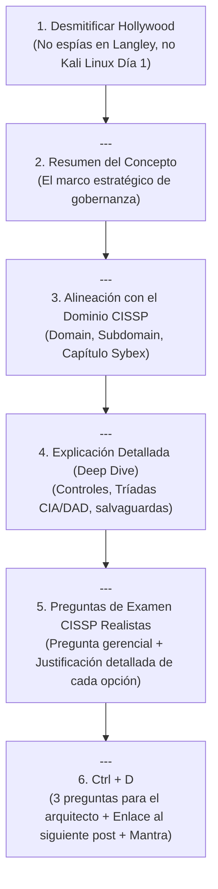

# Serie: Guía de Estudio CISSP 2024

Esta serie prepara al lector para el examen CISSP de (ISC)² basado en la guía oficial de Sybex (10th Edition / 2024), cultivando la mentalidad gerencial (*CISO / Risk Advisor Mindset*) y desmitificando el cliché de ciberseguridad.

## 1. Estructura y Fórmula Obligatoria

### 1. Apertura: El Mindset CISO vs Hacker Técnico
* Comienza desarmando los clichés de películas:
  * *"Antes de que te asustes o pienses que me reclutó el gobierno de EE.UU. para una misión en Langley... no, hoy no hay helicópteros negros cayendo del cielo."*
* Plantea la tesis de la certificación: la ciberseguridad en CISSP no empieza con Wireshark ni rompiendo claves; empieza entendiendo riesgos, gobernanza y el impacto en el negocio.

### 2. Estructura Formal de Secciones
Cada post de CISSP contiene estas secciones numeradas:
1. **Resumen del Concepto:** Definición ejecutiva orientada al negocio.
2. **Alineación con el Dominio CISSP:**
   * **Dominio ISC2:** (ej. *Domain 1: Security and Risk Management*)
   * **Subdominio:** (ej. *Subdomain 1.2: Understand and apply security concepts*)
   * **Objetivo de Examen:** Qué evalúa formalmente (ISC)².
3. **Explicación Detallada (Deep Dive):**
   * Controles técnicos, administrativos y físicos.
   * Relación de opuestos (ej. Tríada CIA vs Tríada DAD: *Disclosure, Alteration, Destruction*).
   * Uso de diagramas Mermaid o esquemas claros.
4. **Preguntas tipo Examen (Escenarios Gerenciales):**
   * 1 o 2 preguntas complejas de opción múltiple (A, B, C, D) donde el CISO debe equilibrar negocio y seguridad.
   * **Justificación exhaustiva:**
     * Por qué la opción correcta lo es (con enfoque en *Business Impact Analysis*, Due Diligence, etc.).
     * Por qué cada distractor es incorrecto (ej. *"Refleja un Technical Mindset rígido que paraliza la operación"*).

### 3. Cierre `## Ctrl + D`
* Preguntas de auto-reflexión para el lector al diseñar su arquitectura.
* Enlace a la siguiente entrega de la serie CISSP.
* Cierre con mantra:
  > *Y como siempre... **lo más importante es nunca dejar de preguntar** (y nunca dejar de verificar la Tríada).*
