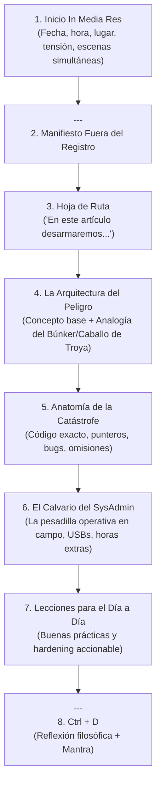

# Serie: Fuera del Registro

Los artículos de esta serie narran grandes desastres tecnológicos, incidentes de seguridad y eventos históricos de infraestructura como si fueran un *thriller* tecnológico cinematográfico.

## 1. Estructura y Fórmula Obligatoria



### 1. Inicio *In Media Res* (Cinematográfico)
* **Regla:** NUNCA empieces diciendo "Hola a todos, hoy hablaremos de...". 
* **Fórmula:** Establece fecha, hora exacta y ubicación física de personas reales enfrentando los primeros segundos del fallo. Usa contraste entre 2 o 3 ubicaciones simultáneas en el mundo (ej. Aeropuerto de Sídney, hospital en Londres, cajeros en Tokio; o un ingeniero en San Francisco a las 11 p.m. mirando 500 ms de latencia).
* **Remate del hook:** Unifica los escenarios con el culpable invisible (*"Todos compartían un hilo invisible..."*).

### 2. Manifiesto de la Serie (Párrafo Canónico)
Inmediatamente después del separador `---`, incluye el manifiesto de Fuera del Registro:
```markdown
---

Te doy la bienvenida a **Fuera del Registro**, el espacio donde nos adentramos en las entrañas de las mayores crisis tecnológicas que han paralizado (o estuvieron a punto de colapsar) al mundo. Aquí no solo revivimos el caos: abrimos la caja negra de la infraestructura moderna para entender cómo un instante de distracción, una grieta humana o una falla de arquitectura puede derrumbarlo todo, y qué lecciones debemos llevarnos para blindar nuestras propias plataformas antes de que la historia se repita.
```

### 3. Hoja de Ruta
Párrafo que anticipa lo que se analizará:
*"En este artículo desarmaremos la anatomía del desastre: [punto técnico 1], [error de arquitectura 2], [calvario operativo 3] y [lecciones de resiliencia 4]."*

### 4. La Explicación Técnica y Analogías
* Explica la teoría con una analogía visual potente (ej. Ring 0 vs Ring 3 como un búnker militar donde el EDR es un contraespía armado dentro del reactor; o las dependencias como la tira de XKCD de la torre sostenida por una pieza de madera en Nebraska).
* Entra al código real: drivers, funciones de C, llamadas al sistema (*syscalls*), banderas de compilación, archivos de configuración.

### 5. El Calvario Operativo del SysAdmin
Describe la pesadilla humana real: las guardias de 40 horas, los administradores corriendo con memorias USB, BitLocker pidiendo 48 dígitos, las llamadas de emergencia de gerencia.

### 6. Lecciones para el Día a Día
Lista de 3 a 4 medidas preventivas concretas (Staged rollouts, canarios, SBOM, builds reproducibles, auditoría fuera de banda).

### 7. Cierre `## Ctrl + D`
* Reflexiona sobre la lección humana o arquitectónica del incidente.
* Cierra integrando el mantra:
  > *Porque cuando [situación de caos técnico], **lo más importante es nunca dejar de preguntar**.*
