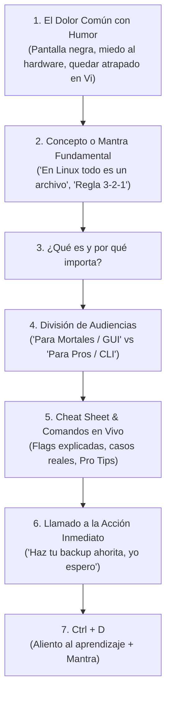

# Serie: Linux & SysAdmin (Esencial, Almacenamiento, Ansible)

Esta serie aborda herramientas, comandos, almacenamiento y automatización en Linux desde una perspectiva pedagógica, directa y llena de anécdotas de administradores de sistemas.

## 1. Estructura y Fórmula Obligatoria



### 1. El Dolor Común con Humor
* Conéctate de inmediato con la frustración del lector:
  * *"Los discos duros huelen el miedo. Siempre fallan el día antes de la entrega..."*
  * *"Empiezas a googlear 'Cómo salir de Vi' y terminas quemando la computadora..."*
  * *"Ese `rm -rf` que ejecutaste por error a las 3 a.m. o el café sobre el teclado..."*

### 2. Concepto Fundamental y Pro Tips
* Introduce el mantra o principio de diseño: *"En Linux, todo es un archivo"*, *"La regla 3-2-1: uno es ninguno"*, *"Automatiza o morirás en el intento"*.
* Inserta al menos 1 o 2 bloques `> **protip >**`:
  ```markdown
  > **protip >** Tratar los archivos de configuración como "datos inofensivos" sin validación es un suicidio operativo.
  ```

### 3. La División de Audiencias
Cuando una herramienta tiene interfaz gráfica y CLI, divide claramente:
* **Para Mortales (Nivel Usuario / GUI):** Herramientas visuales (Déjà Dup, Pika Backup, Time Machine) para usuarios comunes.
* **Para Pros (Nivel SysAdmin / Terminal):** Comandos avanzados (Rsync, LVM, Btrfs, ZFS, Ansible) con scripts y explicaciones de flags.

### 4. Cheat Sheet Práctica
* Listado claro de comandos o atajos de teclado sin rodeos.
* Incluye siempre la sección de emergencia: *"¿Cómo salgo de aquí?"* o *"Cómo revertir esto si rompí todo"*.

### 5. Cierre `## Ctrl + D`
* Recordatorio de que todos los seniors empezaron sin saber nada y que la terminal no muerde.
* Cierre con mantra contextual:
  > *Y recuerda: **lo más importante es nunca dejar de preguntar**... y nunca dejar de respaldar.*
