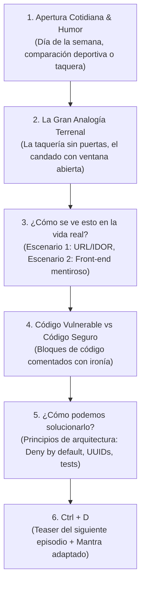

# Serie: OWASP Top 10

Esta serie desmenuza las vulnerabilidades de seguridad en aplicaciones web más críticas del mundo utilizando analogías cotidianas (especialmente comida mexicana / taquerías) y ejemplos de código real.

## 1. Estructura y Fórmula Obligatoria

### 1. Apertura y Conexión Casual
* Saludo según el día de publicación o semana: *"Miércoles. Ya superamos la mitad de la semana y nos toca hablar de la reina de la lista..."*.
* Comparación lúdica: *"Si las vulnerabilidades fueran deportes, esto sería el fútbol: se juega en todo el mundo y casi todos meten un autogol al menos una vez..."*.

### 2. La Gran Analogía Cotidiana (La Taquería)
* Traduce el problema abstracto de software a un absurdo del mundo físico:
  * *"Tengo un problema, siempre todo lo quiero ejemplificar con tacos... pero bueno, hoy toca taquiza."*
  * Caminar al trompo de pastor, servirse tacos, abrir el cajón del dinero, cambiar la receta de la salsa y mirar la cuenta de la mesa de al lado.
  * *"Es como ponerle un candado gigante a la puerta principal pero dejar la ventana abierta sin rejas porque está alta... mínimo unas botellas rotas en la barda, ¿no?"*

### 3. Escenarios del Mundo Real con Código
* **Scenario 1:** El error elemental (ej. cambiar el `id=1024` por `1025` en la URL para ver facturas ajenas).
* **Scenario 2:** La falsa sensación de seguridad (ej. ocultar botones en React con `user.role === 'admin'` pero dejar la API REST abierta y desprotegida).
* Muestra el snippet de código vulnerable en JavaScript/Node/Python y explica por qué falla.

### 4. Buenas Prácticas de Ingeniería
Principios universales:
1. *Deny by Default* (denegar por defecto).
2. Validación en el backend obligatoria (el frontend no es un control de seguridad).
3. Uso de UUIDs para evitar enumeración.
4. Pruebas automatizadas con respuestas `403 Forbidden`.

### 5. Cierre `## Ctrl + D`
* Teaser del siguiente capítulo: *"Nos vemos el viernes para hablar de A02... o cómo dejar el modo debug encendido puede arruinarte el fin de semana"*.
* Cierre con mantra contextualizado:
  > *Mientras tanto, no confíes en el frontend y recuerda que, en el desarrollo y en la vida, **lo más importante es nunca dejar de preguntar** quién está del otro lado de la línea antes de abrir la puerta.*
