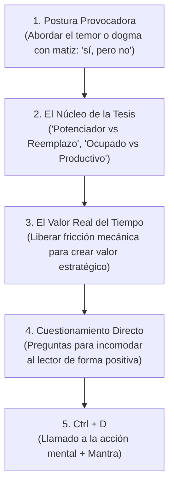

# Serie: Reflexiones & Carrera Tech

Esta serie aborda debates filosóficos de la industria, desarrollo profesional, adopción de IA y equilibrio laboral con honestidad frontal y cuestionamiento de dogmas.

## 1. Estructura y Fórmula Obligatoria

### 1. Postura Provocadora Inicial
* Plantea de inmediato la tensión que la industria suele discutir de forma polarizada:
  * *"Existe el temor de que la IA va a sustituir el trabajo humano. La respuesta corta es: sí, pero no."*
  * *"A menudo usamos las tareas repetitivas como un escudo para decir que estamos trabajando duro, cuando en realidad solo estamos ocupados."*

### 2. Estructura de Párrafos Cortos y Contundentes
* Párrafos de 2 a 3 líneas con alto impacto.
* Uso de antítesis claras: *Ocupado vs Productivo*, *Fricción vs Creatividad*, *Seguridad vs Negocio*.

### 3. Cierre `## Ctrl + D`
* Frase contundente de conclusión (ej. *"los especialistas que usen IA van a reemplazar a los que no la usen"*).
* Cierre reflexivo con el mantra:
  > *La próxima vez que te encuentres haciendo algo por tercera vez consecutiva, detente y pregúntate si no hay una forma más inteligente de hacerlo. Recuerda que **lo más importante es nunca dejar de preguntar**.*
