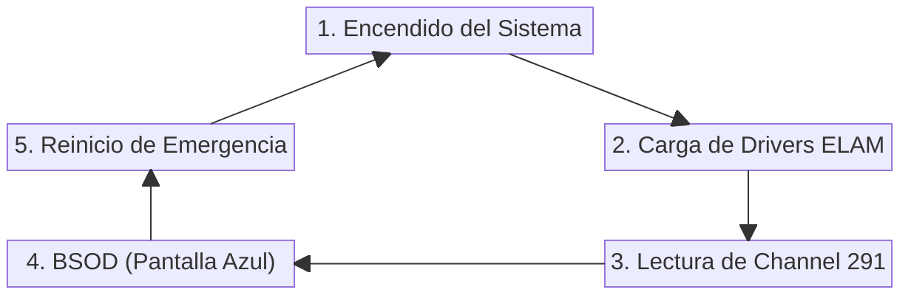

Es el viernes 19 de julio de 2024. Las manecillas del reloj marcan las 4:25 a.m. en la Terminal 1 del Aeropuerto Internacional de Sídney, Australia. Una agente de mostrador intenta escanear el pase de abordar de un pasajero con destino a Los Ángeles. De pronto, la interfaz del sistema de facturación se congela por dos segundos y la pantalla parpadea violentamente, llenándose de un azul cobalto eléctrico. En la parte inferior, sobre una carita triste gigante, un texto en blanco advierte: `PAGE_FAULT_IN_NONPAGED_AREA`. En cuestión de tres segundos, una a una, las más de cincuenta pantallas de registro del vestíbulo imitan el fallo. La cola de miles de viajeros comienza a desbordar las puertas de salida hacia la calle.

A más de 17,000 kilómetros de distancia, son las 5:30 a.m. en las instalaciones de un hospital del Servicio Nacional de Salud (NHS) en el centro de Londres. Un equipo de cirujanos y enfermeras se lava las manos para iniciar una intervención coronaria de emergencia. Al entrar a la sala, la pantalla del sistema de monitoreo cardíaco y el acceso a los expedientes radiológicos se apagan repentinamente, iniciando un bucle infinito de reinicios. Los médicos se miran atónitos: no hay imágenes de tomografía, no hay expedientes, no hay monitores. La cirugía debe cancelarse inmediatamente mientras el personal corre a buscar carpetas de papel archivadas hace años.

Al mismo tiempo, a las 1:30 p.m. en Tokio, decenas de cajeros automáticos en los distritos financieros se congelan mostrando la misma pantalla azul. En Londres, las cámaras de la cadena de noticias *Sky News* se apagan a mitad de una transmisión en vivo porque los servidores de automatización de estudio colapsaron. 

Escenarios completamente distintos, continentes separados por océanos, cero conexión entre sus operaciones diarias. Sin embargo, todos compartían un hilo invisible, una pequeña y silenciosa actualización descargada en segundo plano por el agente de ciberseguridad **CrowdStrike Falcon Sensor**, instalada en la capa más sagrada, privilegiada y peligrosa de un sistema operativo, el **Modo Kernel** o **Ring 0**.

---

Te doy la bienvenida a **Fuera del Registro**, el espacio donde nos adentramos en las entrañas de las mayores crisis tecnológicas que han paralizado al mundo. Aquí no solo revivimos el caos: abrimos la caja negra de la infraestructura moderna para entender cómo un instante de distracción o una falla de arquitectura puede derrumbarlo todo, y qué lecciones debemos llevarnos para blindar nuestras propias plataformas antes de que la historia se repita.

Hoy nos adentramos en el episodio catalogado como el mayor apagón informático de la historia humana: el día en que un archivo de configuración corrupto de apenas unos kilobytes paralizó **8.5 millones de máquinas y servidores Windows** en todo el planeta, dejando pérdidas astronómicas de más de 5,400 millones de dólares.

En este artículo desarmaremos la anatomía del desastre: la diferencia crítica entre ejecutar software en modo usuario y en modo kernel, el error de puntero de memoria exacto dentro del driver `CSagent.sys`, el pecado capital de desplegar cambios globales sin fases de prueba (*Canary Releases*), la pesadilla logística de resolver un bucle de reinicios encriptado con BitLocker y las lecciones indispensables de gobernanza y resiliencia que todos debemos implementar en nuestra infraestructura.

## La arquitectura del peligro: Ring 0 (Kernel) vs. Ring 3 (User Space)

Para entender cómo una simple actualización de reglas pudo apagar aeropuertos, bancos y hospitales al mismo tiempo, debemos retroceder un paso y examinar la arquitectura interna de cómo los procesadores modernos (x86-64) y los sistemas operativos protegen la memoria.

Un sistema operativo como Windows o Linux divide la ejecución del código en capas de privilegio concéntricas llamadas **Anillos de Protección** (*Protection Rings*):

1. **Ring 3 (Modo Usuario / User Space)**: Es el entorno donde viven tus aplicaciones cotidianas: el navegador, Spotify, Slack, tu editor de código o un reproductor de video. Las aplicaciones que corren en Ring 3 tienen privilegios restringidos. Si una aplicación comete un error grave, como intentar acceder a una dirección de memoria que no le pertenece o dividir entre cero, el sistema operativo interviene de inmediato, mata el proceso (arrojando un mensaje de *"La aplicación se ha cerrado inesperadamente"*) y el resto del equipo sigue funcionando sin inmutarse.
2. **Ring 0 (Modo Kernel / Kernel Space)**: Es el núcleo absoluto del sistema operativo. Aquí residen el kernel de Windows (`ntoskrnl.exe`), los controladores de hardware (*drivers*) de la tarjeta de video, disco duro, tarjeta de red... y los agentes de ciberseguridad avanzados. 

En Ring 0 no hay barreras de seguridad, no hay sandbox y no hay supervisores. El código que se ejecuta en el kernel tiene control total y absoluto sobre la memoria RAM física, los registros de la CPU y el hardware de la máquina.

> **protip >** La regla de oro del desarrollo de software en Ring 0 es despiadada: **En el Kernel no existe el concepto de "crash de aplicación"**. Si un proceso en Ring 0 comete un fallo de memoria no manejado, la CPU no puede aislar el problema. Para evitar que la corrupción de datos se extienda al disco duro o dañe el hardware, la CPU fuerza una parada de emergencia instantánea del sistema (*Kernel Panic* en Linux o la infame *Blue Screen of Death* / BSOD en Windows).

### ¿Por qué los agentes de seguridad viven en Ring 0?

Te preguntarás, si Ring 0 es un terreno minado tan peligroso, ¿por qué firmas como CrowdStrike, SentinelOne o Microsoft insisten en colocar sus soluciones EDR (*Endpoint Detection and Response*) justamente ahí?

Imagina tu sistema operativo como un búnker militar de máxima seguridad. **Ring 3** es el vestíbulo público y los pasillos de oficinas: ahí trabajan los civiles (ya las mencionamos: tu navegador, Spotify, tu editor de código) bajo constante supervisión. Si una aplicación causa un escándalo o rompe una regla en Ring 3, la seguridad del búnker simplemente la reduce y la escolta fuera del edificio (un *crash* estándar de aplicación).

El problema es que los verdaderos "superespías" del cibercrimen (los *rootkits*, *bootkits* y exploits de día cero) no entran por la puerta principal pidiendo un gafete de visitante. Ellos se infiltran en las instalaciones durante la madrugada, **antes de que el propio búnker abra sus puertas**. Se camuflan entre los cimientos, falsifican pases de alta prioridad y se esconden en las sombras del kernel.

Si dejas a tus guardias de seguridad parados afuera en Ring 3 con un simple sujetapapeles, son completamente ciegos ante el infiltrado que ya camina por los ductos de ventilación de la bóveda principal. Para cazar a un agente doble que opera con identidades falsas en las sombras, necesitas enviar a tu propio agente de contraespionaje a vivir **dentro del cuarto de control central: Ring 0**.

Ahí adentro, tu agente EDR escucha cada susurro de comunicación en el búnker (*syscalls*), inspecciona los maletines que cruzan las fronteras de red y audita la identidad de cada proceso antes de que la CPU le permita dar un solo paso. 

Sin embargo, como analizamos en [Claude Mythos y la explotación en kernel](/blog/fuera-del-registro-01-claude-mythos-ciberseguridad), esta estrategia de supervivencia tiene un costo mortal: le has dado a tu agente de contraespionaje acreditación total para portar armas dentro del cuarto del reactor. Si el espía que pusiste a cuidar la bóveda comete un solo tropiezo o confunde una orden, puede activar por accidente el protocolo de autodestrucción e incinerar el búnker entero en un segundo.

## Anatomía de la Catástrofe: Channel File 291 y el puntero fantasma

A las **04:09 UTC** del viernes 19 de julio de 2024, los servidores de CrowdStrike distribuyeron de forma automática una actualización para sus clientes a nivel global.

Es importante aclarar un mito técnico muy extendido durante las primeras horas del incidente: **CrowdStrike no desplegó un driver ejecutable nuevo ni una nueva versión binaria de su software**. Lo que enviaron fue un archivo de contenido (*Rapid Response Content*), diseñado para actualizar los patrones de detección de nuevas técnicas de ataque en tiempo real.

Específicamente, el archivo defectuoso se llamaba `C-00000291-00000000-00000032.sys` (conocido internamente como el **Channel File 291**), destinado a ser guardado en el directorio:

```text
C:\Windows\System32\drivers\CrowdStrike\
```

### ¿Qué salió mal dentro del código?

El sensor de CrowdStrike Falcon que corría en las máquinas Windows utilizaba un controlador en Ring 0 llamado `CSagent.sys`. Este controlador estaba programado para leer e interpretar los archivos de contenido de la carpeta de drivers y evaluar la actividad del sistema contra las nuevas reglas de seguridad.

El *Channel File 291* enviado esa madrugada contenía un error de formato severo. El parser de `CSagent.sys` esperaba recibir una estructura de datos válida compuesta por 21 campos de entrada. Sin embargo, debido a un fallo en las herramientas de compilación e integración de contenido de CrowdStrike, la entrada número 21 del archivo entregó un puntero de memoria no inicializado o nulo (`0x9c` / invalid memory address).

Cuando el controlador `CSagent.sys` en Ring 0 intentó leer la dirección de memoria apuntada por el campo 21 para evaluar la regla de seguridad, intentó acceder a una dirección de memoria no mapeada en el espacio del kernel. 

El microprocesador detectó la violación de acceso a nivel de hardware y arrojó la excepción fatal:

```text
PAGE_FAULT_IN_NONPAGED_AREA (CSagent.sys)
```

Al estar ejecutándose en Ring 0, Windows no pudo matar simplemente el servicio de CrowdStrike. El kernel colapsó al instante, pintando la pantalla de azul y reiniciando el equipo de inmediato. La catástrofe iniciaba.

## El Pecado Capital: Despliegue Global Instantáneo sin Canary Releases

Si un programador escribe un bug, es una tragedia individual. Pero si ese bug llega simultáneamente a 8.5 millones de máquinas en todo el planeta en menos de diez minutos, no estamos ante un error de código: **estamos ante un colapso catastrófico de arquitectura y procesos**.

En las prácticas modernas de DevOps y SRE (*Site Reliability Engineering*), existe un principio sagrado: la gestión del radio de impacto (*Blast Radius Management*). Nunca, bajo ninguna circunstancia, se despliega un cambio en producción al 100% de la infraestructura global de manera simultánea.

Para evitar desastres, la industria utiliza **Estrategias de Despliegue Progresivo** (*Staged Rollouts* o *Canary Releases*):


1. **Ring 0 (Canario Interno)**: El cambio se instala primero en los propios servidores y equipos de la empresa desarrolladora durante varias horas o días.
2. **Ring 1 (Canario Externo)**: Se despliega en un 1% de clientes voluntarios o máquinas no críticas.
3. **Ring 2 (Despliegue Escalonado)**: Se amplia al 10%-25% de la infraestructura global. Si las métricas de telemetría y salud se mantienen en verde durante 24 horas, se procede al siguiente anillo.
4. **Ring 3 (Despliegue General)**: Liberación masiva.

¿Qué hizo CrowdStrike? La empresa consideraba que los archivos de contenido (*Channel Files*) eran simples "datos de configuración" y no "código ejecutable". Debido a esta peligrosa distinción conceptual, el sistema de distribución automática omitió el pipeline de despliegue por fases y **empujó el Channel File 291 a todos los endpoints de Windows conectados a internet en el planeta al mismo tiempo**.

El archivo llegó a aerolíneas, bancos, hospitales, cadenas de supermercados y sistemas gubernamentales en cuestión de segundos. Y como el archivo causaba una BSOD inmediata al ser procesado, las máquinas comenzaron a caer en domino como fichas de ajedrez.

> **protip >** Tratar los archivos de configuración o reglas de políticas como "datos inofensivos" sin pasar por pipelines de validación estricta es uno de los fallos más comunes catalogados en el riesgo de la cadena de suministro de software. Un fallo de configuración en un componente crítico con altos privilegios es idéntico a un fallo de código ejecutable. Para profundizar en este riesgo, revisa nuestro análisis sobre [Software Supply Chain Failures (A03)](/blog/owasp-top-10-05-a03-software-supply-chain-failures).

## El Calvario Técnico: BootLoops, BitLocker y el Ejército de USBs

Cuando los equipos de TI y Ciberseguridad alrededor del mundo se despertaron con las alarmas sonando en la madrugada del 19 de julio, la primera reacción intuitiva fue abrir sus consolas de administración en la nube para revertir la actualización o enviar un parche remoto.

Fue entonces cuando descubrieron la verdadera pesadilla técnica del incidente: **las máquinas no se podían reparar remotamente**.

### ¿Por qué falló la gestión remota?

La pantalla azul provocada por `CSagent.sys` ocurría durante la fase temprana de arranque del sistema operativo (*Early Launch Anti-Malware / ELAM*). En este punto del proceso de boot, Windows **todavía no ha cargado los controladores de red** ni los servicios de gestión remota (como Microsoft Intune, Active Directory o SSH).

La máquina entraba en un ciclo infinito de reinicios (*BootLoop*):



Como los equipos se reiniciaban antes de conectarse a internet, era imposible enviar una instrucción remota para borrar el archivo defectuoso.

### La solución: El trabajo manual con memoria USB

La única forma de recuperar una computadora afectada exigía que un técnico se sentara físicamente frente a la máquina para realizar los siguientes pasos manuales:

1. Encender el equipo e interrumpir el arranque tres veces consecutivas para forzar el ingreso a la consola de recuperación de Windows (**WinRE**) o iniciar en **Modo Seguro** (*Safe Mode*).
2. Abrir la terminal de comandos (`cmd.exe`).
3. Navegar hasta la ruta del controlador: `cd C:\Windows\System32\drivers\CrowdStrike`.
4. Buscar y eliminar manualmente el archivo corrupto: `del C-00000291*.sys`.
5. Reiniciar el sistema normalmente.

Una y otra vez escribiamos:
```bash
cd C:\Windows\System32\drivers\CrowdStrike
del C-00000291*.sys
```

### La Pesadilla de BitLocker

El procedimiento manual suena sencillo si tienes que aplicarlo a cinco computadoras en una pequeña oficina. Pero imagínalo en un entorno corporativo con 20,000 laptops repartidas entre empleados haciendo trabajo remoto en diez países distintos.

Y para empeorar dramáticamente la situación, la inmensa mayoría de las empresas tienen sus discos duros cifrados con **Microsoft BitLocker**. 

Al detectar que la secuencia de arranque habitual se había roto y que el equipo intentaba iniciar en Modo Seguro o consola WinRE, la protección de BitLocker se activaba automáticamente, bloqueando el acceso al disco duro y solicitando la **clave de recuperación de BitLocker de 48 dígitos**.

Si la empresa no contaba con una base de datos centralizada, organizada y accesible de claves de recuperación fuera de banda (*out-of-band*), los administradores de TI simplemente no podían desbloquear el disco para borrar el archivo de CrowdStrike. El resultado fue legiones de ingenieros de soporte trabajando turnos de 40 horas seguidas, corriendo con memorias USB por los pasillos de aeropuertos, hospitales y oficinas para tipear manualmente claves de 48 dígitos en miles de laptops, una por una.

## El Ángulo de Ciberseguridad: La "A" Olvidada y la Gobernanza de Terceros

Cuando evaluamos la seguridad de nuestras plataformas, tendemos a centrar el 90% de nuestra atención y presupuesto en la **Confidencialidad** (evitar que roben nuestros datos) y la **Integridad** (evitar que alteren nuestra información).

Sin embargo, como establecemos en [La Tríada CIA en Ciberseguridad](/blog/cissp-2024-02-triada-cia-ciberseguridad), el tercer pilar es la **Disponibilidad** (*Availability*). De nada sirve tener un endpoint blindado contra el malware más avanzado del planeta si la propia herramienta de defensa destruye la disponibilidad operativa de tu empresa durante tres días consecutivos.

Este colapso puso de manifiesto dos fallos conceptuales graves en la gestión de infraestructura moderna:

### 1. La ilusión de la resiliencia en la Nube
Muchas organizaciones creían estar protegidas porque tenían sus aplicaciones respaldadas en AWS o Azure. Sin embargo, si todas las máquinas virtuales dentro de esa nube ejecutan el mismo agente de seguridad con permisos de Ring 0 que se actualiza automáticamente desde un servidor centralizado del proveedor, tu infraestructura no es redundante: **tienes un Punto Único de Falla (*Single Point of Failure / SPOF*) masivo escondido en tu capa de endpoint**.

Es la misma lección sobre radio de impacto que aprendimos en [La caída de Amazon S3 en 2017](/blog/fuera-del-registro-03-caida-amazon-s3-2017): cuando dependes ciegamente de un solo proveedor o proceso global sin aislamiento, un fallo de configuración local puede tumbar el castillo completo.

### 2. Gobernanza de Proveedores de Terceros
Confiar ciegamente en que las actualizaciones automáticas de un proveedor externo nunca fallarán viola los principios fundamentales de Due Care y Due Diligence. Como analizamos en [Marcos de control y gobernanza de terceros](/blog/cissp-2024-05-marcos-control-gobernanza-terceros), las organizaciones deben exigir acuerdos de nivel de servicio (*SLAs*), visibilidad sobre los controles de calidad de sus proveedores y la capacidad técnica de controlar el ritmo de despliegue de cualquier software que posea privilegios administrativos en sus activos críticos.

## ¿Qué cambió tras el desastre y cómo prepararte en tu organización?

El colapso de CrowdStrike obligó a la industria del software a reevaluar los cimientos de la seguridad en sistemas operativos:

1. **Revisión de privilegios en el Kernel (El fin de Ring 0 para EDRs)**: Microsoft convocó a las principales firmas de seguridad (CrowdStrike, Trellix, Sophos, Broadcom) a una cumbre histórica en Redmond para diseñar una nueva arquitectura en Windows. El objetivo a mediano plazo es mover la inspección de seguridad fuera de Ring 0 y llevarla a **Ring 3 (User Mode)** utilizando APIs seguras con aislamiento de memoria (un enfoque similar al modelo eBPF utilizado en el kernel de Linux).
2. **Despliegues por Anillos Configurables en EDRs**: CrowdStrike y sus competidores actualizaron sus plataformas para permitir que los clientes seleccionen la velocidad de recepción de contenido (*Rapid*, *N-1*, *N-2*), permitiendo a los equipos de TI probar las reglas de detección en un grupo reducido de servidores antes de autorizar su distribución masiva.
3. **Validación Estricta de Contenido en Pipelines**: Implementación de verificadores de sintaxis (*fuzzers* y *content validators*) infranqueables en los pipelines de CI/CD para garantizar que un archivo de configuración mal formado sea rechazado antes de salir de la fábrica de software.

### Lecciones clave para el día a día

Si administras servidores, infraestructura cloud o equipos de trabajo, estas son las acciones concretas que debes implementar hoy mismo:

- **Configura Anillos de Despliegue en tus Agentes de Seguridad**: Revisa la consola de tu proveedor EDR/Antivirus y desactiva las actualizaciones globales inmediatas en producción. Establece un grupo canario (equipos de desarrollo o pruebas) que reciba los parches primero.
- **Audita y Desacopla tus Claves de BitLocker**: Garantiza que el 100% de las llaves de recuperación de BitLocker o FileVault estén respaldadas automáticamente en Active Directory / Entra ID y que existan copias de respaldo exportadas en almacenamiento seguro fuera de banda (*out-of-band*).
- **Documenta Procedimientos de Recuperación Offline**: No asumas que tus herramientas de gestión remota (SSH, Ansible, Intune, MDM) estarán disponibles durante una crisis. Mantén guías en papel y unidades USB preparadas con entornos de recuperación para restaurar equipos sin conexión a red.
- **Aplica el Principio de Menor Privilegio a Aplicaciones de Terceros**: Evalúa continuamente si los servicios que ejecutas en tu infraestructura realmente necesitan privilegios de *root* o *Kernel*. Si un servicio puede funcionar en espacio de usuario, aísla su ejecución.

---

## Ctrl + D

El colapso de CrowdStrike en 2024 no fue una historia de ciberataques, hackers respaldados por estados ni zero-days sofisticados. Fue un recordatorio brutal y fascinante de la extrema fragilidad de nuestro mundo hiperconectado, donde la diferencia entre el funcionamiento normal del comercio global y la parálisis absoluta reside en un simple archivo corrupto de pocos kilobytes cargado en la memoria de la CPU.

Nos enseñó que en la ciberseguridad moderna, la resiliencia no consiste en asumir que nuestros proveedores son infalibles o que nuestras defensas nunca fallarán, sino en diseñar arquitecturas capaces de resistir el fallo de sus propios guardianes.

Porque cuando las pantallas se tiñen de azul, los sistemas se congelan y el mundo digital se queda a oscuras, **lo más importante es nunca dejar de preguntar**.
