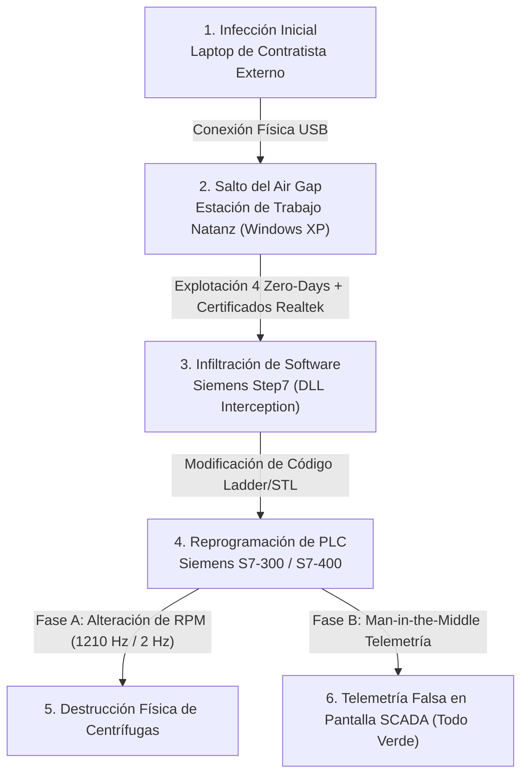
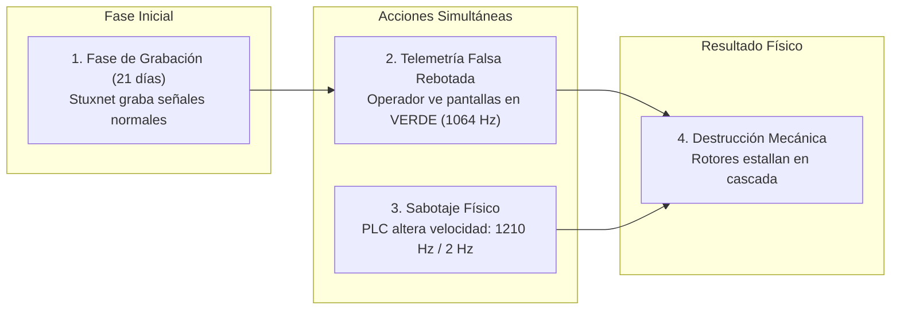

Es una calurosa tarde de junio de 2009 en la planta de enriquecimiento de uranio de Natanz, sepultada a más de ocho metros bajo el desierto de Irán. En la sala de control principal, dos operadores vestidos con batas blancas conversan tranquilamente mientras beben té negro. Sobre sus escritorios, los monitores del sistema SCADA despliegan pantallas coloridas de Siemens WinCC. Las gráficas de presión son líneas rectas perfectas, los indicadores de flujo permanecen estables y el contador digital marca una frecuencia constante de centrifugado de 1,064 Hz (unas 63,840 revoluciones por minuto). En el software de supervisión, todo brilla en un pacífico y consolador verde esperanza.

Sin embargo, varios metros por debajo de sus pies, en las galerías subterráneas de cascadas de centrifugado IR-1, se desarrolla un infierno metálico silencioso. 

Cien tubos de aluminio aeroespacial que giran casi a la velocidad del sonido comienzan repentinamente a acelerar fuera de control. Alcanzan los 1,210 Hz, una velocidad para la que jamás fueron diseñados. Las diminutas estructuras de aleación se deforman por la fuerza centrífuga insostenible; los rotores chocan violentamente contra sus propias carcasas de acero al vacío y, en una fracción de segundo, la maquinaria pesada de millones de dólares se desintegra por completo, transformándose en metralla retorcida dentro de los tubos sellados. 

Minutos después, el ataque hace una pausa y obliga a las centrifugadoras sobrevivientes a frenar en seco hasta caer a 2 Hz, haciendo que crucen su frecuencia de resonancia natural y destruyendo los rodamientos de zafiro que las sostienen.

¿Lo verdaderamente siniestro? Durante cada segundo que duró la masacre mecánica, las pantallas en la sala de control superior jamás parpadearon. Siguieron reportando con absoluta compostura: `ESTADO: OPERACIONAL - 1,064 Hz`.

Durante meses, los ingenieros y científicos iraníes vivieron sumergidos en una pesadilla paranoica. Culparon a remesas de acero defectuoso importadas de Europa, acusaron a los técnicos locales de incompetencia y reemplazaron cientos de centrifugadoras destruidas solo para verlas estallar nuevamente semanas más tarde. Lo que ignoraban era que no se enfrentaban a una falla de manufactura ni a un sabotaje de tuberías: estaban siendo víctimas del primer ciberataque de la historia capaz de cruzar la frontera del mundo digital para destruir infraestructura física en el mundo real. Su nombre en código: **Stuxnet**.

---

Esto es **Fuera del Registro**, el espacio donde nos adentramos en las entrañas de las mayores crisis tecnológicas que han paralizado al mundo. Aquí no solo revivimos el caos: abrimos la caja negra de la infraestructura moderna para entender cómo un instante de distracción o una falla de arquitectura puede derrumbarlo todo, y qué lecciones debemos llevarnos para blindar nuestras propias plataformas antes de que la historia se repita.

Hoy nos adentramos en el origen de la guerra informática moderna: el día en que un gusano informático de apenas un par de megabytes se infiltró en una instalación nuclear militar sin tocar internet, encadenó cuatro vulnerabilidades de día cero jamás vistas, falsificó firmas digitales gubernamentales, reescribió las entrañas de controladores industriales y demostró que una línea de código puede ser tan destructiva como un misil de crucero.

En este artículo desarmaremos la anatomía del ataque: la convergencia crítica entre **IT** (Tecnologías de la Información) y **OT** (Tecnología Operativa), la falsa ilusión de seguridad del *Air Gap*, el hackeo quirúrgico a los controladores PLC de Siemens, la obra maestra del ataque *Man-in-the-Middle* con reproducción de telemetría y las lecciones indispensables de ciberseguridad industrial y control de medios extraíbles que toda organización debe aplicar hoy en día.

## La Convergencia Letal: Cuando el código informático (IT) toca el hierro físico (OT)

Para dimensionar el abismo que abrió Stuxnet en 2010, debemos entender la histórica división entre dos mundos que durante décadas existieron en planos completamente separados: las Tecnologías de la Información (**IT**) y la Tecnología Operativa (**OT**).

Por un lado, el **Mundo IT** representa el entorno digital con el que convivimos todos los días: servidores web, bases de datos SQL, correo electrónico, laptops corporativas y aplicaciones en la nube. En este terreno, los datos son volátiles, los sistemas se reinician con frecuencia, los parches se aplican los fines de semana y el objetivo primordial es proteger la **Confidencialidad**, y la **Integridad** de la información.

Por el otro lado, en las sombras de la infraestructura crítica, se encuentra el **Mundo OT**. Este es el reino del hierro, el acero y la física aplicada. Hablamos de las válvulas de presión en refinerías de petróleo, las turbinas en represas hidroeléctricas, los brazos robóticos en ensambladoras de autos y las centrifugadoras en plantas nucleares. En OT no existen los navegadores web ni las bases de datos Postgres; en su lugar, todo el ecosistema es orquestado por controladores lógicos programables (**PLCs**), sensores analógicos de temperatura, actuadores hidráulicos y buses de campo industriales como Profibus o Modbus.

En este universo industrial, la regla suprema e inquebrantable no es ocultar datos, sino garantizar la **Disponibilidad física continua**. Un controlador industrial que regula la mezcla de químicos o el flujo de gas en una planta no puede darse el lujo de reiniciar a las 3:00 a.m. para instalar una actualización de seguridad de Windows. Como consecuencia directa, los entornos industriales solían operar sobre sistemas operativos antiguos (como Windows XP o Windows 2000), sin antivirus y sin parches de seguridad durante años... bajo la premisa de que "si no está roto y no toca internet, no hay peligro".

> **protip >** En ciberseguridad industrial, la confusión entre IT y OT suele ser trágica. Mientras que en IT un fallo de sistema resulta en un error 500 o una llamada perdida en Slack, en OT un fallo de control puede significar una fuga tóxica, una explosión de calderas o la destrucción física de una planta completa. Para profundizar en la gestión de disponibilidad y riesgos, revisa nuestro análisis sobre [La Tríada CIA en Ciberseguridad](/blog/cissp-2024-02-triada-cia-ciberseguridad).

Stuxnet fue la primera prueba aterradora de lo que ocurre cuando un atacante utiliza el mundo IT únicamente como un puente de transporte para clavar una estaca en el corazón del mundo OT.

## El Mito del Air Gap y el caballo de Troya de 2 dólares

Las instalaciones nucleares de Natanz fueron diseñadas bajo la premisa de la máxima paranoia militar. La red industrial que controlaba las centrifugadoras estaba aislada por un **Air Gap** (un abismo de aire): una separación física absoluta. No había cables de red hacia el exterior, no había redes Wi-Fi, no había conexiones de fibra óptica ni enlaces a internet de ningún tipo. La planta estaba blindada digitalmente. O eso creían.

¿Cómo logra un software malicioso infectar una instalación subterránea desconectada del planeta entero?

La respuesta no requirió satélites militares ni comunicaciones cuánticas: bastó un simple dispositivo de plástico de 2 dólares introducido en el bolsillo de un contratista o ingeniero confiado: **una memoria USB**.

En algún momento entre 2007 y 2009, la memoria USB infectada fue conectada a una computadora de ingeniería de la planta. Stuxnet no esperó a que el usuario ejecutara un archivo `.exe` ni que abriera un documento de texto. El gusano llevaba en su interior un arsenal bélico digital que la ciberseguridad jamás había presenciado reunido en una sola pieza de software: **cuatro vulnerabilidades de día cero (*Zero-Days*) no descubiertas en Windows**.

### El Arsenal Digital de Stuxnet:

1. **Vulnerabilidad LNK en Windows Explorer (`MS10-046`)**: Esta fue la joya de la corona del vector de entrada. Permitía que el código malicioso se ejecutara automáticamente en el sistema operativo con solo mostrar el icono de un archivo dentro de la memoria USB en el Explorador de Windows. El usuario no tenía que hacer doble clic en nada; el simple hecho de insertar el pendrive y abrir la carpeta desencadenaba la infección.
2. **Vulnerabilidad de Print Spooler (`MS10-061`)**: Utilizada para propagarse a través de la red local compartida de impresoras entre computadoras de la planta.
3. **Dos Vulnerabilidades de Escalación de Privilegios en el Kernel (`MS10-073`)**: Una vez dentro de una máquina, Stuxnet utilizaba estos fallos para ganar privilegios totales de administrador (`SYSTEM`) en el sistema operativo.
4. **Firmas Digitales Robadas**: Para pasar completamente desapercibido ante los pocos controles de seguridad existentes en Windows, los componentes del driver de Stuxnet estaban firmados digitalmente con certificados auténticos y legítimos robados a dos gigantes globales de fabricación de microchips en Taiwán: **Realtek** y **JMicron**. Para el sistema operativo, Stuxnet no era un malware: era un controlador de hardware verificado y confiable.

## El Cerebro del Ataque: Secuestrando los Controladores PLC de Siemens

Una vez que Stuxnet logró infectar las estaciones de trabajo con Windows en Natanz, el malware demostró una paciencia y una discriminación escalofriantes. No borró archivos, no robó contraseñas, no instaló ransomware ni emitió alertas de red. Si la computadora infectada no tenía instalado el software industrial específico de Siemens, Stuxnet simplemente se quedaba dormido o intentaba saltar a otro pendrive USB.

Stuxnet estaba buscando una aguja muy específica en un pajar global: la presencia del software de ingeniería **Siemens SIMATIC Step7** y las estaciones de supervisión **Siemens WinCC**.

### ¿Qué es un PLC y por qué fue el objetivo final?

Un **PLC** (*Programmable Logic Controller*) es la computadora industrial que gobierna el mundo físico. Es una pequeña caja montada en un riel metálico dentro de un gabinete eléctrico. No tiene pantalla ni teclado. Se le programa desde una laptop (usando software como Siemens Step7) escribiendo lógica de control (lenguaje Ladder o STL) y luego se le desconecta. El PLC ejecuta ese programa en un bucle infinito millones de veces por segundo: lee sensores de voltaje, verifica la velocidad de los motores y activa válvulas electromecánicas.

Stuxnet realizó un ataque de interceptación de archivos biblioteca (`DLL Hijacking`). Sustituyó la librería legítima `s7otbxdx.dll` del software Siemens Step7 por una versión modificada del propio malware. A partir de ese momento, cada vez que un ingeniero de Natanz abría su software de Siemens para revisar los programas de los PLCs, el software pirateado por Stuxnet le mentía al ingeniero, ocultando la presencia del malware mientras inyectaba código malicioso directamente en la memoria EEPROM de los controladores **Siemens S7-300 y S7-400**.

Y no atacó a cualquier PLC: Stuxnet auditó minuciosamente la arquitectura de hardware del controlador. Verificó que el PLC estuviera conectado a variadores de frecuencia específicos fabricados por dos proveedores muy concretos (Vacon en Finlandia y Fararo Paya en Irán) encargados de regular motores de ultra-alta velocidad (usados exclusivamente en el enriquecimiento de uranio). Si la máquina controlaba un ascensor, una bomba de agua o un brazo robótico común, Stuxnet no hacía absolutamente nada. Pero si detectaba la firma exacta de las cascadas de centrifugado de Natanz, activaba su *payload* de autodestrucción.

## La Obra Maestra del Sabotaje: Man-in-the-Middle y Telemetría Falsa

El golpe de gracia de Stuxnet no fue simplemente alterar la velocidad de los motores; fue la maquiavélica estrategia de ilusión digital con la que encubrió el sabotaje.

Cualquier ataque torpe que acelere un motor industrial activará de inmediato las alarmas de presión y temperatura en las consolas de supervisión, permitiendo a los operadores presionar el botón de paro de emergencia antes de sufrir daños irreparables. Los creadores de Stuxnet sabían esto perfectamente.

Por ello, el malware ejecutó una operación en dos etapas perfectamente orquestadas:

1. **La Fase de Escucha y Grabación (21 días)**: Durante tres semanas completas antes de iniciar el sabotaje, Stuxnet se limitó a escuchar pasivamente el bus de datos industrial (Profibus). Grabó y almacenó en la memoria del PLC la secuencia exacta de lecturas normales transmitidas por los sensores de presión, flujo y frecuencia de las centrifugadoras en funcionamiento óptimo.
2. **El Sabotaje Físico**: Transcurridas las tres semanas, Stuxnet tomó el control de las salidas analógicas del PLC. Forzó a las centrifugadoras a subir violentamente a 1,210 Hz durante 15 minutos, estresando el aluminio al límite de su resistencia física. Días después, ordenó una desaceleración drástica hasta los 2 Hz, forzando al metal a pasar por la frecuencia de resonancia crítica donde la vibración desgarra los soportes mecánicos.
3. **El Replay de Telemetría Falsa (*Man-in-the-Middle*)**: Mientras las centrifugadoras se despedazaban físicamente en el nivel subterráneo, Stuxnet interceptaba las lecturas reales de los sensores del PLC y enviaba hacia la sala de control de los ingenieros **la grabación reproducida en bucle de los 21 días de operación normal**.

Los operadores miraban sus pantallas y veían gráficas perfectas, presiones normales y una frecuencia inmutable de 1,064 Hz. El software les decía que todo estaba en orden, mientras a pocos metros de distancia, el uranio enriquecido se derramaba y millones de dólares en infraestructura nuclear se convertían en chatarra inservible.

## El Antes y Después: La Ciberguerra Cruzó el Rubicón

El descubrimiento de Stuxnet en 2010 por la empresa de seguridad VirusBlokAda (y su posterior análisis por laboratorios como Symantec y Kaspersky) cambió para siempre la historia de la tecnología y la geopolítica global.

Stuxnet demostró que el software ya no era solo una herramienta para procesar información, enviar correos o robar números de tarjetas de crédito. Había nacido la era de las **Armas Cibernéticas Físicas**: código capaz de alterar procesos físicos en el mundo real con la misma eficacia y precisión destructiva que un bombardeo militar, pero con la ventaja estratégica del anonimato y la denegación plausible.

El impacto conceptual de este ataque fue brutal y redefinió las reglas del juego en dos frentes críticos. 

Primero, decretó la **muerte definitiva del Air Gap como garantía absoluta de seguridad**. La ingenua creencia de que una red industrial o un sistema crítico está 100% a salvo simplemente por no tener un cable Ethernet conectado a internet quedó completamente pulverizada. El factor humano, las cadenas de suministro de hardware y los medios extraíbles (USBs, laptops de mantenimiento) demostraron ser puentes invisibles que ningún abismo de aire puede bloquear por sí solo.

Segundo, dejó al descubierto la extrema **fragilidad de la cadena de suministro industrial**. El ataque no necesitó vulnerar los sistemas de la planta nuclear directamente; le bastó con contaminar silenciosamente a los contratistas y proveedores externos que ingresaban a las instalaciones con sus propias laptops de servicio. Una lección de riesgo de terceros idéntica a la que analizamos en [Software Supply Chain Failures (A03)](/blog/owasp-top-10-05-a03-software-supply-chain-failures).

## Lecciones para el día a día: Cómo proteger la infraestructura moderna

Aunque Stuxnet fue un arma cibernética de nivel estatal diseñada para un objetivo militar específico, los vectores de ataque y las fallas de arquitectura que explotó están presentes hoy en día en miles de empresas, centros de datos y plantas industriales de todo el mundo.

Estas son las lecciones y controles indispensables que todo equipo de ingeniería y ciberseguridad debe implementar:

### 1. Control y Sanitización Estricta de Medios Extraíbles (USBs)
El uso descontrolado de memorias USB en entornos servidores o industriales es una invitación al desastre.
- **Bloqueo de Puertos por Política**: Desactiva lógicamente el montaje de dispositivos de almacenamiento masivo USB en servidores y estaciones de trabajo críticas mediante directivas de grupo (GPO) o agentes de gestión de endpoints.
- **Estaciones de Sanitización (USB Kiosks)**: Si el uso de medios extraíbles es imprescindible para transferir archivos a redes aisladas, implementa quioscos dedicados de limpieza fuera de la red que escaneen los archivos con múltiples motores antivirus antes de autorizar su copia.

### 2. Principio de Mínimo Privilegio e Integridad en PLCs y Dispositivos IoT/OT
- **Verificación de Firmas y Hashing en Controladores**: Exige que los firmware de controladores industriales y dispositivos embebidos verifiquen matemáticamente la firma criptográfica del fabricante antes de autorizar cualquier actualización de código o lógica.
- **Monitoreo de Cambios en Lógica de Control**: Implementa herramientas de auditoría en tiempo real que comparen continuamente el hash del programa residente en los PLCs (`OB1`, `OB35`) contra el repositorio central de código para detectar alteraciones no autorizadas al instante.

### 3. Segmentación Estricta y Arquitectura Zero-Trust (Modelo Purdue)
No asumas que tu red interna es segura solo porque hay un *firewall* en el perímetro.
- **Aislamiento Micro-segmentado**: Divide las redes administrativas de la empresa (IT) de las redes de control de infraestructura (OT). Aplica la arquitectura del Modelo Purdue de Control Industrial, utilizando zonas desmilitarizadas industriales (iDMZ) y proxies unidireccionales (*Data Diodes*) para garantizar que el tráfico fluya exclusivamente en una dirección.
- **Cero Comunicación Directa**: Ninguna computadora de la red de oficinas debe tener acceso IP directo a controladores industriales o servidores SCADA sin pasar por jump hosts autenticados con multifactor (MFA).

### 4. Auditoría de Integridad Física y Telemetría Fuera de Banda (*Out-of-Band*)
Stuxnet triunfó porque el sistema SCADA confiaba ciegamente en la telemetría entregada por el propio software infectado.
- **Sensores Analógicos Independientes**: En procesos críticos o de alta peligrosidad, no dependas exclusivamente de las pantallas de software. Mantén instrumentos analógicos físicos y redes de monitoreo fuera de banda (*out-of-band*), desacopladas de la red digital principal, para auditar variables físicas reales (temperatura, vibración, voltaje) de forma independiente.

---

## Ctrl + D

El fantasma de Stuxnet en las centrifugadoras de Natanz no fue solo una hazaña fascinante de la ingeniería de software ni un capítulo aislado de la ciberguerra del siglo XXI. Fue la primera advertencia de un mundo donde la frontera entre el espacio virtual de los bits y el mundo material de los átomos se disolvió para siempre.

En 2010, crear un arma cibernética de esta magnitud requirió años de inteligencia militar, equipos enteros de ingenieros encadenando *zero-days* a mano y presupuestos multimillonarios de estados nación. Sin embargo, en la era actual impulsada por agentes de inteligencia artificial autónomos, como los que analizamos al explorar [Claude Mythos y la explotación en kernel](/blog/fuera-del-registro-01-claude-mythos-ciberseguridad), la barrera de entrada para descubrir vulnerabilidades latentes en firmware industrial, sintetizar *payloads* para controladores PLC y manipular telemetría a la velocidad de la luz se ha reducido de forma sobrecogedora. El verdadero suspenso de los años por venir no es solo que un malware altere en silencio las revoluciones de un motor, sino que una IA autónoma pueda auditar, adaptar y sabotear infraestructura física en tiempo real sin requerir intervención humana.

Stuxnet nos enseñó que en la ciberseguridad industrial la confianza ciega es mortal. La resiliencia no se construye aislando un cable ni asumiendo que las pantallas nos muestran la verdad, sino cuestionando continuamente la integridad de cada sensor, auditando los accesos de nuestros proveedores y verificando que el mundo físico responda a lo que el código realmente está ejecutando.

Porque cuando las máquinas guardan silencio, la telemetría miente y el código amenaza con transformar los bits en metralla, **lo más importante es nunca dejar de preguntar**.
