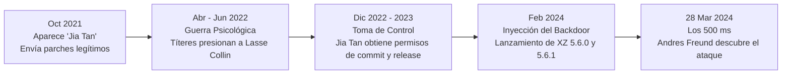
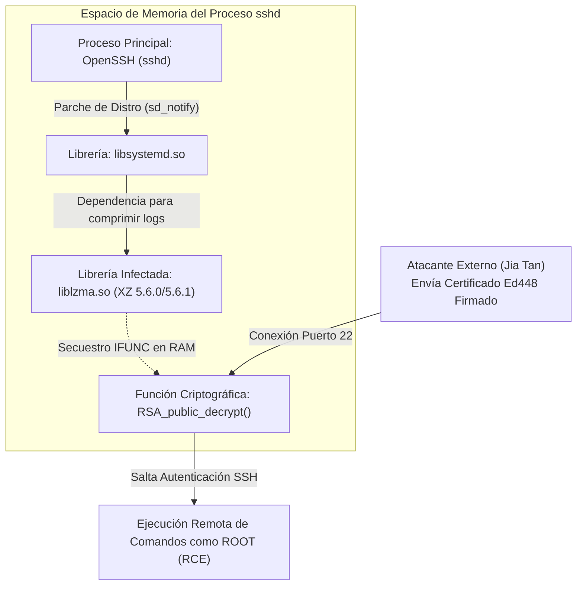

Es la noche del jueves 28 de marzo de 2024 en San Francisco, California. En la tranquilidad de su oficina, **Andres Freund**, un ingeniero de software de 38 años de Microsoft dedicado al desarrollo del motor de bases de datos PostgreSQL, observa con el ceño fruncido la terminal de su computadora con Debian Sid. No está cazando *hackers* rusos, no trabaja en el departamento de inteligencia militar ni está auditando armamento cibernético. Simplemente está haciendo pruebas rutinarias de micro-rendimiento (*micro-benchmarking*).

Sin embargo, algo en su pantalla le resulta profundamente irritante. 

En los registros de su sistema, varios procesos del demonio `sshd` (el servicio que gestiona las conexiones remotas por SSH en prácticamente todos los servidores Linux del planeta) están consumiendo una cantidad inusual de ciclos de CPU. Peor aún: cada vez que un intento de inicio de sesión por SSH falla en su máquina de pruebas, el proceso tarda aproximadamente **500 milisegundos** más de lo normal en responder.

Medio segundo. Para cualquier ser humano normal, 500 milisegundos no son absolutamente nada; es lo que tardas en parpadear o en arrepentirte de haber presionado *"Responder a todos"* en un correo corporativo. Cualquiera de nosotros habría pensado *"Seguro es cosa de mi red, reinicio el servicio y me voy a dormir"*. Pero para un ingeniero de bases de datos obsesionado con optimizar microsegundos de latencia en el disco duro, medio segundo de retraso en un proceso de autenticación es una eternidad. Es un insulto personal al silicio.

Intrigado, Freund deja su taza a un lado y abre `perf`, una herramienta de análisis de rendimiento del kernel de Linux, junto con el depurador de memoria `valgrind`. Empieza a rastrear milímetro a milímetro qué función exacta dentro del procesador se está comiendo esos 500 milisegundos. El rastro lo lleva desde el servicio `sshd` hacia una librería del sistema llamada `libsystemd` y, finalmente, desemboca en el lugar más absurdo e inexplicable posible: **`liblzma.so`**, el componente central de **XZ Utils** (versiones `5.6.0` y `5.6.1`), una modesta e inofensiva herramienta de compresión de archivos.

Mientras desensambla los binarios en la penumbra de su pantalla, Freund siente un escalofrío recorrerle la espalda. Esa librería de compresión de datos no está comprimiendo archivos: está interceptando en secreto las funciones criptográficas `RSA_public_decrypt` de OpenSSH en plena memoria RAM.

Al día siguiente, viernes 29 de marzo, Freund envía un correo electrónico a la lista pública `oss-security` con un asunto que detuvo en seco la respiración de toda la industria tecnológica mundial: *"backdoor in upstream xz/liblzma leading to ssh server compromise"*. Sin buscarlo, por culpa de medio segundo de lentitud, acababa de desactivar a minutos de la catástrofe la bomba de tiempo más sofisticada jamás plantada en el corazón de internet.

---

Esto es **Fuera del Registro**, el espacio donde nos adentramos en las entrañas de las mayores crisis tecnológicas que han paralizado (o estuvieron a milímetros de secuestrar) al mundo. Aquí no solo revivimos el caos: abrimos la caja negra de la infraestructura moderna para entender cómo un instante de distracción, una grieta humana o una falla de arquitectura puede derrumbarlo todo, y qué lecciones debemos llevarnos para blindar nuestras propias plataformas antes de que la historia se repita.

Hoy nos adentramos en una verdadera novela de espionaje moderno comparable en paciencia quirúrgica con [la operación de Stuxnet en Natanz](/blog/fuera-del-registro-05-stuxnet-arma-cibernetica-2010): el caso **XZ Utils (CVE-2024-3094)**. La historia de cómo un fantasma digital llamado **"Jia Tan"** ejecutó durante más de dos años y medio una paciente y despiadada operación de ingeniería social, manipulación psicológica y ofuscación criptográfica para insertar una llave maestra universal en millones de servidores Linux alrededor del globo.

En este artículo desarmaremos la anatomía de la infiltración: el agotamiento (*burnout*) de los mantenedores solitarios que sostienen el código abierto, el teatro de marionetas que dobló la voluntad del creador original, la brujería técnica que conectó una librería de compresión con el demonio de SSH, el derrumbe del mito de que *"en el open source muchos ojos ven el código"* y las lecciones indispensables de cadena de suministro que debemos aplicar en nuestro día a día.

## La Paradoja de Nebraska: El castillo de billones de dólares sobre los hombros de un hombre cansado

Existe una famosa tira cómica de [**XKCD (#2347: "Dependency")**](https://xkcd.com/2347/) que todo ingeniero de sistemas tiene tatuada en la memoria: muestra toda la infraestructura digital moderna como una gigantesca e imponente torre de bloques metálicos en equilibrio precario, sostenida en su base inferior por una diminuta pieza de madera que dice: *"Un proyecto que una persona al azar en Nebraska lleva manteniendo sin recibir un centavo desde 2003"*.

*Fuente: [XKCD #2347 - "Dependency"](https://xkcd.com/2347/) por Randall Munroe (CC BY-NC 2.5).*

Parece un chiste exagerado de programadores, hasta que te das cuenta de que **XZ Utils** era literalmente esa pieza de madera.

XZ Utils es la suite de herramientas y la librería (`liblzma`) encargada de comprimir y descomprimir archivos en formato `.xz` y `.lzma`. Si alguna vez has descargado una imagen del kernel de Linux, instalado un paquete en Debian, Ubuntu, Fedora o Red Hat, o descomprimido un archivo `.tar.xz` en tu servidor, has utilizado el código de este proyecto. Está preinstalado por defecto en prácticamente todas las distribuciones de Linux de producción, contenedores de Docker e imágenes de la nube del planeta.

¿Y qué gigantesco corporativo multinacional con cientos de ingenieros bien pagados mantenía esta pieza crítica de la civilización humana? Ninguno. Desde mediados de los años 2000, el proyecto recaía casi exclusivamente sobre los hombros de una sola persona en su tiempo libre: **Lasse Collin**, un desarrollador finlandés.

Como vimos al recorrer los [35 años de la historia de Linux](/blog/fuera-del-registro-02-35-anos-linux-historia), las grandes corporaciones tecnológicas construyeron imperios multimillonarios en la nube sobre el software libre. Sin embargo, durante casi dos décadas, Collin mantuvo el código limpio, estable y gratuito para que empresas del *Fortune 500* operaran su infraestructura sin pagarle ni un café. Pero el trabajo invisible cobra factura (un problema de saturación que sigue empeorando hoy, como analizamos en [Claude Mythos y el agotamiento de los mantenedores open source](/blog/fuera-del-registro-01-claude-mythos-ciberseguridad)). Para el año 2021, Collin estaba exhausto, lidiando con problemas personales y de salud mental a largo plazo, mientras la bandeja de entrada del proyecto seguía acumulando parches y peticiones. 

Los atacantes detrás de la operación no buscaron una falla en el código en C de Collin. Buscaron una falla mucho más fácil de explotar y difícil de parchear: **la soledad y el agotamiento humano**.

## La Infiltración de "Jia Tan": Dos años de guerra psicológica

A finales de **2021**, apareció en escena un usuario con el nombre de **Jia Tan** (bajo el alias `JiaT75` en GitHub). Su cuenta era nueva, sus correos electrónicos eran impecablemente educados y sus contribuciones de código eran útiles, limpias y bien documentadas. Empezó enviando parches menores e inofensivos a XZ Utils y a otros proyectos relacionados. Nada sospechoso; parecía simplemente un desarrollador entusiasta queriendo ayudar a la comunidad.

Pero en **abril de 2022**, comenzó la verdadera operación de ingeniería social digna de una agencia de inteligencia estatal.

Cuando Jia Tan envió un parche a la lista de correo de XZ Utils, aparecieron de la nada dos supuestos usuarios llamados **"Jigar Kumar"** y **"Dennis Ens"**. Estas cuentas fantasma (*sockpuppets* o títeres digitales, creadas con toda probabilidad por el mismo grupo atacante) comenzaron una campaña de acoso psicológico sistemático contra Lasse Collin. En correos públicos con un tono pasivo-agresivo y hostil, acusaban a Collin de tener el proyecto abandonado, de ignorar a la comunidad, de ser demasiado lento fusionando parches y exigían que cediera el control o nombrara a un nuevo co-mantenedor de inmediato.

En junio de 2022, acorralado y agotado por la presión pública, Lasse Collin escribió un correo desgarrador en la lista pública explicando que no había perdido el interés, sino que su capacidad para trabajar estaba severamente limitada por problemas de salud mental de larga duración, y mencionó que ya estaba trabajando de cerca con Jia Tan, quien quizás tendría un rol más grande en el futuro.

La trampa psicológica del "policía malo, policía bueno" había funcionado a la perfección: mientras los títeres golpeaban emocionalmente al mantenedor agotado, **Jia Tan estaba ahí con una sonrisa comprensiva, listo para "quitarle el peso de encima"**.

Para finales de **2022 y principios de 2023**, la transferencia de confianza era total:
1. Jia Tan obtuvo permisos de *commit* directo en el repositorio oficial.
2. Cambió el correo electrónico de contacto principal del proyecto en **OSS-Fuzz** (el sistema automático de Google que busca vulnerabilidades en proyectos críticos) por el suyo propio.
3. Envió un parche a OSS-Fuzz solicitando desactivar la auditoría de funciones indirectas (`IFUNC`) bajo el pretexto de que "generaba falsos positivos"... casualmente, el mecanismo exacto que usaría meses después para inyectar su puerta trasera sin que las alarmas automáticas de Google sonaran.

El lobo ya no solo estaba dentro del gallinero; tenía las llaves de la granja, firmaba los reportes de seguridad y había desconectado las cámaras de vigilancia.

> **protip >** La ingeniería social en la cadena de suministro no siempre consiste en un correo de *phishing* mal redactado pidiendo tu contraseña. En ataques de Amenazas Persistentes Avanzadas (APT), el vector de ataque es la paciencia: construir reputación real durante años para heredar privilegios de forma legítima. Revisa nuestro análisis sobre el "lobo con piel de oveja" en [A03: Fallas en la Cadena de Suministro de Software](/blog/owasp-top-10-05-a03-software-supply-chain-failures).

## Anatomía Técnica del Caballo de Troya: ¿Qué demonios hace un compresor de archivos dentro de SSH?

En **febrero de 2024**, tras más de dos años de preparación paciente, Jia Tan decidió que había llegado el momento de apretar el gatillo y publicó las versiones **`5.6.0`** y **`5.6.1`** de XZ Utils.

Aquí es donde cualquier administrador de sistemas con sentido común se detiene y hace la pregunta del millón: *"Espera un segundo, Luis... `xz` sirve para comprimir archivos, y `sshd` sirve para conectarse remotamente al servidor. ¡OpenSSH ni siquiera utiliza `liblzma` en su código fuente! ¿Cómo demonios una puerta trasera en un compresor de archivos termina secuestrando las llaves criptográficas de SSH?"*.

La respuesta es una obra maestra del aprovechamiento de las **dependencias transitivas** en Linux:

Por diseño original, es cierto que el servidor **OpenSSH (`sshd`)** no depende de `liblzma`. Sin embargo, las principales distribuciones empresariales y comunitarias de Linux (como **Debian, Ubuntu, Fedora y Red Hat Enterprise Linux**) aplican un parche al código de OpenSSH para integrarlo con **systemd**, el gestor de arranque y servicios del sistema. 

¿Para qué? Para que cuando el servicio `sshd` termine de arrancar, pueda enviar una notificación rápida (`sd_notify`) diciéndole a systemd: *"Oye, ya estoy listo para recibir conexiones"*.

Para lograr esa simple notificación, el binario de `sshd` se enlaza dinámicamente con la librería **`libsystemd.so`**. Y a su vez, `libsystemd` utiliza múltiples funciones del sistema, incluyendo la capacidad de comprimir los registros del sistema (*journal logs*), por lo que `libsystemd.so` carga en memoria la librería **`liblzma.so`** de XZ Utils.

¡Bingo! Gracias a esa cadena de dependencias en cascada (`sshd` → `libsystemd` → `liblzma`), en el instante en que tu servidor Linux encendía el demonio de SSH, el código de Jia Tan era cargado directamente dentro del espacio de memoria privilegiado de `sshd`.

### El arte del escondite: Por qué nadie vio el código malicioso en GitHub

Si el código de XZ Utils era público y abierto en GitHub, ¿por qué ningún programador vio una función llamada `hackear_servidor_ssh()` al revisar los cambios?

Porque **el código fuente de la puerta trasera ni siquiera estaba en el código en C de GitHub**. Jia Tan utilizó un mecanismo de ofuscación de múltiples etapas digno de película:

1. **Los archivos de prueba inocentes**: En el repositorio de Git, Jia Tan subió dos archivos binarios comprimidos aparentemente corruptos dentro de la carpeta de pruebas (`tests/files/bad-3-corrupt_lzma2.xz` y `tests/files/good-large_compressed.lzma`). En una librería de compresión, es totalmente normal tener archivos dañados de prueba para verificar que el programa no crashee al leer basura. Nadie audita con lupa el contenido hexadecimal de un archivo binario de test. Pero dentro de esos dos archivos no había basura: estaban los *scripts* y el binario encriptado de la puerta trasera.
2. **El truco del paquete de distribución (`.tar.gz`)**: Cuando los mantenedores de distribuciones como Debian o Fedora empaquetan un programa en C que usa `autotools`, rara vez clonan el repositorio de Git directamente. En su lugar, descargan el archivo empaquetado de lanzamiento oficial (*release tarball*, ej. `xz-5.6.1.tar.gz`) generado por el mantenedor. Jia Tan introdujo una versión alterada de un script de configuración llamado `build-to-host.m4` **exclusivamente dentro del archivo `.tar` de lanzamiento**, sin subir esa modificación a Git.
3. **La mutación en tiempo de compilación**: Cuando los servidores de construcción de Debian o Fedora ejecutaban `./configure && make` sobre ese archivo `.tar` para crear el paquete oficial de la distribución, el script oculto despertaba. Verificaba silenciosamente que estuviera corriendo en una arquitectura **x86-64 en Linux**, que se estuviera compilando como paquete `.deb` o `.rpm` con el compilador GCC, y procedía a extraer, desencriptar y reconstruir los datos ocultos en los dos archivos de prueba, inyectando un objeto binario malicioso (`liblzma_la-crc64-fast.o`) directamente dentro de `liblzma.so`.
4. **El golpe maestro con `IFUNC`**: Una vez compilada e instalada la librería, el malware utilizaba una característica legítima del enlazador dinámico de GNU llamada **IFUNC** (*Indirect Functions*), diseñada originalmente para elegir en tiempo de arranque qué versión de una función es más rápida según tu modelo de procesador. El código de Jia Tan abusó de `IFUNC` para interceptar y reemplazar en memoria la función **`RSA_public_decrypt`** de OpenSSL dentro de `sshd`.

### La Llave Maestra Universal (RCE pre-autenticación)

El resultado final no era un simple fallo que cualquiera pudiera explotar en internet; era una **puerta trasera criptográficamente bloqueada para uso exclusivo de sus creadores**.

Para el 99.9999% del tráfico mundial, el servidor SSH seguía funcionando exactamente igual (salvo por esos fatídicos 500 milisegundos extra de cálculo que tomó verificar la firma). Pero si un atacante se conectaba al puerto 22 enviando un certificado específico firmado matemáticamente con la llave privada **Ed448** de Jia Tan, la función secuestrada `RSA_public_decrypt` reconocía la firma maestra, **saltaba por completo toda la autenticación de SSH** y ejecutaba cualquier comando enviado por el atacante a través de `system()` con privilegios absolutos de **`root`**.

Peor aún: como la intercepción ocurría *antes* de las rutinas normales de validación de credenciales, el servidor ni siquiera registraba un intento de acceso sospechoso en los logs de auditoría. Entrada limpia, silenciosa, invisible y con control total del sistema.

## El Antes y Después: El día en que murió la "Ley de Linus"

Durante más de veinticinco años, la comunidad tecnológica repitió como un mantra religioso la famosa **Ley de Linus** (formulada por Eric S. Raymond en su célebre ensayo *La Catedral y el Bazar*):

> *"Dados suficientes ojos, todos los errores son superficiales."* (*Given enough eyeballs, all bugs are shallow*).

Existía la creencia ciega y romántica de que el software de código abierto era intrínsecamente inmune a puertas traseras porque "miles de programadores alrededor del mundo pueden auditar el código en cualquier momento".

El caso XZ Utils en 2024 demolió ese mito de un solo golpe y nos obligó a despertar a una realidad mucho más cruda: **que el código sea público no significa que alguien lo esté leyendo**. 

En la práctica, millones de empresas descargan y actualizan librerías críticas asumiendo que *"alguien más en internet ya revisó que sea seguro"*. Es el efecto espectador llevado a escala planetaria. Además, Jia Tan demostró que ni siquiera necesitas esconder tu malware a simple vista en el código fuente de Git si puedes inyectarlo en los artefactos de distribución (`.tar.gz`) y ocultarlo dentro de binarios de prueba donde ningún ojo humano puede leerlo.

Estuvimos a un suspiro de una catástrofe sin precedentes. Cuando Andres Freund dio la voz de alarma el 29 de marzo, las versiones infectadas (`5.6.0` y `5.6.1`) ya habían entrado en las ramas de prueba y desarrollo de **Debian Testing/Unstable, Fedora 40/Rawhide, Kali Linux, openSUSE Tumbleweed y Arch Linux**. Estaban a solo unas pocas semanas de superar el periodo de pruebas e integrarse silenciosamente en las versiones estables de producción de **Ubuntu LTS, Debian Stable y Red Hat Enterprise Linux**, lo que habría comprometido de golpe decenas de millones de servidores bancarios, gubernamentales y de nube en todo el planeta.

Nos salvó la pura casualidad estadística de que un ingeniero de bases de datos ultra-meticuloso estuviera usando una rama inestable de Debian y no dejara pasar medio segundo de consumo de CPU. La suerte no es una estrategia de ciberseguridad.

## Lecciones para el día a día: Cómo blindar nuestra infraestructura

El incidente de XZ Utils dejó claro que proteger nuestro propio código ya no basta si los cimientos sobre los que construimos están comprometidos. Estas son las lecciones prácticas y controles de ingeniería que debemos adoptar hoy mismo:

### 1. Vigilancia de Anomalías Sutiles de Latencia y Rendimiento
Lo más irónico de toda esta historia es que la operación de inteligencia más sofisticada de la década no fue detectada por un sistema EDR de millones de dólares, ni por un antivirus con Inteligencia Artificial, ni por un escáner de vulnerabilidades estático (SAST). **Fue descubierta por un análisis de rendimiento de CPU.**
- **Trata la telemetría de rendimiento como telemetría de seguridad**: Un incremento súbito de 300 ms o 500 ms en el tiempo de respuesta de un servicio de autenticación, un pico inusual de ciclos de CPU en procesos del sistema (`sshd`, `systemd`, `nginx`) o un aumento de consumo de memoria tras un parche menor no deben descartarse como "ruido de red". Como profundizamos en [A09: Fallas en el Registro y Monitoreo de Seguridad](/blog/owasp-top-10-11-a09-security-logging), correlacionar métricas de observabilidad (APM) con alertas del SOC es vital para detectar anomalías invisibles a las firmas tradicionales.

### 2. Compilaciones Reproducibles (*Reproducible Builds*) e Integridad de Artefactos
El ataque de Jia Tan funcionó porque el archivo `.tar.gz` oficial que descargaban las distribuciones contenía archivos modificados (`build-to-host.m4`) que **no existían en el repositorio público de Git**.
- **Desconfía de los tarballs pre-generados**: Siempre que sea posible en pipelines críticos o empaquetado de software, construye a partir de un *commit hash* verificado del repositorio fuente limpio en lugar de archivos comprimidos pre-procesados por terceros.
- **Adopta Reproducible Builds**: Una compilación reproducible garantiza matemáticamente que, dado el mismo código fuente público, cualquier persona o servidor que lo compile obtendrá un binario con un hash criptográfico (`SHA-256`) **exactamente idéntico bit por bit**. Si el binario distribuido no coincide con el resultado de compilar el repositorio limpio, sabes al instante que algo fue inyectado en el proceso de construcción. Revisa más sobre este principio en nuestro artículo de [A08: Fallas en la Integridad de Software y Datos](/blog/owasp-top-10-10-a08-software-integrity).

### 3. SBOM (Software Bill of Materials) y Auditoría de Dependencias Transitivas
La mayoría de los administradores de sistemas jamás imaginaron que una vulnerabilidad en una herramienta para comprimir archivos `.xz` pudiera dar acceso `root` por SSH, porque desconocían la relación `sshd` → `libsystemd` → `liblzma` (un fenómeno idéntico a la pesadilla de las dependencias ocultas que vimos en [A06: Componentes Vulnerables y el caso Log4Shell](/blog/owasp-top-10-08-a06-vulnerable-components)).
- **Genera y audita tu SBOM en cada build**: Mantener un inventario vivo y automatizado (*Software Bill of Materials* en formatos estándar como CycloneDX o SPDX) de tus imágenes de contenedores y servidores te permite mapear no solo las librerías que instalas directamente, sino el árbol completo de dependencias transitivas del sistema operativo.
- **Principio de Mínima Superficie de Enlace**: En arquitecturas críticas, cuestiona si tus demonios expuestos a internet realmente necesitan estar enlazados a megaproyectos monolíticos que arrastran docenas de librerías secundarias a su espacio de memoria.

### 4. Gobernanza Upstream y Sostenibilidad del Open Source
Como analizamos en [Marcos de control y gobernanza de terceros](/blog/cissp-2024-05-marcos-control-gobernanza-terceros), el riesgo de terceros también incluye el código abierto del que depende tu negocio.
- **Evalúa el riesgo humano de tus dependencias**: Al auditar paquetes críticos, no mires únicamente si tienen CVEs abiertos; revisa la salud de su comunidad. Un proyecto esencial mantenido por una sola persona exhausta o un cambio repentino de mantenedor tras años de actividad son banderas rojas de riesgo en la cadena de suministro. Si tu empresa factura millones gracias a una librería abierta, financiar o contribuir a su mantenimiento no es caridad: es seguridad nacional para tu infraestructura.

---

## Ctrl + D

El caso de XZ Utils y el fantasma de "Jia Tan" quedará grabado en los libros de historia como el momento en que internet miró al abismo y se salvó por medio segundo. Nos demostró que en la ciberseguridad moderna, el eslabón más vulnerable no siempre es un algoritmo roto o un puerto abierto por descuido, sino el cansancio silencioso de un programador solitario del otro lado del mundo al que todos damos por sentado.

Aquel jueves de marzo de 2024, millones de servidores se salvaron no por un *firewall* de última generación, sino porque un ingeniero miró su pantalla, vio que un proceso tardaba 500 milisegundos de más y, en lugar de encogerse de hombros y seguir con su vida, decidió abrir una terminal e investigar hasta el fondo por qué ocurría eso.

La verdadera seguridad nunca nace de asumir que el código que descargamos es inocente solo porque millones de personas lo usan, sino de cultivar esa incomodidad técnica que no se conforma con un *"así funciona siempre"*. Porque cuando las dependencias se entrelazan en las sombras, la confianza ciega nos vuelve vulnerables y el destino de internet pende de medio segundo de retraso, **lo más importante es nunca dejar de preguntar**.
