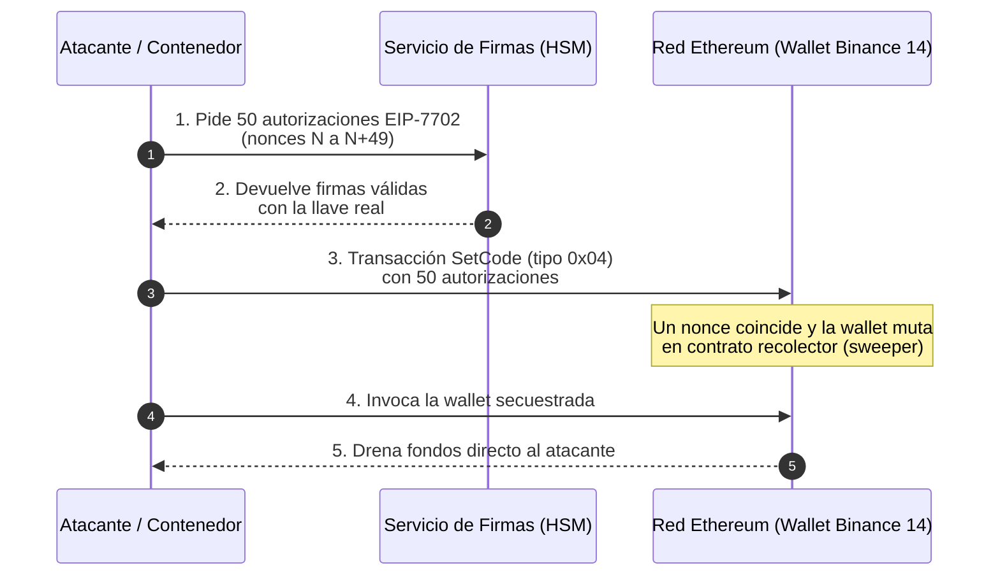

Es la tarde del jueves 29 de octubre de 2026. En la Ciudad de México son las 2:05 p.m., y alguien formado en la fila de una tortería abre la app de Binance para revisar su saldo mientras espera su cubana. Todo se ve normal. Los números siguen ahí, verdes y tranquilos, como siempre.

En ese mismo instante, del otro lado del Pacífico, pasan de las 4 de la mañana. Un ingeniero de guardia de Binance se despierta con el teléfono vibrando sobre el buró. No es una alerta de CPU ni un disco lleno. Es el monitor de flujos de salida de las billeteras calientes (*hot wallets*), y está gritando. Abre la laptop con los ojos entrecerrados esperando un falso positivo, uno de esos que se arreglan con un *ack* y una maldición. Pero las gráficas no mienten: los saldos de Ethereum, Bitcoin, Tron y XRP están cayendo en línea recta, como si alguien hubiera quitado el tapón de la tina.

A las 20:24 UTC, en San Francisco, un analista de inteligencia blockchain está terminando su almuerzo frente a tres monitores cuando su panel de rastreo marca algo que nunca había visto: **una sola transacción en Ethereum con 64 transferencias combinadas** saliendo de una dirección etiquetada como Binance. Deja el sándwich a medio morder. Lo vuelve a leer. Lo copia en el canal interno con un solo mensaje: *"esto no es un rebalanceo"*.

Y a las 21:01 UTC, en algún lugar donde el equipo de cumplimiento de Tether tiene su cuarto de guerra, alguien presiona el botón que la comunidad cripto más purista jura que no debería existir: **congelar direcciones**. Tres minutos después, Circle hace lo mismo.

Ninguno de ellos lo sabía todavía, pero todos estaban viendo el final de una película que había empezado cinco meses antes, con algo tan inocente como un ingeniero buscando en Google cómo instalar una herramienta de programación. El atraco más grande en la historia de las criptomonedas no rompió un solo algoritmo. No adivinó una sola llave. Simplemente le pidió amablemente a la infraestructura de Binance que firmara, y la infraestructura obedeció.

---

Te doy la bienvenida a **Fuera del Registro**, el espacio donde nos adentramos en las entrañas de las mayores crisis tecnológicas que han paralizado (o estuvieron a punto de colapsar) al mundo. Aquí no solo revivimos el caos: abrimos la caja negra de la infraestructura moderna para entender cómo un instante de distracción, una grieta humana o una falla de arquitectura puede derrumbarlo todo, y qué lecciones debemos llevarnos para blindar nuestras propias plataformas antes de que la historia se repita.

Hoy toca el caso que va a reescribir los manuales de seguridad de cualquier empresa que maneje dinero, llaves o infraestructura crítica: **el robo de más de 6,300 millones de dólares a Binance**, atribuido por el FBI, TRM Labs y Chainalysis al grupo norcoreano **TraderTraitor** (una subunidad del famoso **Lazarus Group**). Para dimensionarlo: es más de cuatro veces lo que se llevaron de Bybit en febrero de 2025, que hasta hace una semana era el récord absoluto.

En este artículo desarmaremos la anatomía del desastre: por qué la bóveda criptográfica nunca se abrió y aun así se vació, los cinco actos de una operación de persistencia avanzada que pasó por un Homebrew envenenado y un reclutador falso, el papel incómodo de una herramienta interna de IA como trampolín, la jugada maestra con **EIP-7702**, el calvario de contener una hemorragia en diez blockchains al mismo tiempo y las lecciones que cualquier equipo de DevOps debería aplicar mañana a primera hora.

## La arquitectura del peligro: el taquero que despacha cualquier comanda

Antes de entrar al código, hay que entender algo que el informe forense preliminar de Binance (publicado el 3 de noviembre) repite casi con orgullo herido: **las llaves privadas maestras nunca fueron extraídas**. La criptografía funcionó perfectamente. Los módulos de seguridad de hardware (HSM) y los esquemas de cómputo multiparte (MPC) hicieron exactamente lo que se supone que deben hacer.

*"Pero entonces... ¿entonces cómo se robaron 6 mil millones si las llaves estaban a salvo?"*

Vámonos a la taquería.

Imagina el trompo de pastor más vigilado del mundo. El taquero (nuestro HSM) está detrás de un vidrio blindado, con guardias armados, cámaras y un cuchillo que solo él puede tocar. Nadie en la historia ha logrado quitarle el cuchillo. Es incorruptible. Pero el taquero tiene una regla de oro: **despacha todo lo que diga la comanda que le pasa el mesero**. No pregunta, no duda, no levanta la vista. Si la comanda dice "500 de pastor para la mesa 14", salen 500 de pastor para la mesa 14.

Lazarus no intentó asaltar al taquero. No intentó robarse el cuchillo. Entró por la puerta de proveedores, se consiguió un mandil, copió el gafete de un mesero y empezó a meter comandas a la cocina. El taquero, impecable como siempre, despachó cada una.

Traducido al mundo real, la cocina de Binance funcionaba más o menos así. Hasta el fondo, en la bóveda, estaban los HSM y los nodos MPC con las llaves privadas: el taquero detrás del vidrio blindado. Esa parte nunca fue vulnerada. Pero la bóveda no decide nada por su cuenta; solo firma lo que le piden. Y quien le pedía era un **servicio interno de retiros**, el mesero oficial, con permiso para llegar a la ventanilla y decir *"firma esto"*. Ese servicio, a su vez, corría como un contenedor dentro de un **orquestador**, el gerente de piso que decide quién trabaja en la cocina ese día. ¿Y quién le daba órdenes al orquestador? Los ingenieros de Wallet DevOps, desde sus laptops, con **tokens de despliegue** que funcionaban como el gafete que te deja entrar por la puerta de atrás.

Ahí está el hueco. Las llaves estaban en el lugar más blindado del edificio, pero la cadena de mando que terminaba en ellas empezaba en la laptop de una persona. Si controlas la laptop, controlas el gafete. Si tienes el gafete, metes a tu propio mesero. Y si tu mesero pide firmas, el taquero despacha.

Durante años, la industria se obsesionó con proteger la caja fuerte: ceremonias de llaves, HSM certificados FIPS 140, MPC con umbrales de 3 de 5. Y funcionó tan bien que los atacantes simplemente cambiaron de blanco. Si la bóveda es impenetrable, **ataca a quien tiene permiso de hablar con la bóveda**. Un HSM no se cansa, no busca chamba, no le da clic al primer resultado de Google ni se emociona con una oferta de trabajo en dólares. Un ingeniero sí. Lo he dicho mil veces y lo voy a seguir repitiendo: **es más fácil hackear a un humano que a una máquina**. Lazarus lo sabe mejor que nadie.

Es el mismo principio que vimos con [los límites de confianza y mecanismos de protección del CISSP](/blog/cissp-2024-03-mecanismos-proteccion-limites-seguridad): un control de seguridad es tan fuerte como el canal que lo invoca, y en este caso el canal empezaba en una persona.

> **protip >** Si tu modelo de amenazas termina en "las llaves están en un HSM", tu modelo de amenazas está incompleto. Pregúntate: ¿quién puede pedirle una firma al HSM, desde dónde, y qué valida el HSM por su cuenta antes de firmar? Si la respuesta a la última pregunta es "nada", tienes un taquero muy caro que despacha cualquier comanda.

## Anatomía de la catástrofe: cinco meses, cinco actos

Lo que hace a este caso tan escalofriante no es la sofisticación de una sola técnica, sino la paciencia con la que se encadenaron fallas pequeñas, cada una aparentemente inofensiva por separado. Es la misma paciencia quirúrgica que vimos con [Jia Tan y el caso XZ Utils](/blog/fuera-del-registro-06-caso-xz-utils-puerta-trasera-2024), pero ahora con un botín de miles de millones al final del túnel.

Si esto fuera una película de robos, el guion tendría la estructura clásica de *Ocean's Eleven*, solo que sin George Clooney y con mucho, muchísimo más presupuesto. Primero, el **reconocimiento**: en junio, un instalador envenenado les regala el organigrama del equipo que cuida las billeteras. Luego, el **infiltrado**: en septiembre, una entrevista de trabajo impecable les pone un pie dentro de una laptop corporativa. Después, el **plano de la bóveda**: el 20 de octubre, una herramienta interna de IA les abre las puertas que faltaban y los lleva hasta un token de despliegue olvidado en una laptop. El **día del golpe**, el 29 de octubre a las 17:15 UTC, meten a su propio empleado en la cocina de producción. Y el **escape**: a las 20:05 UTC, veinte minutos para vaciar diez blockchains.

Cinco meses de preparación para veinte minutos de ejecución. Vamos acto por acto.

### Acto 1 (junio de 2026): el instalador que salió primero en Google

Un especialista del equipo de **Wallet DevOps** (el informe lo llama Ingeniero A) necesitaba instalar una herramienta de programación asistida por IA. Hizo lo que todos hemos hecho mil veces: la buscó en un motor de búsqueda y le dio clic al primer resultado. Ese resultado no era el sitio oficial. Era una página posicionada a propósito mediante **envenenamiento SEO** (*SEO poisoning*), con un instalador adulterado del gestor de paquetes **Homebrew**.

Aquí viene lo interesante: **el equipo de seguridad de Binance sí lo detectó**. Reemplazaron la laptop, rotaron sus credenciales y cerraron el incidente. De manual. El problema es que el objetivo de esta primera fase nunca fue quedarse. Fue hacer reconocimiento: averiguar quién era el Ingeniero A, qué rol tenía, con quién trabajaba y cómo estaba organizado el equipo que administra la infraestructura de billeteras. Los atacantes se fueron con el organigrama en la bolsa.

Es como cachar a alguien husmeando en tu cocina, sacarlo a patadas, cambiar la chapa... y no darte cuenta de que ya se llevó una foto del plano de la casa.

### Acto 2 (septiembre de 2026): la entrevista de trabajo perfecta

Con el mapa en mano, TraderTraitor eligió a su siguiente víctima: el Ingeniero de Software B. Lo contactaron por una plataforma de empleo legítima, haciéndose pasar por el director de proyectos de una empresa ficticia. Y aquí es donde la ingeniería social norcoreana deja en ridículo a cualquier correo del *Príncipe Nigeriano* con faltas de ortografía:

1. **Primera entrevista en video, en vivo**, con una supuesta reclutadora de recursos humanos que incluso compartió sus perfiles de redes sociales con fotos y videos personales para generar confianza.
2. **Segunda entrevista por una app de mensajería** con un falso CEO.
3. **La prueba técnica**: un repositorio que había que clonar y configurar. En la laptop corporativa.

Durante la "configuración del entorno" se ejecutó un **malware de día cero** que evadió los controles EDR. Y la técnica de persistencia es de esas que dan coraje por lo sencillas: en lugar de instalar un binario raro en una ruta sospechosa, **reemplazó el ejecutable de Python que vive dentro de la ruta de Homebrew**. Renombró el binario original, lo eliminó y creó en su lugar un **enlace simbólico malicioso** que, cada vez que algo invocaba Python, abría una consola interactiva con un canal de comando y control (C2) y borraba rastros forenses.

Piénsalo un segundo. ¿Cuántas veces al día un ingeniero de DevOps ejecuta Python sin darse cuenta? Scripts, linters, herramientas de CLI, hooks de Git, el autocompletado del editor. Cada una de esas invocaciones era una llamada a casa.

Si administras Macs o Linux con Homebrew, esto te toma dos minutos revisarlo:

```bash
# ¿A dónde apunta REALMENTE el python de Homebrew?
readlink -f "$(brew --prefix)/bin/python3"

# ¿Ese archivo pertenece a una fórmula instalada o salió de la nada?
brew list python@3.12 | grep 'bin/python3'

# Enlaces simbólicos modificados recientemente en la ruta de Homebrew
find "$(brew --prefix)/bin" -type l -newermt "2026-09-01" -exec ls -la {} \;

# Compara el hash contra otra máquina limpia del mismo modelo y versión
shasum -a 256 "$(readlink -f "$(brew --prefix)/bin/python3")"
```

Si `readlink` te devuelve algo fuera de `$(brew --prefix)/Cellar/` o `$(brew --prefix)/opt/`, deja el café y llama a tu equipo de respuesta a incidentes.

> **protip >** La regla de oro que todos conocemos y nadie respeta: **nunca ejecutes código de un tercero en tu equipo de trabajo**. Y una prueba técnica de una "empresa" que te contactó por LinkedIn es exactamente eso. Si te piden correr un repo, hazlo en una VM desechable sin credenciales, sin VPN y sin acceso a nada que te importe. Ningún reclutador legítimo se va a ofender por eso.

### Acto 3 (20 de octubre de 2026): la IA interna como puente

Desde la laptop del Ingeniero B, el grupo hizo algo que debería quitarle el sueño a cualquier CISO que esté desplegando asistentes internos: **usaron una herramienta interna de inteligencia artificial de Binance como trampolín para moverse lateralmente**.

Esta plataforma tenía permisos e integraciones que cruzaban equipos y entornos. Era, en la práctica, la cajera que tiene llaves de todas las puertas del restaurante porque "así es más práctico". A través de ella, los atacantes **recuperaron el control sobre el equipo del Ingeniero A** (sí, el mismo de junio, que ya tenía laptop nueva y credenciales rotadas) y comprometieron a un tercero: el **Ingeniero de Software C**. En el camino descubrieron el premio gordo: el Ingeniero A guardaba en su máquina **un token con permisos para desplegar contenedores**.

El informe preliminar no detalla el mecanismo exacto con el que abusaron de la herramienta (y honestamente, no voy a inventarlo), pero el patrón es viejo y conocido: es el **"diputado confundido"** (*confused deputy*) de toda la vida, ahora con una interfaz conversacional. Un sistema con muchos privilegios que actúa en nombre de quien le hable, sin verificar si quien le habla debería tener acceso a lo que pide. Es [Broken Access Control](/blog/owasp-top-10-03-a01-broken-access-control) con esteroides y un chatbot amable por encima.

Recapitulemos el recorrido: de la laptop de B a la IA interna, de la IA a las máquinas de A y C, y de ahí directo a un token olvidado que abría la puerta de producción. Ningún salto requirió romper criptografía ni inventar exploits de ciencia ficción; solo abusar de permisos que ya existían y que estaban peligrosamente entrelazados.

### Acto 4 (29 de octubre, 17:15 a 19:56 UTC): el mesero falso entra a la cocina

Con todo listo, los atacantes se sentaron en la computadora del Ingeniero C y usaron el token y las credenciales del Ingeniero A para **desplegar un contenedor malicioso directamente en el entorno de producción**. Nada de pipelines de CI/CD, nada de revisiones de código, nada de imágenes firmadas: un despliegue manual desde una laptop, con un token que vivía en un archivo de configuración.

Desde ese contenedor ejecutaron un script que habló directamente con las operaciones internas de firma de billeteras, **haciéndose pasar por el servicio interno autorizado para emitir retiros automatizados**. Para el servicio de firmas, la petición venía de adentro, del lugar correcto, con el formato correcto. ¿Por qué iba a dudar?

Durante casi tres horas, el mesero falso estuvo en la cocina preparando las comandas. Y luego empezó a gritarlas todas al mismo tiempo.

### Acto 5 (29 de octubre, 20:05 a 23:56 UTC): el saqueo y la jugada EIP-7702

A partir de las **20:05 UTC**, en una ventana principal de apenas **20 minutos**, los atacantes drenaron las billeteras calientes en **diez redes distintas**. En las redes que no son compatibles con Ethereum (Bitcoin, Tron, XRP, Solana) bastaba con que el servicio de firmas aprobara retiros. Pero en Ethereum hicieron algo mucho más elegante, y aquí es donde hay que hablar de **EIP-7702**.

EIP-7702 llegó con la actualización **Pectra** y permite que una cuenta normal de Ethereum (una EOA, controlada por una llave privada) **delegue su ejecución a un contrato inteligente**. La idea original es bonita: que tu billetera de siempre pueda hacer cosas de billetera inteligente (agrupar operaciones, pagar gas con otros tokens, recuperación social) sin migrar de dirección. Funciona así:

1. El dueño de la cuenta **firma una autorización**: un mensaje con el prefijo mágico `0x05` que contiene `[chain_id, dirección_del_contrato, nonce]`.
2. Cualquiera (literalmente cualquiera) puede meter esa autorización en una transacción de **tipo `0x04`** (*SetCode*) dentro de su `authorization_list`.
3. Si el `nonce` de la autorización coincide con el nonce actual de la cuenta, la red escribe en la cuenta el código `0xef0100 || dirección_del_contrato`. A partir de ese momento, **cada vez que alguien llama a esa cuenta, se ejecuta el código del contrato delegado**.
4. Si el nonce no coincide, esa autorización simplemente se ignora y la transacción sigue con las demás.

¿Ves la trampa? El punto 4 es la clave. Una hot wallet de Binance está haciendo transacciones todo el tiempo, así que su nonce cambia cada pocos segundos. Si firmas una sola autorización, para cuando la envíes probablemente ya caducó. Entonces, ¿qué hicieron los atacantes? Le pidieron al servicio de firmas **50 autorizaciones, cada una con un nonce distinto**, y las metieron todas en **una sola transacción**. Una de ellas iba a atinarle sí o sí.

Y ojo con este detalle: para que esas 50 autorizaciones existieran, **alguien tuvo que firmarlas con la llave real de la billetera `Binance 14`**. Ese alguien fue el servicio de firmas, obedeciendo al contenedor malicioso. Las llaves nunca salieron de la bóveda. No hizo falta.



En segundos, la billetera caliente se convirtió en un **contrato recolector** (*sweeper*) controlado por el atacante, que redirigía todo lo que tocaba. A las **20:24 UTC** se procesó la transacción principal en Ethereum con **64 transferencias combinadas** (la que hizo que nuestro analista de San Francisco soltara el sándwich). Siguieron oleadas en Avalanche y Polygon a las **23:05 UTC** y una última transferencia en Ethereum a las **23:56 UTC**.

Lo brutal de EIP-7702 en este contexto es que la delegación **no pasa por la lógica de aprobación de retiros del exchange**. Una vez que la cuenta ejecuta código ajeno, ya no estás autorizando retiros uno por uno; le entregaste el volante a otro.

> **protip >** Si operas billeteras de liquidez o custodia en Ethereum, pregúntale hoy mismo a tu proveedor de HSM/MPC si puede **rechazar por política cualquier payload con el prefijo `0x05`** (autorizaciones EIP-7702). Una hot wallet de exchange no tiene ninguna razón legítima para delegar su código a un contrato. Si tu firmador no distingue entre "firmar un retiro" y "entregar el control total de la cuenta", tienes un problema que ningún HSM va a resolver solito.

## El antes y el después: de robar contraseñas a secuestrar la fábrica

Binance no es nuevo en esto de que le vacíen los bolsillos. Pero comparar sus tres grandes incidentes es como ver la evolución de una especie:

| Incidente | Vector de ataque principal | Componente comprometido | Pérdida estimada |
|---|---|---|---|
| **Mayo 2019** | Phishing, malware y robo de claves API y 2FA | Billetera caliente de Bitcoin | 40 millones USD |
| **Octubre 2022** | Falsificación de pruebas criptográficas Merkle | Puente cross-chain BSC Token Hub | 570 millones USD |
| **Octubre 2026** | Cadena de suministro, IA interna y contenedores | Orquestador de firmas y hot wallets | Más de 6,300 millones USD |

- **En 2019**, los atacantes juntaron pacientemente claves API y códigos de dos factores de usuarios (sí, [el MFA importa, pero no es magia](/blog/ciberseguridad-basica-01-mfa)) para programar un único retiro masivo que se saltó las validaciones de riesgo. Ataque a las credenciales de los clientes.
- **En 2022**, el ataque fue puramente matemático y externo: una falla en la verificación de árboles IAVL dentro del puente BSC Token Hub permitió acuñar dos millones de BNB de la nada, sin tocar un solo servidor interno de Binance. Ataque a la lógica del protocolo.
- **En 2026**, ya con la custodia criptográfica madura (HSM, MPC, umbrales), los atacantes dejaron de pelear contra las matemáticas. **Secuestraron la maquinaria de software y los flujos de DevOps autorizados para pedirle a las llaves que firmaran.** Ataque a la fábrica.

La lección es incómoda: cada vez que blindamos una capa, el atacante baja (o sube) a la siguiente. Endurecimos la criptografía y se fueron al pipeline. Es exactamente la tesis de [A03: Fallas en la Cadena de Suministro de Software](/blog/owasp-top-10-05-a03-software-supply-chain-failures), solo que ahora con nueve ceros.

## El calvario del SysAdmin: contener una hemorragia en diez redes

Pongámonos en los zapatos del equipo de respuesta. Son las 4 de la mañana en Asia. Tienes diez blockchains sangrando al mismo tiempo, cada una con sus propias herramientas, sus propios exploradores y su propia forma de (no) poder detener una transacción. No hay un botón de "rollback" en Bitcoin. No hay soporte técnico de Ethereum al que puedas hablarle. La red es inmutable, y por primera vez en tu carrera odias esa palabra.

Así quedó el daño por red:

| Red o categoría | Activos afectados (USD) | Estado de recuperación |
|---|---|---|
| Ethereum | 3,800 millones | Parcialmente congelado en stablecoins |
| Bitcoin | 1,500 millones | En manos de atacantes, no congelable |
| Tron | 628 millones | Parcialmente congelado por emisores |
| XRP | 296 millones | En rastreo on-chain |
| Solana | 96 millones | En rastreo on-chain |
| Arbitrum, Optimism y Base | 39 millones | En rastreo on-chain |
| Avalanche | 28 millones | En rastreo on-chain |
| Polygon | 10 millones | En rastreo on-chain |
| **Total** | **Unos 6,397 millones** | |

Y aquí viene la ironía más deliciosa de todo el caso, la que va a provocar discusiones eternas en Twitter: **lo que salvó a Binance fue la centralización**.

- A las **21:01 UTC**, Tether congeló las direcciones receptoras de los atacantes. A las **21:04 UTC**, Circle hizo lo mismo. Después, ambos emisores **bloquearon temporalmente la propia billetera caliente de Binance** para cortar la salida de fondos. Imagínate llamarle al banco para que te congele tu propia cuenta porque alguien más la está usando.
- Entre Tether, Circle y World Liberty Financial lograron congelar **cerca de 3,000 millones de dólares en stablecoins** antes de que los atacantes pudieran cambiarlas en pools descentralizados.
- En cambio, los activos nativos descentralizados, como los **18,270 BTC** y el Ether que los atacantes movieron a nuevas direcciones en la madrugada del 30 de octubre, no tienen ninguna función de bloqueo. Siguen en manos de Pyongyang, y la carrera ahora es de rastreo: puentes, exchanges descentralizados, servicios de intercambio instantáneo, y analistas siguiendo migajas en un bosque de direcciones nuevas.

Los mismos que llevan años diciendo que "un token que se puede congelar no es cripto de verdad" esa noche estaban muy agradecidos de que existiera un botón rojo en una oficina de Tether.

Mientras tanto, el equipo de Binance hacía malabares:

1. **Suspender retiros** en toda la plataforma (y aguantar el pánico en redes sociales).
2. A las **00:10 UTC del 30 de octubre**, enviar desde la billetera afectada (`Binance 14`) una transacción con una autorización EIP-7702 apuntando a **la dirección cero** (`0x0000...0000`). En EIP-7702, delegar a la dirección cero **borra el código delegado** y devuelve la cuenta a ser una EOA normal. Es, literalmente, arrancarle el volante al secuestrador.
3. **Reponer los activos** con reservas propias y el fondo de emergencia **SAFU** (*Secure Asset Fund for Users*), para que ningún usuario absorbiera la pérdida.
4. **Reconstruir desde cero** tanto el entorno completo de billeteras como la herramienta interna de IA. No "parchar". No "endurecer". Tirar y volver a construir, porque después de cinco meses de persistencia no hay forma de saber qué más dejaron escondido.
5. Reanudar los retiros **por fases el 1 de noviembre**, mientras el FBI (junto con el Servicio Secreto y el IRS-CI) emitía el 31 de octubre su aviso oficial confirmando a TraderTraitor como responsable.

Si alguna vez te ha tocado una guardia de 30 horas por un servidor caído, multiplica esa angustia por diez blockchains, miles de millones de dólares, reguladores de varios países y millones de usuarios refrescando la app cada cinco segundos. Ese fue el fin de semana de alguien. Como vimos con [la pesadilla operativa de CrowdStrike](/blog/fuera-del-registro-04-colapso-crowdstrike-falcon-2024), la recuperación siempre es más larga, más cara y más humana que el incidente.

## Lecciones para el día a día: cómo no ser el siguiente

No necesitas manejar miles de millones en cripto para que este caso te aplique. Si tu empresa tiene ingenieros con laptops, tokens de despliegue, un orquestador de contenedores y alguna herramienta interna de IA conectada a "todo", ya tienes los mismos ingredientes. Estas son las medidas concretas que me llevo:

### 1. La laptop del ingeniero ya es infraestructura crítica

- **Aislamiento de estaciones de trabajo**: el mismo equipo no debería servir para navegar libremente, chatear con reclutadores, correr pruebas técnicas de extraños **y** administrar producción. Separa funciones: estaciones de administración dedicadas (PAW) para quien toca infraestructura sensible.
- **Repositorios internos verificados**: bloquea la descarga directa de instaladores desde buscadores. Homebrew, pip, npm y compañía deben pasar por espejos y registros internos auditados.
- **Monitoreo de integridad de binarios (FIM)**: el reemplazo de Python por un enlace simbólico es exactamente el tipo de cambio que un control de integridad de archivos debería gritar. Vigila rutas de herramientas de desarrollo (`/opt/homebrew/bin`, `/usr/local/bin`, `~/.local/bin`) con la misma seriedad que `/etc`.
- **Entornos de desarrollo efímeros**: entornos en la nube o contenedores desechables, sin acceso directo a redes de producción. Si se infecta, lo tiras y levantas otro.

### 2. Tu IA interna no es un empleado de confianza, es una superficie de ataque

- **Mínimo privilegio, de verdad**: cada integración de un asistente interno debe tener permisos acotados por rol (RBAC) y por equipo. Si la herramienta puede alcanzar las máquinas de Wallet DevOps desde la laptop de un desarrollador de otro equipo, no es una herramienta: es un túnel.
- **La identidad del usuario debe viajar con cada acción**: el asistente debe actuar **con los permisos de quien le pide**, no con los suyos. Si tú no puedes entrar a la máquina del Ingeniero A, tu IA tampoco.
- **Registra todo**: cada consulta, cada herramienta invocada, cada recurso tocado. Y que esos registros alimenten al SOC, como explicamos en [A09: Fallas en el Registro y Monitoreo](/blog/owasp-top-10-11-a09-security-logging).

> **protip >** Haz este ejercicio con tu equipo: dibujen en un pizarrón todas las integraciones de su herramienta interna de IA (repos, tickets, wikis, CI/CD, nubes, SSH, bases de datos). Ahora pregunten: "si alguien controla la sesión de cualquier usuario de esta herramienta, ¿hasta dónde llega?". Si la respuesta es "a todo", ya saben qué hacer el lunes.

### 3. Nada llega a producción desde una laptop

- **Elimina los tokens estáticos de despliegue en endpoints**: un token con permisos de despliegue guardado en un archivo de una laptop es una bomba de tiempo. Sustitúyelos por credenciales efímeras de corta duración, emitidas bajo demanda y vinculadas a hardware (FIDO2).
- **Despliegues inmutables y firmados**: todo contenedor en producción debe venir exclusivamente de un pipeline CI/CD automatizado, con imágenes firmadas criptográficamente y un **controlador de admisión** que rechace cualquier cosa sin firma válida. En Kubernetes, algo así de simple habría detenido el Acto 4:

```yaml
apiVersion: kyverno.io/v1
kind: ClusterPolicy
metadata:
  name: solo-imagenes-firmadas-por-ci
spec:
  validationFailureAction: Enforce
  rules:
    - name: verificar-firma-cosign
      match:
        any:
          - resources:
              kinds: ["Pod"]
              namespaces: ["wallet-signing"]
      verifyImages:
        - imageReferences: ["registry.interno.example/*"]
          attestors:
            - entries:
                - keys:
                    publicKeys: |-
                      -----BEGIN PUBLIC KEY-----
                      (llave pública del pipeline de CI)
                      -----END PUBLIC KEY-----
```

Con esto, aunque alguien robe un token y tenga permisos de despliegue, el clúster se niega a correr una imagen que no haya firmado el pipeline. El token deja de ser suficiente. Profundizamos en este principio en [A08: Fallas en la Integridad de Software y Datos](/blog/owasp-top-10-10-a08-software-integrity).

### 4. El taquero también tiene que leer la comanda

Esta es, para mí, la lección arquitectónica más importante del caso: **el firmador no debe confiar ciegamente en el orquestador**.

- **Políticas verificadas dentro del HSM/MPC**: las reglas de negocio (listas blancas de destino, tipos de operación permitidos, montos máximos) deben validarse en la capa de firma, de forma independiente al servicio que pide la firma.
- **Bloqueo de delegaciones de código**: prohibir por política la firma de autorizaciones EIP-7702 desde billeteras operativas o de liquidez.
- **Cortacircuitos automáticos** (*circuit breakers*): topes estrictos de volumen de salida por minuto y por hora, a nivel de infraestructura, que congelen las firmas ante picos anómalos. Drenar 6 mil millones en 20 minutos no debería ser físicamente posible.
- **Quórum humano fuera de banda**: cuando el flujo acumulado supere un umbral, se requiere aprobación criptográfica de varios operadores humanos en dispositivos dedicados.


Ninguna de estas reglas habría impedido que los atacantes entraran. Pero cualquiera de ellas habría convertido un robo de 6 mil millones en un incidente de unos cuantos millones y un postmortem incómodo.

### 5. La entrevista trampa: cuando la ingeniería social viene con videollamada

- **Simulaciones de reclutamiento falso**: entrena a tu personal técnico específicamente contra entrevistas falsas, ofertas trampa y "pruebas técnicas" que hay que ejecutar. Los norcoreanos llevan años perfeccionando esta campaña; tus ingenieros merecen saber que existe.
- **Higiene en redes profesionales**: ese perfil de LinkedIn que dice "Senior Wallet Infrastructure Engineer, experto en MPC, HSM y Kubernetes en el equipo de custodia de hot wallets" es un letrero de neón para cualquier equipo de reconocimiento (OSINT). Puedes presumir tu experiencia sin publicar el diagrama de tu arquitectura interna.

---

## Ctrl + D

El robo a Binance de octubre de 2026 va a quedar en los libros como el día en que la industria entendió que **la criptografía perfecta no sirve de nada si no sabe a quién le está obedeciendo**. Las llaves estaban en una bóveda impecable. Los HSM nunca fallaron. Las matemáticas aguantaron todo. Y aun así, más de 6,300 millones de dólares salieron por la puerta en veinte minutos, porque la bóveda firmó cada comanda que le pusieron enfrente sin levantar la vista.

Lo más inquietante es que ninguno de los eslabones de esta cadena fue espectacular por sí solo. Un clic en el primer resultado de Google. Una entrevista de trabajo convincente. Una herramienta interna "conectada a todo para ser más útil". Un token guardado en una laptop porque era más cómodo. Un firmador que confiaba en quien le hablaba desde adentro. Cada decisión, por separado, se veía razonable. Juntas, fueron el atraco del siglo.

La próxima vez que tu equipo despliegue un asistente de IA con acceso a medio mundo, que alguien guarde un token "nomás en lo que configuramos el pipeline", o que te llegue una oferta de trabajo demasiado buena con una prueba técnica que hay que correr en tu máquina, acuérdate del taquero que despachaba cualquier comanda. La seguridad moderna ya no se trata solo de proteger los secretos, sino de desconfiar sanamente de cada sistema que tiene permiso de usarlos. Porque cuando la llave más segura del mundo obedece a cualquiera que hable con el tono correcto, **lo más importante es nunca dejar de preguntar** quién está pidiendo la firma.
