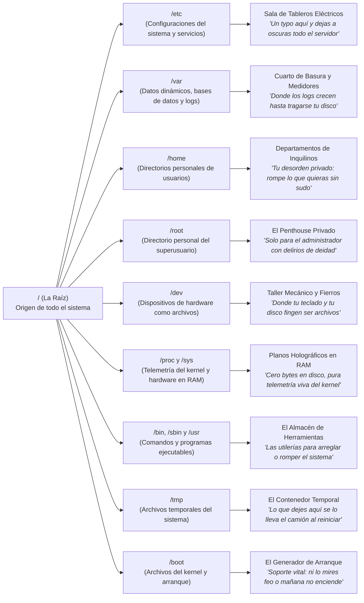
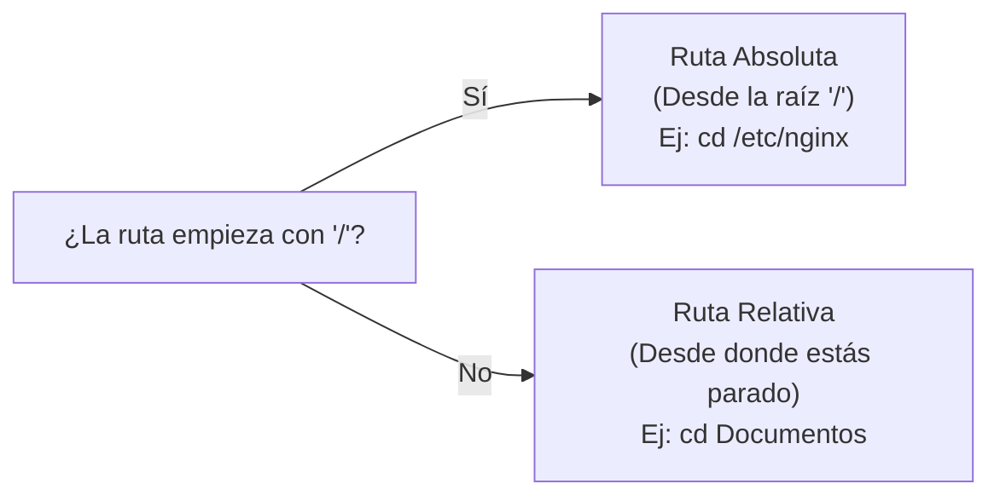

Si vienes del ecosistema Windows, tu primer día frente a una consola de Linux suele comenzar con un microinfarto. Abres la terminal, respiras hondo, intentas moverte con la confianza de quien lleva años usando computadoras y de repente te das cuenta de una cruda realidad: ¿dónde está el disco `C:`? Ni lo conozco. Tampoco hay un disco `D:`, ¿`Archivos de Programa`? ¿qué es eso?, ¡no hay ventanas con íconos de colores para rescatarme!

Solo estás tú, una pantalla negra con letras blancas y una solitaria diagonal (`/`) que parece burlarse de lo perdido que estás... a todos nos pasó.

Es completamente normal sentirse perdido al inicio. Todos hemos pasado por esa fase en la que creemos que el sistema de archivos de Linux es una especie de laberinto medieval diseñado exclusivamente para que los administradores de sistemas nos veamos interesantes con una taza de café en la mano. "Mira mi consola corriendo un ping al servidor"... el espantamorras 3000 compatible con EXT4.

Sin embargo, detrás de esa aparente frialdad existe un orden milimétrico y sobretodo elegante y logico. Hoy vamos a platicar sobre ese mapa, entenderemos qué es el **FHS** (*Filesystem Hierarchy Standard*) y cumpliremos una promesa que dejamos pendiente en nuestro [artículo sobre el editor Vi](/blog/linux-esencial-04-vi-editor-esencial): explicar por qué, en el mundo de Linux, **absolutamente todo es un archivo**.

---

## El pilar de Unix y Linux: En Linux, todo es un archivo

Bienvenido al único lugar del universo donde tu nota de recordatorios es un archivo, tu configuración de pantalla es un archivo y ese script que automatiza tu vida también es un archivo. Pero no para ahí: ¿un puerto de red? Un archivo. ¿Un proceso del sistema? Un archivo. ¿Tu teclado, tu mouse, la tarjeta de video y hasta el estado actual de tu batería? Claro que sí, cómo no, todos son archivos. En Linux, si algo existe, respira o consume electricidad, el sistema operativo lo mira fijamente, le asigna una ruta en el árbol y te dice: **"Felicidades, eres un archivo"**. Al final, la vida aquí es ridículamente simple: todo se reduce a abrir, leer y rezar para no borrar el archivo equivocado.

¿Suena a capricho o a chiste de programador? En realidad es una decisión de diseño brillante. En otros sistemas operativos, los dispositivos de hardware, las conexiones de red y las interfaces gráficas son abstracciones controladas por controladores opacos que viven en cajas negras. En cambio, en los sistemas Unix y Linux, los creadores originales aplicaron una regla revolucionaria por su simplicidad: **tratar a cualquier recurso del sistema como si fuera un archivo de texto o un flujo de bytes**.

¿Qué significa esto en el día a día?

* Un documento de texto (`notas.txt`) es un archivo regular.
* Un directorio o carpeta (`/home/usuario/`) es un archivo que contiene una lista con los nombres de otros archivos.
* Tu disco duro o tu memoria USB conectada (`/dev/sdb`) es un archivo de bloques sobre el cual el sistema lee y escribe sectores directamente.
* La memoria RAM y el estado de tus procesos (`/proc`) se leen como archivos de texto en tiempo real, aunque jamás toquen el disco magnético.
* Incluso tu teclado o la pantalla por la que lees esto pueden ser representados como archivos de caracteres por donde viajan datos.

Al unificar todo bajo la misma interfaz de "abrir, leer, escribir y cerrar", los comandos básicos que aprendiste en nuestra [primera entrega de comandos esenciales](/blog/linux-esencial-01-basico-10-comandos), como `cat`, `grep` o `echo`, adquieren un nivel de poder impresionante. No necesitas una herramienta especial para preguntarle al procesador su temperatura o modelo; basta con leer el archivo correspondiente.

---

## El Filesystem Hierarchy Standard (FHS): El plano del edificio

Imagina que el sistema de archivos de Linux es un edificio de departamentos u oficinas corporativas con un reglamento de convivencia muy estricto. La entrada principal del edificio es la raíz, representada por una simple barra diagonal: `/`. 

A partir de esa puerta principal, todo se organiza en áreas con propósitos designados por un estándar internacional llamado **FHS** (*Filesystem Hierarchy Standard*). Gracias a esta convención, ya sea que estés administrando un servidor Red Hat Enterprise Linux, un contenedor en Fedora, una máquina virtual Debian o tu laptop personal con Arch Linux (porque Arch es para los verdaderos hackers... si, si... yo no tengo tanto tiempo libre), las cosas importantes siempre están en el mismo cajón.

Visualicemos este árbol antes de ensuciarnos las manos en la terminal:



Vamos a recorrer los pasillos más transitados de este edificio para que nunca más vuelvas a sentirte como un turista sin brújula.

---

## Los Departamentos Críticos del Sistema

### 1. `/etc` : El panel de control del universo
Si vienes de Windows, probablemente estés acostumbrado al monstruoso Registro de Windows o al Panel de Control. En Linux no existe tal cosa. En su lugar tenemos `/etc` (históricamente nombrado por *"etcetera"*, aunque hoy nos gusta llamarlo *"Editable Text Configurations"*).

Aquí viven prácticamente todos los archivos de configuración del sistema y de los servicios que instales (servidores web, firewalls, bases de datos, redes). ¿Y qué crees? Todos son archivos de texto plano legibles para humanos. Puedes abrirlos, leerlos y modificarlos con cualquier editor de texto como Vi o Vim, ya sabes usarlos porque leiste nuestra [guía práctica de personalización de Vi](/blog/linux-esencial-05-personaliza-vi-flujo-trabajo).

> **protip >** Tocar un archivo en `/etc` sin hacer un respaldo previo es el camino más rápido para pasar un viernes en la noche llorando frente a la terminal. Antes de editar cualquier configuración crítica, saca una copia rápida:
> ```bash
> sudo cp /etc/ssh/sshd_config /etc/ssh/sshd_config.bak
> ```
> Si algo se rompe, solo tienes que revertir la copia y reiniciar el servicio. Tu salud mental te lo agradecerá.

### 2. `/var` : La bitácora y los datos vivos
La palabra viene de *variable*. Mientras que `/etc` contiene planos que casi no cambian, `/var` es el departamento donde el ruido nunca se detiene. Aquí residen los datos que crecen dinámicamente durante el funcionamiento continuo de la máquina.

El rincón más sagrado para cualquier SysAdmin dentro de este directorio es `/var/log`. Aquí es donde el kernel, los programas y las aplicaciones registran cada acierto, advertencia y desastre que ocurre. Cuando un servicio web falla o sospechas de una intrusión, tu primer reflejo debe ser correr hacia este directorio y usar comandos como `tail -f` (que conocimos en la [segunda parte de comandos esenciales](/blog/linux-esencial-02-otros-10-comandos)) para ver los registros en tiempo real:

```bash
sudo tail -f /var/log/messages
```

### 3. `/home` y `/root` : Los cuartos privados
En `/home` se encuentra el espacio personal de cada usuario ordinario del sistema (por ejemplo, `/home/pereidax86`). Es tu territorio sagrado: aquí puedes crear proyectos, descargar archivos, guardar tus cochinadas, compilar código o romper cosas sin necesidad de privilegios administrativos de `sudo`.

Por otro lado, `/root` es el directorio personal exclusivo del superusuario (*root*). No confundas la raíz general del sistema (`/`) con la carpeta personal del administrador (`/root`). La primera es la base de todo el árbol; la segunda es simplemente la recámara privada del usuario todopoderoso.

### 4. `/dev` : El taller mecánico
En `/dev` (*devices*) reside la prueba más clara de que todo es un archivo. Si conectas una memoria USB, Linux no le asigna mágicamente una letra `E:`. En su lugar, el kernel crea un archivo especial dentro de `/dev`, usualmente llamado algo como `/dev/sdb`. 

Si necesitas particionar discos o administrar volúmenes lógicos mediante LVM (como detallamos en nuestra [guía de LVM para almacenamiento](/blog/linux-almacenamiento-03-lvm-guia-linux)), interactuarás directamente con los archivos contenidos en `/dev`.

### 5. `/proc` y `/sys` : Radiografías de la memoria en tiempo real
Estos dos directorios son fascinantes porque representan una ilusión óptica creada por el kernel de Linux. Si revisas su tamaño en disco con herramientas de almacenamiento, verás que técnicamente ocupan cero bytes en tu almacenamiento físico.

¿Por qué? Porque no existen en tu disco duro ni en tu unidad SSD. Son **sistemas de archivos virtuales** generados directamente en la memoria RAM por el kernel de Linux. Funcionan como una ventana directa a los signos vitales de tu computadora:

```bash
# Ver información exacta de tu procesador
cat /proc/cpuinfo

# Ver el uso y distribución de la memoria RAM
cat /proc/meminfo
```

### 6. `/bin`, `/sbin` y `/usr` : Las herramientas de trabajo
Aquí se almacenan los archivos ejecutables (los comandos y utilerías que ejecutas a diario). En sistemas modernos, la gran mayoría de comandos residen bajo `/usr/bin` (para usuarios comunes) y `/usr/sbin` (para comandos de administración de sistemas que requieren privilegios elevados), manteniendo `/bin` y `/sbin` como enlaces simbólicos por compatibilidad histórica.

### 7. `/tmp` : El "ahorita lo quito, no me tardo más de 5 minutos"
`/tmp` es el directorio para almacenar archivos temporales. Cualquier usuario y proceso puede escribir aquí. Sin embargo, ten mucho cuidado: la mayoría de las distribuciones modernas vacían este directorio automáticamente al reiniciar el sistema o eliminan archivos tras un período de inactividad programado.

> **protip >** Jamás, bajo ninguna circunstancia, guardes un script importante o notas de producción dentro de `/tmp`. Si el servidor se reinicia inesperadamente por una actualización del kernel o un apagón eléctrico, tus archivos desaparecerán en el éter digital sin dejar rastro.

---

## Rutas Absolutas vs Rutas Relativas

Uno de los errores más frustrantes cuando estás empezando a utilizar los comandos `cd`, `ls` o `cp` es recibir el temido mensaje: `No such file or directory`. Nueve de cada diez veces, este error ocurre por confundir una ruta absoluta con una ruta relativa.



1. **Ruta Absoluta:** Es la dirección postal completa con código postal incluido. Comienza **siempre** con una diagonal inicial (`/`). Sin importar en qué directorio te encuentres trabajando en este momento, apuntará exactamente al mismo lugar:
   ```bash
   cd /var/log/
   ```

2. **Ruta Relativa:** Depende de tu ubicación actual (la cual puedes comprobar con el comando `pwd`). No lleva diagonal al principio:
   ```bash
   # Si estás parado en /home/pereidax86, esto intentará entrar a /home/pereidax86/etc
   cd etc
   # Resultado: ¡Error! Porque 'etc' no vive dentro de tu home, sino en la raíz
   ```

Si alguna vez tienes dudas sobre qué estándar rige a cada carpeta de tu sistema operativo, no necesitas acudir a internet. Recuerda lo que aprendimos en nuestra guía de [ayuda en Linux sin rezarle a San Google](/blog/linux-esencial-03-ayuda-sin-google) y consulta el manual oficial del sistema de archivos directamente desde tu terminal:

```bash
man hier
```

El comando `man hier` (de *hierarchy*) abrirá en tu pantalla la documentación oficial del árbol de directorios de tu distribución específica, explicada detalle por detalle.

---

## Ctrl + D

Aprender la anatomía del sistema de archivos en Linux es el verdadero rito de iniciación del administrador de sistemas. Cuando dejas de ver la raíz `/` como un abismo sin ventanas y comienzas a entenderla como una biblioteca perfectamente catalogada, la consola pierde todo su misticismo intimidante y se convierte en una extensión de tu propio flujo de pensamiento.

En la próxima entrega de esta serie daremos el siguiente gran salto: ahora que ya conocemos los comandos básicos y sabemos dónde vive cada componente, aprenderemos a conectar esos comandos entre sí mediante [**tuberías y redirecciones** (`|`, `>`, `>>`)](/blog/linux-esencial-07-tuberias-redirecciones), desbloqueando el verdadero potencial de automatización de la terminal.

No tengas miedo de explorar con `cd`, revisar con `ls -la` y curiosear en `/proc`. Y recuerda: **lo más importante es nunca dejar de preguntar**... y jamás olvidar una diagonal al moverte por la raíz.
