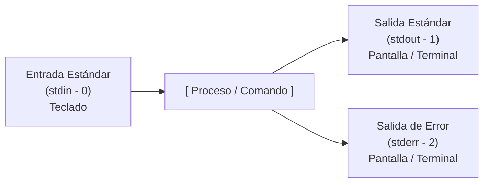
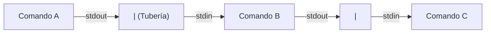

¿Alguna vez te has encontrado seleccionando con el mouse la salida de un comando en la terminal, copiándola, abriendo un bloc de notas o una hoja de cálculo y pegándola manualmente para buscar una palabra? Si la respuesta es sí, no te sientas culpable; todos hemos tenido ese momento de desesperación en nuestros primeros días de trinchera.

Sin embargo, ese proceso manual va completamente en contra del alma de Linux.

En 1978, Doug McIlroy formuló uno de los pilares de la filosofía Unix que transformó la informática moderna: *"Escribe programas que hagan una sola cosa y la hagan bien. Escribe programas que trabajen juntos. Escribe programas que manejen flujos de texto, porque esa es una interfaz universal"*.

En nuestras entregas anteriores aprendiste [los 10 comandos básicos de supervivencia](/blog/linux-esencial-01-basico-10-comandos), descubriste [otros 10 comandos prácticos de administración](/blog/linux-esencial-02-otros-10-comandos) y recorriste [el mapa del sistema de archivos FHS](/blog/linux-esencial-06-arbol-directorios-fhs). Hasta este punto, esos comandos eran como piezas de LEGO sueltas sobre tu mesa. Hoy aprenderás a ensamblarlas utilizando el pegamento más potente de la consola: **las tuberías y las redirecciones**.

---

## Los Tres Canales Sagrados: stdin, stdout y stderr

Para entender cómo viaja la información entre programas, primero debemos mirar qué ocurre detrás de escena cada vez que presionas `Enter`.

En los sistemas operativos basados en Unix, cada proceso que ejecutas en la terminal nace automáticamente con tres canales estándar de comunicación (denominados descriptores de archivo o *file descriptors*):



1. **Entrada Estándar (`stdin` / Descriptor 0):** Por donde el comando recibe información. Por defecto, es tu teclado.
2. **Salida Estándar (`stdout` / Descriptor 1):** Por donde el comando envía los resultados exitosos. Por defecto, es tu monitor.
3. **Salida de Error Estándar (`stderr` / Descriptor 2):** Un canal independiente reservado exclusivamente para advertencias, quejas y errores. Aunque por defecto también se imprime en tu pantalla junto con `stdout`, vive en un carril separado para que un fallo no contamine los datos limpios.

Comprender esta separación es el secreto para dominar la terminal.

---

## Redirecciones: Cambiando el destino del flujo

Las redirecciones te permiten alterar esos canales por defecto para leer desde un archivo en lugar del teclado, o guardar resultados en disco en lugar de inundar la pantalla.

### 1. Guardar o sobreescribir con `>`
El operador `>` toma la salida exitosa (`stdout`) de un comando y la escribe en un archivo. Si el archivo no existe, lo crea; si ya existe, **borra todo su contenido anterior** y escribe lo nuevo encima:

```bash
# Guardar la lista de archivos de /etc en un reporte
ls -la /etc > reporte_etc.txt
```

### 2. Concatenar o añadir con `>>`
Si no quieres destruir lo que ya tenías guardado, utiliza el operador doble `>>`. Este operador añade los nuevos datos al final del archivo existente (ideal para bitácoras):

```bash
# Registrar la fecha y hora sin borrar el historial
date >> registro_actividad.log
```

> **protip >** Un error de principiante muy doloroso es escribir accidentalmente `>` en lugar de `>>` sobre un archivo de configuración crítico. Si quieres evitar sobreescrituras accidentales en tu sesión de Bash, puedes activar la protección con el comando:
> ```bash
> set -o noclobber
> ```
> Para desactivarla cuando realmente quieras sobreescribir, usa `set +o noclobber`.

### 3. Silenciar quejas y domar el canal de error: `2>` y `/dev/null`
¿Recuerdas cuando hablamos de que en Linux todo es un archivo en nuestra [entrega sobre el árbol de directorios](/blog/linux-esencial-06-arbol-directorios-fhs)? Aquí tienes una de sus aplicaciones más prácticas.

Cuando buscas archivos con `find` en carpetas del sistema, la pantalla se suele llenar de cientos de líneas que dicen `Permission denied`. Eso no es salida estándar, es `stderr` (canal 2). Puedes redirigir únicamente esos errores al basurero infinito del sistema (`/dev/null`):

```bash
# Buscar archivos .conf ignorando silenciosamente los errores de acceso
find /etc -name "*.conf" 2> /dev/null
```

Y si estás ejecutando un script de automatización y necesitas mandar tanto la salida limpia como los errores al mismo archivo de log, combinas ambos canales con `2>&1`:

```bash
# Enviar todo (éxito y fallos) a la misma bitácora
./mi_script_respaldo.sh > respaldo.log 2>&1
```

---

## La Tubería (`|`): El superpoder de conectar comandos

La barra vertical o tubería (`|`, conocida en inglés como *pipe*) es la encarnación viva de la filosofía Unix. Toma la salida estándar (`stdout`) del comando de la izquierda y la inyecta directamente como entrada estándar (`stdin`) al comando de la derecha, sin necesidad de escribir nada en disco.



Veamos casos de uso reales de administración diaria donde esta combinación ahorra horas de trabajo:

### Caso 1: Investigar procesos activos sin perderte
En lugar de mirar los cientos de procesos que devuelve `ps aux`, filtra con `grep`:

```bash
ps aux | grep nginx
```

### Caso 2: Contar elementos rápidamente
¿Cuántos usuarios existen registrados en tu servidor? Lee el archivo de cuentas y cuenta sus líneas con `wc -l`:

```bash
cat /etc/passwd | wc -l
```

### Caso 3: Saber quién se está comiendo tu disco duro
Combinando `du`, `sort` y `head` (comandos que revisamos en [la segunda parte de comandos](/blog/linux-esencial-02-otros-10-comandos)), obtenemos en un segundo los 5 directorios más pesados de la raíz:

```bash
du -sh /* 2>/dev/null | sort -rh | head -n 5
```

---

## Dos Herramientas Aliadas Indispensables: `tee` y `xargs`

Para llevar tus tuberías a un nivel profesional, existen dos utilerías que resuelven dilemas clásicos:

### 1. `tee` : Ver en pantalla y guardar en disco al mismo tiempo
Cuando ejecutas un comando que tarda varios minutos, quieres ver el progreso en vivo frente a ti, pero también necesitas conservar el registro en un archivo. La herramienta `tee` funciona exactamente como una "T" de fontanería, bifurcando el flujo:

```bash
ping -c 5 google.com | tee ping_resultados.txt
```

Además, `tee` resuelve el famoso dolor de cabeza de querer escribir en un archivo protegido con `sudo`:

```bash
# Esto suele fallar con redirección simple porque la redirección la ejecuta tu shell:
# sudo echo "nombre_servidor" > /etc/hostname (FALLO)

# La solución elegante de SysAdmin:
echo "servidor-web-01" | sudo tee /etc/hostname
```

### 2. `xargs` : Convertir texto en argumentos
Algunos comandos antiguos no aceptan entradas por tubería directamente; esperan argumentos en su línea de comandos. `xargs` toma la lista de texto que viene del pipe y se la entrega como argumentos al comando final:

```bash
# Buscar todos los archivos de registro antiguos y eliminarlos en un solo paso
find /var/log -name "*.old" | xargs rm -f
```

---

## Ctrl + D

Aprender a encadenar comandos mediante tuberías y redirecciones es el momento exacto en el que dejas de ser un usuario novato de la terminal y te conviertes en un verdadero operador de sistemas. Ya no dependes de herramientas pesadas o interfaces gráficas limitadas: ahora puedes moldear la información a tu antojo combinando herramientas sencillas y veloces.

En nuestra próxima entrega abordaremos uno de los temas más críticos y peor entendidos de la administración en Linux: **usuarios, grupos y permisos a fondo**, desmitificando por qué aplicar `chmod 777` ante la primera dificultad no es una solución, sino una invitación abierta al desastre.

Prueba tus propias combinaciones, experimenta filtrando bitácoras y recuerda: **lo más importante es nunca dejar de preguntar**... y jamás olvidar hacia dónde apunta tu tubería.
