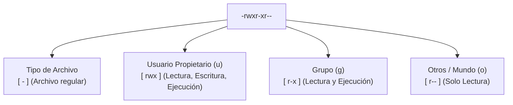

y aqui estas tu, configurando un servidor web, intentas subir una imagen o ejecutar un script recién creado, y la terminal te estampa un seco y tajante mensaje en la cara:

`bash: ./deploy.sh: Permission denied`

En ese instante de frustración, buscas en foros o le preguntas a un colega con prisas, y alguien suelta la infame frase: *"Ponle `chmod 777` a todo y listo, no se que hace pero con eso jala"* (basado en hechos reales).

Efectivamente, ejecutas el comando, el script corre mágicamente y sientes un alivio pasajero. Lo que muchos no te dicen es que acabas de resolver un problema de cerradura derribando la puerta principal de tu casa, bajandole los chones al servidor y colgando un letrero de bienvenida para cualquier intruso.

Linux fue diseñado desde sus cimientos como un sistema operativo multiusuario y multitarea. A diferencia de las computadoras personales de los años 80 donde una sola persona controlaba todo el hardware, en los servidores conviven decenas de servicios, demonios y usuarios simultáneos. Los permisos no son un capricho burocrático para hacerte la vida difícil; son las paredes y candados que evitan que un proceso comprometido tome el control absoluto de tu máquina.

En esta entrega vamos a desarmar el sistema de permisos de Linux pieza por pieza para que nunca más tengas que recurrir al peligroso `chmod 777`.

---

## La Radiografía de ls -l: Aprendiendo a leer los candados

Cuando ejecutas `ls -l` en cualquier directorio, la primera columna muestra una serie de 10 caracteres crípticos que parecen jeroglíficos para quien empieza. Desglosemos una línea típica:

```text
-rwxr-xr-- 1 luis developers 4096 Oct 28 10:00 app.sh
```

Esos 10 caracteres se leen de izquierda a derecha en cuatro bloques bien definidos:



1. **Primer carácter (El Tipo de Archivo):** En Linux casi todo se representa como un archivo, pero no todos los archivos son iguales (como vimos en nuestra [entrega sobre el árbol FHS](/blog/linux-esencial-06-arbol-directorios-fhs)). Este primer carácter identifica cuál de los 7 tipos fundamentales de objetos representa:
   * `-`: **Archivo regular** (documentos de texto, imágenes, ejecutables, scripts).
   * `d`: **Directorio** (carpetas que contienen otros archivos y directorios).
   * `l`: **Enlace simbólico** (*symlink*, un acceso directo que apunta a otro archivo o carpeta).
   * `b`: **Dispositivo de bloques** (*block device*, hardware que almacena o transfiere datos en bloques de tamaño fijo, como tus discos duros `/dev/sda` o `/dev/nvme0n1`).
   * `c`: **Dispositivo de caracteres** (*character device*, canales de hardware que procesan flujos de información byte por byte en tiempo real, como terminales `/dev/tty` o generadores de aleatoriedad `/dev/urandom`).
   * `s`: **Socket de dominio local** (*Unix socket*, canales de comunicación directa entre procesos en memoria sin pasar por la tarjeta de red, como `/var/run/docker.sock`).
   * `p`: **Tubería con nombre** (*named pipe* o FIFO, *First In First Out*, exactamente el mismo concepto de tubería que dominamos en [la entrega de tuberías y redirecciones](/blog/linux-esencial-07-tuberias-redirecciones), pero persistente en disco con `mkfifo`).

2. **Tríada de Usuario (`u` / Propietario):** Los siguientes 3 caracteres (`rwx`) definen lo que puede hacer la persona que creó o posee el archivo.
3. **Tríada de Grupo (`g`):** Los siguientes 3 caracteres (`r-x`) definen lo que pueden hacer los integrantes del grupo asignado (en este ejemplo, el grupo `developers`).
4. **Tríada de Otros (`o` / El resto del mundo):** Los últimos 3 caracteres (`r--`) definen los derechos de cualquier otra persona o servicio con una cuenta en el servidor.

---

## El Significado de r, w y x (Y la gran trampa de los directorios)

Cada letra representa una capacidad específica:

| Letra | Permiso | En un archivo normal | En un directorio (carpeta) |
|---|---|---|---|
| `r` | *Read* (Lectura) | Ver o leer el contenido del archivo. | Listar los archivos dentro de la carpeta con `ls`. |
| `w` | *Write* (Escritura) | Modificar o guardar cambios en el archivo. | Crear, renombrar o borrar archivos dentro de la carpeta. |
| `x` | *Execute* (Ejecución) | Ejecutarlo como un programa o script. | **Poder entrar a la carpeta con el comando `cd`**. |

> **protip >** ¡Cuidado con la trampa de los directorios! Muchos principiantes le dan permisos `rw-` a una carpeta pensando que con eso basta para trabajar. Si una carpeta no tiene permiso de ejecución (`x`), el sistema no te permitirá ingresar a ella con `cd`, ni acceder a los archivos que contiene, aunque tengas permiso de lectura sobre ellos.

---

## El Método Octal: La matemática simple detrás de chmod

Para modificar permisos utilizamos el comando `chmod` (*change mode*). Aunque puedes usar letras (`chmod +x script.sh`), en el mundo profesional de SysAdmin se utiliza el sistema numérico octal. Lejos de ser matemática compleja, se basa en una suma de tres valores fijos:

* **Lectura (`r`) = 4**
* **Escritura (`w`) = 2**
* **Ejecución (`x`) = 1**
* **Sin permiso (`-`) = 0**

Cada dígito de un comando `chmod` representa la suma de los permisos para una de las tres tríadas (Usuario, Grupo y Otros):

* `7` = 4 + 2 + 1 = `rwx` (Acceso total: leer, escribir y ejecutar).
* `6` = 4 + 2 + 0 = `rw-` (Lectura y escritura, típico de archivos de texto).
* `5` = 4 + 0 + 1 = `r-x` (Lectura y ejecución, sin escritura).
* `4` = 4 + 0 + 0 = `r--` (Solo lectura).
* `0` = 0 + 0 + 0 = `---` (Sin ningún acceso).

### Las dos combinaciones doradas de seguridad

En el 95% de los escenarios reales de un servidor, solo necesitas dos recetas:

1. **Para archivos estándar (documentos, configuraciones, imágenes): `644`**
   ```bash
   chmod 644 config.txt
   ```
   * *Usuario (6):* Lee y escribe (`rw-`).
   * *Grupo (4):* Solo lee (`r--`).
   * *Otros (4):* Solo lee (`r--`).

2. **Para scripts ejecutables y carpetas de navegación: `755`**
   ```bash
   chmod 755 mi_script.sh
   ```
   * *Usuario (7):* Control total (`rwx`).
   * *Grupo (5):* Lee y ejecuta (`r-x`).
   * *Otros (5):* Lee y ejecuta (`r-x`).

---

## ¿Por qué chmod 777 es una catástrofe en potencia?

Cuando aplicas `chmod 777`, estás asignando `rwxrwxrwx`:

* **Cualquier usuario** en la máquina puede leer la información (incluyendo claves o secretos en texto plano).
* **Cualquier proceso o demonio** puede modificar el archivo o inyectarle código malicioso.
* Si el archivo es un directorio con `777`, cualquier cuenta local o atacante que consiga acceso de bajo privilegio (por ejemplo a través del usuario de un servidor web comprometido) puede borrar o reemplazar archivos críticos sin pedir confirmación.

En auditorías de seguridad y entornos corporativos, encontrar archivos con permisos `777` es considerado una falta grave y una señal inmediata de mala práctica técnica.

> **protip >** Si sospechas que en tu sistema hay archivos con permisos excesivos regalados en el pasado, puedes usar el comando `find` (que aprendimos a dominar en [nuestra primera entrega](/blog/linux-esencial-01-basico-10-comandos)) combinado con redirección de errores (de [nuestra entrega de tuberías](/blog/linux-esencial-07-tuberias-redirecciones)) para cazarlos:
> ```bash
> find /var/www -type f -perm 0777 2>/dev/null
> ```

---

## Cambiando Propietarios y Grupos: chown y chgrp

A veces el problema de acceso no se resuelve cambiando los permisos, sino corrigiendo quién es el dueño del archivo. Si creaste un archivo como `root` usando `sudo`, tu usuario común no podrá editarlo aunque tenga permisos correctos.

Para cambiar el propietario y el grupo usamos `chown` (*change owner*):

```bash
# Cambiar solo el usuario propietario
sudo chown luis archivo.txt

# Cambiar el usuario y el grupo simultáneamente (la forma favorita en SysAdmin)
sudo chown luis:developers archivo.txt

# Aplicarlo a toda una carpeta y su contenido de forma recursiva (-R)
sudo chown -R luis:developers /var/www/proyecto
```

Y si solo necesitas cambiar el grupo sin tocar al usuario:

```bash
sudo chgrp developers archivo.txt
```

---

## Ctrl + D

Comprender el modelo de usuarios y permisos en Linux es la línea divisoria entre quien simplemente copia y pega comandos a ciegas y quien realmente administra un sistema con criterio y responsabilidad. Con `chmod 644`, `chmod 755` y un uso adecuado de `chown`, resolverás prácticamente cualquier conflicto de acceso de forma limpia, elegante y segura.

Con este artículo cerramos una trilogía fundamental: primero exploramos el mapa completo del sistema con el [árbol FHS](/blog/linux-esencial-06-arbol-directorios-fhs), luego aprendimos a conectar comandos como piezas de LEGO con [tuberías y flujos](/blog/linux-esencial-07-tuberias-redirecciones), y hoy aseguramos cada puerta con permisos certeros.

Revisa tus directorios, audita tus scripts y recuerda: **lo más importante es nunca dejar de preguntar**... y jamás regalar un 777 donde un 755 hace el trabajo con honor.
