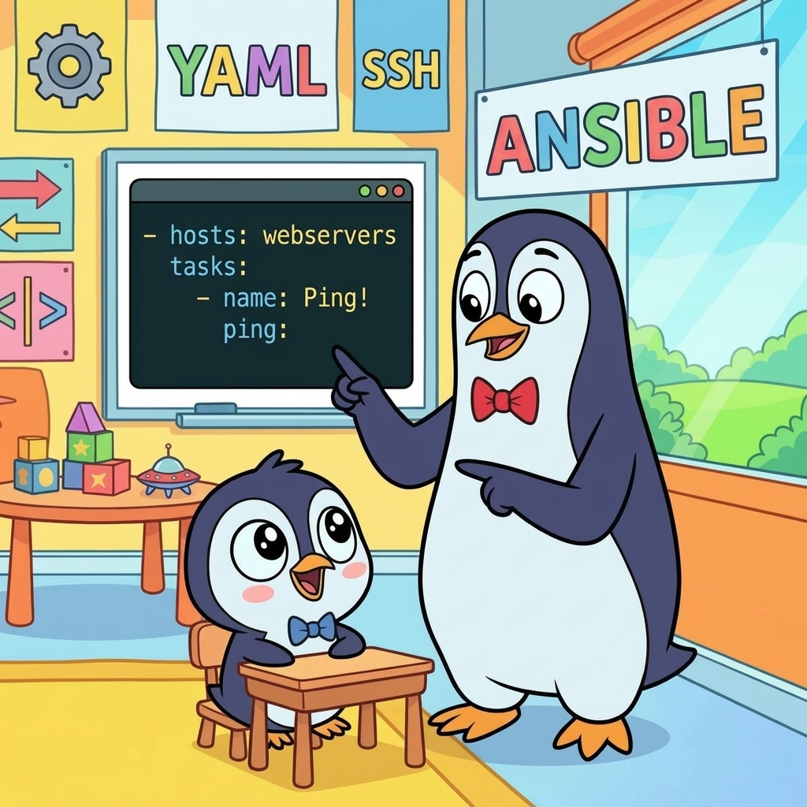
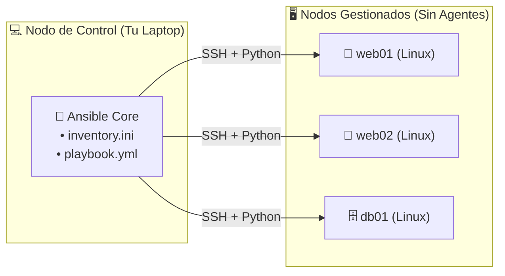

## 🚀 Introducción: De hacer scripts a gobernar servidores



**¡Bienvenido al siguiente nivel!** Si ya sobreviviste a la [Guía de Linux](/cheatsheets/linux-principiante) y ya diste tus primeros pasos automatizando tareas en una máquina con la [Guía de Bash Scripting](/cheatsheets/bash-scripting-principiante), tarde o temprano te vas a topar con una pared muy específica: **¿qué pasa cuando no tienes un servidor, sino cinco, diez o cincuenta?**

Imagínate la escena clásica: viernes a las 11 de la noche. Tienes que instalar una actualización urgente o cambiar un archivo de configuración en 8 servidores. Abres 8 pestañas en tu terminal, te conectas por SSH a cada una y empiezas a copiar y pegar comandos. Para el servidor número 6 ya tienes sueño, escribes mal una ruta, en el servidor 7 se te olvida reiniciar el servicio y el lunes por la mañana nadie sabe por qué producción se comporta de forma misteriosa.

A ese fenómeno en el mundo SysAdmin le llamamos **deriva de configuración** (*Configuration Drift*): tu infraestructura empieza a parecerse menos a un ejército uniformado y más a un grupo de personas que salieron a correr sin ponerse de acuerdo; todos más o menos hacen lo mismo, pero cada quien a su manera... y uno llegó disfrazado de gótico y nadie sabe por qué.

Ahí es donde entra **Ansible**.

Esta guía es nivel **principiante**: vamos a ir desde cero absoluto hasta que puedas controlar múltiples servidores desde la comodidad de tu propia terminal, escribiendo recetas claras, repetibles y a prueba de errores humanos.

### ¿Por qué Ansible y no solo un script de Bash con un bucle `for`?

Cuando escribes un script en Bash, le das a la computadora **pasos secuenciales** (*"haz esto, luego esto"*). Si corres ese mismo script dos veces seguidas, a veces duplica líneas en un archivo de configuración, vuelve a descargar cosas que ya estaban ahí o falla porque la carpeta ya existe.

Ansible funciona con una filosofía diferente llamada **Idempotencia** (palabra elegante para apantallar en reuniones, pero muy simple en la práctica):

* **En un script tradicional:** describes el **camino** paso a paso.
* **En Ansible:** describes el **estado deseado** (el destino).

Es como la diferencia entre ir cocina por cocina dándole instrucciones gritadas a cada cocinero versus entregarle a todos el **mismo libro de recetas**. Si le dices a Ansible *"asegúrate de que el paquete `nginx` esté instalado y el servicio corriendo"*, la primera vez lo instalará y lo encenderá. Si lo vuelves a ejecutar 5 minutos después (o 50 veces), Ansible revisará el servidor, verá que `nginx` ya está instalado y corriendo, y dirá: *"Aquí ya todo está como me pediste, no toco nada"*.

> **💡 Pro tip** > Esa propiedad de poder ejecutar un Playbook 1 o 100 veces y obtener exactamente el mismo resultado sin efectos secundarios se llama **idempotencia**. Es el superpoder que te permitirá dormir tranquilo los viernes por la noche.

### Arquitectura básica: ¿Cómo funciona la magia?

Una de las mejores cosas de Ansible es que es **Agentless** (sin agentes). No tienes que instalar ningún programa extraño ni demonios en segundo plano dentro de tus servidores.



Solo necesitas dos cosas en los servidores que vas a administrar (**Nodos Gestionados**):
1. **Acceso por SSH** (que ya tienes en cualquier servidor Linux).
2. **Python instalado** (que ya viene por defecto en casi todas las distribuciones modernas).

Ansible vive únicamente en tu máquina (**Nodo de Control**), se conecta por SSH, ejecuta pequeños módulos en Python y se desconecta sin dejar basura.

### Los 4 conceptos fundamentales

Antes de tocar una sola tecla, memoriza este mapa mental. Todo en Ansible gira alrededor de estas cuatro piezas:

| Concepto | ¿Qué es? | Analogía de cocina |
|----------|----------|--------------------|
| **Inventory** (`inventory.ini`) | La lista de tus servidores agrupados por función (`[webservers]`, `[databases]`). | La lista de sucursales o cocinas a las que les vas a mandar la orden. |
| **Playbook** (`playbook.yml`) | Un archivo escrito en **YAML** donde describes el estado deseado de tus servidores. | El libro de recetas detallado. |
| **Task** (Tarea) | Una acción individual dentro del Playbook (ej. *"Instalar Nginx"*, *"Abrir puerto 80"*). | Un paso específico de la receta. |
| **Module** (Módulo) | La herramienta interna que Ansible usa para ejecutar la tarea (`dnf`, `apt`, `copy`, `service`, `user`). | El utensilio de cocina (sartén, cuchillo, horno) que ya sabe hacer el trabajo sucio. |

---

## 🛠️ Instalación y Preparación SSH: El terreno de juego

Como vimos arriba, **solo instalas Ansible en tu máquina de control** (tu laptop o servidor central de administración). Tus servidores objetivo ni se enteran hasta que te conectas a ellos.

### Instalar Ansible (Solo en tu máquina)

Abre tu terminal y ejecuta el comando según tu distribución favorita:

```bash
# En Fedora / RHEL / CentOS Stream / AlmaLinux / Rocky Linux
sudo dnf install ansible -y

# En Debian / Ubuntu / Linux Mint
sudo apt update && sudo apt install ansible -y

# En Arch Linux
sudo pacman -S ansible
```

Verifica que todo quedó listo:

```bash
ansible --version
```

**Salida típica**:
```text
ansible [core 2.17.x]
  config file = None
  configured module search path = ['/home/pereidax86/.ansible/plugins/modules', '/usr/share/ansible/plugins/modules']
  python version = 3.12.x (/usr/bin/python3)
```

| Nivel de peligro | 🟢 **Seguro** — Solo instala la herramienta en tu equipo local |
|------------------|----------------------------------------------------------------|

### Preparar llaves SSH (Adiós a teclear contraseñas)

Ansible se conecta por SSH. Si tienes 10 servidores y no configuras llaves SSH, tendrías que escribir tu contraseña 10 veces cada vez que corras un comando. Eso destruye el propósito de automatizar.

**Paso 1: Genera tu par de llaves SSH** (si aún no tienes una):

```bash
ssh-keygen -t ed25519 -C "ansible-control"
```
*(Presiona `Enter` para aceptar la ruta por defecto `~/.ssh/id_ed25519`).*

**Paso 2: Copia tu llave pública a cada servidor que vayas a administrar**:

```bash
ssh-copy-id usuario@192.168.1.10
ssh-copy-id usuario@192.168.1.11
```

**Paso 3: Prueba que puedes entrar sin contraseña**:

```bash
ssh usuario@192.168.1.10 "hostname && uptime"
```

Si te devuelve el nombre del servidor sin pedirte contraseña (o usando tu `ssh-agent`), ya estás del otro lado.

> **💡 Pro tip** > Usa siempre llaves `ed25519` (`-t ed25519`). Son más cortas, más rápidas y criptográficamente más seguras que las viejas llaves RSA de 2048 bits.

### `ansible.cfg`: Tu archivo de configuración local

Aunque Ansible tiene un archivo global en `/etc/ansible/ansible.cfg`, **la buena práctica profesional** es crear una carpeta para tu proyecto y poner adentro tu propio `ansible.cfg`. Si Ansible detecta un `ansible.cfg` en tu directorio actual, lo usa automáticamente e ignora el global.

```bash
mkdir ~/mi-primer-ansible && cd ~/mi-primer-ansible
```

Crea el archivo `ansible.cfg`:

```ini
# ansible.cfg - Configuración local del proyecto
[defaults]
inventory = ./inventory.ini
remote_user = fedora
host_key_checking = False
retry_files_enabled = False

[privilege_escalation]
become = False
become_method = sudo
become_user = root
```

**¿Qué hace cada línea?**
* `inventory = ./inventory.ini`: Te ahorra tener que escribir `-i inventory.ini` en cada comando.
* `remote_user = fedora`: Define el usuario SSH por defecto (cámbialo por `ubuntu`, `debian`, `rocky` o tu usuario).
* `host_key_checking = False`: Evita que Ansible se detenga preguntando *"Are you sure you want to continue connecting (yes/no)?"* en laboratorios de prueba. *(Nota: en producción crítica conviene mantenerlo en `True` o gestionar `known_hosts`).*

#### 💪 Ejercicio 1: Preparando tu nodo de control

| Nivel de peligro | 🟢 **Bajo** — Solo creas una carpeta de trabajo y verificas tu versión |
|------------------|------------------------------------------------------------------------|

**Reto**: Crea un directorio llamado `laboratorio-ansible`, entra en él, crea un archivo `ansible.cfg` que apunte a `./inventory.ini` y verifica con `ansible --version` que Ansible está leyendo tu nuevo archivo de configuración (y no `None`).

<details>
<summary><strong>✅ Solución</strong> (haz clic para ver)</summary>

```bash
# 1. Crear directorio de proyecto y entrar
mkdir -p ~/laboratorio-ansible
cd ~/laboratorio-ansible

# 2. Crear ansible.cfg mínimo
cat > ansible.cfg << EOF
[defaults]
inventory = ./inventory.ini
retry_files_enabled = False
EOF

# 3. Verificar que Ansible detecta tu archivo local
ansible --version
```

**Salida esperada (fíjate en la segunda línea)**:
```text
ansible [core 2.17.x]
  config file = /home/pereidax86/laboratorio-ansible/ansible.cfg
```

**¡Bingo!** Cuando `config file` muestra la ruta de tu carpeta actual, tienes control total del proyecto.

</details>

---

## 📋 El Inventario: Tu agenda de servidores

Ansible necesita saber qué servidores existen y cómo conectarse a ellos. Esa lista vive en el **Inventario**. Aunque puede escribirse en YAML, el formato **INI** (`inventory.ini`) es el más directo, legible y universal para empezar.

### Formato INI (`inventory.ini`)

En un archivo `inventory.ini`, los nombres entre corchetes `[grupo]` definen categorías lógicas de servidores. Un mismo servidor puede pertenecer a varios grupos si lo necesitas.

```ini
# inventory.ini - Mi infraestructura

[webservers]
web01 ansible_host=192.168.1.10
web02 ansible_host=192.168.1.11
web03 ansible_host=192.168.1.12

[databases]
db01 ansible_host=192.168.1.20 ansible_port=2222

[staging]
staging01 ansible_host=10.0.0.5 ansible_user=ubuntu
```

**Parámetros de conexión más usados en el inventario**:

| Parámetro | Qué indica | Ejemplo |
|-----------|------------|---------|
| `ansible_host` | La dirección IP o dominio real al que se conectará SSH | `ansible_host=192.168.1.10` |
| `ansible_user` | El usuario SSH para ese servidor | `ansible_user=fedora` |
| `ansible_port` | El puerto SSH (si no es el 22 por defecto) | `ansible_port=2222` |
| `ansible_ssh_private_key_file` | Ruta a la llave privada específica para ese host | `ansible_ssh_private_key_file=~/.ssh/id_ed25519` |
| `ansible_connection` | Tipo de conexión (`ssh` por defecto, o `local` para tu propia máquina) | `ansible_connection=local` |

> **💡 Pro tip** > ¿No tienes servidores extra ni máquinas virtuales a la mano para practicar hoy? ¡Puedes usar tu propia computadora como conejillo de indias! Agrega esta línea a tu `inventory.ini` y podrás correr comandos de Ansible contra tu propia máquina sin siquiera usar SSH:
> ```ini
> [local]
> mi_pc ansible_connection=local
> ```

### Variables de inventario (`[all:vars]`)

Si todos tus servidores comparten una configuración (por ejemplo, el mismo usuario SSH o la ruta de Python), no la repitas en cada línea. Usa un bloque `:vars`:

```ini
[webservers]
web01 ansible_host=192.168.1.10
web02 ansible_host=192.168.1.11

[databases]
db01 ansible_host=192.168.1.20

# Variables que aplican solo al grupo webservers
[webservers:vars]
http_port=80

# Variables globales para TODOS los grupos
[all:vars]
ansible_user=fedora
ansible_python_interpreter=/usr/bin/python3
```

### `ansible-inventory`: Verificar tu inventario

Antes de lanzar comandos a ciegas, puedes pedirle a Ansible que te dibuje un árbol de tu inventario para confirmar que no cometiste errores de sintaxis:

```bash
# Ver el árbol visual de grupos y servidores
ansible-inventory -i inventory.ini --graph

# Ver el árbol incluyendo las variables de cada servidor
ansible-inventory -i inventory.ini --graph --vars

# Ver toda la estructura compilada en formato JSON
ansible-inventory -i inventory.ini --list
```

**Salida de `ansible-inventory --graph`**:
```text
@all:
  |--@ungrouped:
  |--@webservers:
  |  |--web01
  |  |--web02
  |  |--web03
  |--@databases:
  |  |--db01
  |--@staging:
  |  |--staging01
```

| Nivel de peligro | 🟢 **Seguro** — Solo lee tu archivo `inventory.ini`, no se conecta a ningún servidor |
|------------------|--------------------------------------------------------------------------------------|

#### 💪 Ejercicio 2: Tu primer inventario organizado

**Reto**: Crea un archivo `inventory.ini` con dos grupos: `[local]` (con tu propia máquina usando `ansible_connection=local`) y `[laboratorio]` (con dos servidores ficticios `srv01` en `192.168.56.10` y `srv02` en `192.168.56.11`). Luego visualiza el árbol con `ansible-inventory --graph`.

<details>
<summary><strong>✅ Solución</strong> (haz clic para ver)</summary>

```bash
# 1. Crear el archivo inventory.ini
cat > inventory.ini << EOF
[local]
localhost ansible_connection=local

[laboratorio]
srv01 ansible_host=192.168.56.10
srv02 ansible_host=192.168.56.11

[laboratorio:vars]
ansible_user=admin
EOF

# 2. Verificar el árbol
ansible-inventory -i inventory.ini --graph
```

**Salida esperada**:
```text
@all:
  |--@ungrouped:
  |--@local:
  |  |--localhost
  |--@laboratorio:
  |  |--srv01
  |  |--srv02
```

</details>

### 🏆 Desafío: El Arquitecto del Inventario

| Dificultad | 🟢 **Principiante** — Diseño de inventario INI, grupos, puertos personalizados y variables por grupo |
|------------|------------------------------------------------------------------------------------------------------|

**Situación Real**: Acabas de entrar a una empresa que tiene 3 servidores web (`10.10.1.11` al `13`) que usan el usuario `rocky`, y 2 servidores de base de datos (`10.10.2.21` y `22`) que por seguridad tienen el puerto SSH en el `2200` y usan el usuario `dbadmin`.

**Tu Misión**:
1. Escribe un archivo `inventario_empresa.ini` limpio sin repetir el usuario ni el puerto en cada línea de servidor (usa bloques `:vars`).
2. Comprueba con `ansible-inventory -i inventario_empresa.ini --graph --vars` que cada servidor heredó las variables correctas.

<details>
<summary><strong>✅ Solución</strong></summary>

```ini
# inventario_empresa.ini
[webservers]
web01 ansible_host=10.10.1.11
web02 ansible_host=10.10.1.12
web03 ansible_host=10.10.1.13

[webservers:vars]
ansible_user=rocky

[databases]
db01 ansible_host=10.10.2.21
db02 ansible_host=10.10.2.22

[databases:vars]
ansible_user=dbadmin
ansible_port=2200

[all:vars]
ansible_python_interpreter=/usr/bin/python3
```

**Comando de verificación**:
```bash
ansible-inventory -i inventario_empresa.ini --graph --vars
```

**Resultado**: Limpio, escalable y si mañana agregan `web04`, solo escribes una línea y automáticamente hereda el usuario `rocky`.

</details>

---

## ⚡ Comandos Ad-Hoc: Dispara primero, escribe YAML después

No siempre necesitas escribir un archivo Playbook completo. A veces solo quieres saber cuánto espacio libre en disco les queda a todos tus servidores, reiniciar un servicio rebelde ahora mismo o comprobar si todos responden.

Para esas tareas rápidas de una sola línea existen los **Comandos Ad-Hoc**.

### Anatomía de un comando Ad-Hoc

```bash
ansible webservers -i inventory.ini -m service -a "name=nginx state=restarted" --become
│       │          │                │          │                               └─ Escalar a root (sudo)
│       │          │                │          └─ Argumentos para el módulo (-a)
│       │          │                └──────────── Módulo que vas a usar (-m)
│       │          └───────────────────────────── Archivo de inventario (-i)
│       └──────────────────────────────────────── Objetivo: grupo, servidor o 'all'
└──────────────────────────────────────────────── Ejecutable de comandos ad-hoc
```

> **💡 Pro tip** > Si no especificas `-m <módulo>`, Ansible usa por defecto el módulo `command`. Es decir, `ansible all -a "uptime"` equivale exactamente a `ansible all -m command -a "uptime"`.

### `ping`: ¿Están vivos mis servidores?

El "Hola Mundo" oficial de Ansible. Verifica que tu inventario está bien escrito, que SSH conecta sin problemas y que Python funciona en los servidores destino.

```bash
# Probar conexión con TODOS los servidores del inventario
ansible all -i inventory.ini -m ping

# Probar solo el grupo webservers
ansible webservers -i inventory.ini -m ping

# Probar solo un servidor específico
ansible web01 -i inventory.ini -m ping
```

**Salida exitosa**:
```json
web01 | SUCCESS => {
    "changed": false,
    "ping": "pong"
}
web02 | SUCCESS => {
    "changed": false,
    "ping": "pong"
}
```

> **⚠️ ADVERTENCIA**: El módulo `ping` de Ansible **NO es un ping de red (ICMP)** como el comando `ping 8.8.8.8` de tu terminal. El módulo `ping` de Ansible abre una sesión SSH real, ejecuta un pequeño script en Python del otro lado y te responde `"pong"`. Si ves `"pong"`, tienes garantía total de que puedes automatizar ese servidor.

### `command` y `shell`: Comandos rápidos en flota

Cuando quieres correr un comando tradicional de Linux en 1 o 50 máquinas al mismo tiempo:

```bash
# Ver espacio en disco en todos los servidores
ansible all -i inventory.ini -m command -a "df -h"

# Ver memoria RAM libre en el grupo databases
ansible databases -i inventory.ini -m command -a "free -h"

# Ver versión del kernel y cuánto tiempo llevan encendidos
ansible all -i inventory.ini -a "uname -r"
ansible all -i inventory.ini -a "uptime"
```

**¿Cuál es la diferencia entre `-m command` y `-m shell`?**

| Módulo | ¿Cómo funciona? | ¿Soporta pipes `\|`, `>`, `&&`, `$VAR`? | Seguridad |
|--------|-----------------|----------------------------------------|-----------|
| `command` *(default)* | Ejecuta el binario directamente sin pasar por un shell. | ❌ **No** (trata `\|` o `>` como texto literal) | 🟢 **Más seguro** (inmune a inyección de shell) |
| `shell` | Abre `/bin/sh` en el servidor y ejecuta la línea completa. | ✅ **Sí** (`df -h \| grep sda`, `echo $HOME`) | 🟡 **Úsalo solo cuando necesites pipes o redirecciones** |

**Ejemplo donde necesitas `-m shell`**:
```bash
# Usar pipes (|) requiere -m shell
ansible webservers -i inventory.ini -m shell -a "ps aux | grep nginx"
```

### Gestión rápida de paquetes, servicios y usuarios

La verdadera magia de los comandos Ad-Hoc es usar módulos idempotentes con la bandera `--become` (o `-b` para abreviar), que equivale a usar `sudo`:

```bash
# Instalar htop en todos los servidores (Fedora/RHEL)
ansible all -i inventory.ini -m dnf -a "name=htop state=present" --become

# Instalar htop en todos los servidores (Debian/Ubuntu)
ansible all -i inventory.ini -m apt -a "name=htop state=present" --become

# Parche de emergencia: actualizar openssl a la última versión en toda la flota
ansible all -i inventory.ini -m dnf -a "name=openssl state=latest" --become

# Reiniciar nginx en todos los servidores web
ansible webservers -i inventory.ini -m service -a "name=nginx state=restarted" --become

# Crear un usuario de emergencia en los servidores de base de datos
ansible databases -i inventory.ini -m user -a "name=auditor state=present" --become
```

> **💡 Pro tip** > Si tu usuario remoto en los servidores requiere contraseña cuando ejecuta `sudo`, agrega la bandera `-K` (mayúscula, equivale a `--ask-become-pass`) al final de tu comando: `ansible all -m dnf -a "name=vim state=present" -b -K`.

#### 💪 Ejercicio 3: Auditoría relámpago con Ad-Hoc

| Nivel de peligro | 🟢 **Seguro** — Comandos de solo lectura contra tu máquina local |
|------------------|------------------------------------------------------------------|

**Reto**: Usando el grupo `[local]` que creaste en el Ejercicio 2 (`localhost ansible_connection=local`), ejecuta tres comandos Ad-Hoc para:
1. Recibir un `"pong"` con el módulo `ping`.
2. Consultar el espacio libre en `/` con `df -h /`.
3. Ver las últimas 5 líneas de `/etc/passwd` usando `-m shell` y un pipe (`|`).

<details>
<summary><strong>✅ Solución</strong> (haz clic para ver)</summary>

```bash
# 1. Probar conectividad Ansible
ansible local -i inventory.ini -m ping

# 2. Ver espacio en disco en la raíz
ansible local -i inventory.ini -m command -a "df -h /"

# 3. Usar un pipe con el módulo shell
ansible local -i inventory.ini -m shell -a "cat /etc/passwd | tail -n 5"
```

</details>

### 🏆 Desafío: El Bombero de Viernes por la Noche

| Dificultad | 🟢 **Principiante** — Comandos Ad-Hoc con módulos `dnf`/`apt`, `service` y escalación `--become` |
|------------|--------------------------------------------------------------------------------------------------|

**Situación Real**: Se acaba de anunciar una vulnerabilidad crítica en `curl`. Tu líder técnico te pide saber qué versión de `curl` tienen instalada todos los servidores, actualizar el paquete `curl` a la última versión en toda la flota y finalmente reiniciar el servicio `sshd` en el grupo `webservers`. No tienes tiempo de escribir un Playbook.

**Tu Misión**: Escribe los 3 comandos Ad-Hoc exactos para resolver la emergencia en menos de 60 segundos.

<details>
<summary><strong>✅ Solución</strong></summary>

```bash
# 1. Revisar qué versión de curl tiene cada servidor actualmente
ansible all -i inventory.ini -m command -a "curl --version"

# 2. Actualizar curl a la última versión disponible (con privilegios sudo)
# En RHEL/Fedora:
ansible all -i inventory.ini -m dnf -a "name=curl state=latest" --become
# (O en Debian/Ubuntu: -m apt -a "name=curl state=latest update_cache=yes" --become)

# 3. Reiniciar sshd únicamente en el grupo webservers
ansible webservers -i inventory.ini -m service -a "name=sshd state=restarted" --become
```

**Resultado**: En 3 líneas auditaste, parchaste y reiniciaste servicios en toda tu infraestructura sin abrir una sola sesión interactiva de SSH.

</details>

---

## 📜 Playbooks YAML: Tus recetas de cocina

Los comandos Ad-Hoc son geniales para apagar incendios rápidos, pero si quieres construir infraestructura reproducible y guardarla en Git, necesitas **Playbooks**.

Un Playbook es un archivo de texto con extensión `.yml` o `.yaml` donde defines, paso a paso, cómo debe lucir tu servidor.

### Reglas de supervivencia en YAML

YAML (*YAML Ain't Markup Language*) es muy fácil de leer para humanos, pero igual que Python, **la indentación (los espacios al inicio de cada línea) tiene significado**. Si te equivocas por un solo espacio, Ansible te gritará.

Memoriza estas 4 reglas y te ahorrarás el 95% de los dolores de cabeza:

1. **PROHIBIDO usar la tecla `Tab` (Tabulador):** YAML solo acepta espacios normales. Configura tu editor (`vim` o `VS Code`) para que al presionar `Tab` inserte **2 espacios**.
2. **Usa siempre 2 espacios por nivel de indentación:** Los elementos que están al mismo nivel deben estar alineados en la misma columna.
3. **Espacio obligatorio después de los dos puntos (`:`):**
   * ✅ `name: Instalar nginx` (Correcto)
   * ❌ `name:Instalar nginx` (Error de sintaxis)
4. **Cuando uses `{{ variables }}` o caracteres especiales (`:`, `*`), pon el valor entre comillas dobles (`"`):**
   * ✅ `msg: "Hola {{ usuario }}: bienvenido"`
   * ❌ `msg: {{ usuario }}` (YAML piensa que `{` es un diccionario y explota)

```yaml
# --- Mini plantilla visual de YAML ---
---                                    # Inicio del documento YAML (opcional pero buena práctica)
- name: Nombre de la jugada (Play)     # El guion '-' indica un elemento de una lista
  hosts: webservers                    # A qué grupo del inventario aplica
  become: yes                          # Ejecutar tareas como root (sudo)

  tasks:                               # Lista de tareas a ejecutar en orden
    - name: 1.Primera tarea            # Tarea 1 (indentada a 4 espacios)
      ansible.builtin.ping:            # Módulo que usa esta tarea (indentado a 6 espacios)
```

> **💡 Pro tip** > En versiones modernas de Ansible verás tanto el nombre corto del módulo (`dnf:`, `copy:`, `service:`) como su nombre completo **FQCN** (*Fully Qualified Collection Name*: `ansible.builtin.dnf:`, `ansible.builtin.copy:`). **Ambos funcionan exactamente igual** para los módulos base. Puedes empezar con los nombres cortos para aprender rápido.

### Tu primer Playbook paso a paso

Vamos a crear un archivo llamado `setup-web.yml` que convierte cualquier servidor Linux recién instalado en un servidor web funcional con Nginx y una página personalizada:

```yaml
---
# setup-web.yml - Mi primer Playbook de Ansible
- name: Configurar servidores web con Nginx
  hosts: webservers
  become: yes

  tasks:
    - name: 1. Asegurar que Nginx está instalado
      dnf:
        name: nginx
        state: present

    - name: 2. Asegurar que el directorio web existe con permisos correctos
      file:
        path: /usr/share/nginx/html
        state: directory
        owner: root
        group: root
        mode: "0755"

    - name: 3. Desplegar nuestra página de inicio personalizada
      copy:
        content: |
          <!DOCTYPE html>
          <html>
          <head><title>Servidor Automatizado</title></head>
          <body style="font-family: monospace; background: #111; color: #0f0; padding: 2rem;">
            <h1>🚀 Servidor configurado con Ansible por @pereidax86</h1>
            <p>Si estás viendo esto, no tuve que entrar por SSH manualmente.</p>
          </body>
          </html>
        dest: /usr/share/nginx/html/index.html
        mode: "0644"

    - name: 4. Asegurar que Nginx está iniciado y habilitado al arranque
      service:
        name: nginx
        state: started
        enabled: yes
```

*(Nota: si tus servidores son Ubuntu/Debian, solo cambia `dnf:` por `apt:` en la tarea 1 y `/usr/share/nginx/html` por `/var/www/html`).*

### `ansible-playbook`: Ejecutando la magia

Para correr un Playbook ya no usamos el comando `ansible`, sino su hermano mayor **`ansible-playbook`**:

```bash
# Ejecutar el playbook
ansible-playbook -i inventory.ini setup-web.yml

# Si configuraste tu ansible.cfg local, ni siquiera necesitas poner -i:
ansible-playbook setup-web.yml
```

**Salida en terminal**:
```text
PLAY [Configurar servidores web con Nginx] *************************************

TASK [Gathering Facts] *********************************************************
ok: [web01]
ok: [web02]

TASK [1. Asegurar que Nginx está instalado] ************************************
changed: [web01]
changed: [web02]

TASK [2. Asegurar que el directorio web existe con permisos correctos] *********
ok: [web01]
ok: [web02]

TASK [3. Desplegar nuestra página de inicio personalizada] *********************
changed: [web01]
changed: [web02]

TASK [4. Asegurar que Nginx está iniciado y habilitado al arranque] ************
changed: [web01]
changed: [web02]

PLAY RECAP *********************************************************************
web01  : ok=5  changed=3  unreachable=0  failed=0  skipped=0  rescued=0  ignored=0
web02  : ok=5  changed=3  unreachable=0  failed=0  skipped=0  rescued=0  ignored=0
```

### El semáforo de Ansible: Entendiendo la salida

Al final de cada ejecución verás el **`PLAY RECAP`**. Entender sus colores y contadores es vital para cualquier SysAdmin:

| Estado | Color | Qué significa |
|--------|-------|---------------|
| **`ok`** | 🟢 **Verde** | El servidor **ya estaba** en el estado deseado. Ansible verificó y no tuvo que modificar nada. |
| **`changed`** | 🟡 **Amarillo** | El servidor **no estaba** en el estado deseado y Ansible **hizo cambios reales** para dejarlo listo. |
| **`failed`** | 🔴 **Rojo** | Algo falló en esa tarea. Ansible detiene la ejecución para ese servidor (los demás continúan). |
| **`unreachable`** | 🔴 **Rojo** | No se pudo conectar por SSH al servidor (IP apagada, firewall o llave SSH incorrecta). |
| **`skipped`** | 🔵 **Cian** | La tarea tenía una condición (`when:`) que no se cumplió, así que se saltó limpiamente. |

> **💡 Pro tip** > **El ritual de la segunda ejecución:** Cada vez que termines de escribir un Playbook nuevo y lo ejecutes por primera vez, **vuélvelo a ejecutar inmediatamente una segunda vez**. En esa segunda corrida, todas las tareas bien diseñadas deben salir en verde (`ok`) y el contador debe marcar **`changed=0`**. Si en la segunda ejecución algo sigue saliendo en amarillo (`changed`), significa que tu tarea no es del todo idempotente (por ejemplo, usaste `command` o `shell` en vez de un módulo nativo).

#### 💪 Ejercicio 4: El ritual de la idempotencia

| Nivel de peligro | 🟢 **Bajo** — Crea una carpeta y un archivo dentro de `/tmp` en tu máquina local |
|------------------|----------------------------------------------------------------------------------|

**Reto**: Crea un Playbook llamado `prueba-local.yml` que apunte a `hosts: local` (sin `become: yes`), cree el directorio `/tmp/ansible-demo` y guarde adentro un archivo `/tmp/ansible-demo/hola.txt` con el texto `"Automatizado con éxito"`. Córrelo **dos veces seguidas** y observa cómo cambia el `PLAY RECAP`.

<details>
<summary><strong>✅ Solución</strong> (haz clic para ver)</summary>

```yaml
---
# prueba-local.yml
- name: Mi primera prueba de idempotencia local
  hosts: local
  gather_facts: no

  tasks:
    - name: 1. Crear carpeta de demostración en /tmp
      file:
        path: /tmp/ansible-demo
        state: directory
        mode: "0755"

    - name: 2. Crear archivo de bienvenida
      copy:
        content: "Automatizado con éxito por {{ lookup('env', 'USER') }}\n"
        dest: /tmp/ansible-demo/hola.txt
        mode: "0644"
```

**Ejecución**:
```bash
# Primera ejecución → Verás changed=2 (amarillo)
ansible-playbook -i inventory.ini prueba-local.yml

# Segunda ejecución → Verás ok=2, changed=0 (todo verde)
ansible-playbook -i inventory.ini prueba-local.yml

# Verificar que el archivo existe
cat /tmp/ansible-demo/hola.txt
```

</details>

### 🏆 Desafío: Tu primer servidor web automatizado

| Dificultad | 🟡 **Intermedio** — Playbook completo con paquetes, archivos, servicios y verificación con `uri` |
|------------|--------------------------------------------------------------------------------------------------|

**Situación Real**: Necesitas escribir un Playbook llamado `desplegar-web.yml` que no solo instale y arranque `nginx`, sino que al final haga una petición HTTP real a `http://localhost` desde el propio Playbook para verificar que el servidor responde con código `200 OK` antes de cantar victoria.

**Tu Misión**: Escribe el Playbook agregando una última tarea con el módulo `uri` que compruebe `url: "http://localhost"` y `status_code: 200`.

<details>
<summary><strong>✅ Solución</strong></summary>

```yaml
---
# desplegar-web.yml
- name: Desplegar y verificar servidor web Nginx
  hosts: webservers
  become: yes

  tasks:
    - name: 1. Instalar Nginx
      dnf:
        name: nginx
        state: present

    - name: 2. Crear página index.html
      copy:
        content: "<h1>Servidor Web Operativo</h1>\n"
        dest: /usr/share/nginx/html/index.html
        mode: "0644"

    - name: 3. Iniciar y habilitar el servicio Nginx
      service:
        name: nginx
        state: started
        enabled: yes

    - name: 4. Healthcheck automático (Verificar código HTTP 200)
      uri:
        url: "http://localhost"
        status_code: 200
```

**Por qué esto es nivel profesional**: Si por alguna razón Nginx arrancó pero devuelve un error `500` o `403`, la tarea 4 fallará en rojo y te enterarás de inmediato, no cuando te llame un usuario enojado.

</details>

---

## 🧰 Los Módulos Esenciales: Tu caja de herramientas

Ansible incluye cientos de módulos listos para usar, pero la realidad es que con **estos 10 módulos dominarás el 90% de las tareas diarias** de administración de servidores Linux:

| Módulo | Para qué sirve | Estado más común (`state`) |
|--------|----------------|----------------------------|
| **`dnf` / `apt` / `package`** | Instalar, actualizar o desinstalar paquetes del sistema | `present`, `latest`, `absent` |
| **`service` / `systemd`** | Iniciar, detener, reiniciar o habilitar demonios al arranque | `started`, `stopped`, `restarted`, `reloaded` |
| **`file`** | Crear directorios, enlaces simbólicos, borrar archivos o cambiar permisos | `directory`, `file`, `link`, `absent` |
| **`copy`** | Copiar archivos estáticos del nodo de control al servidor (o inyectar texto) | *(implícito: crea/actualiza el archivo)* |
| **`template`** | Copiar plantillas dinámicas `.j2` sustituyendo variables | *(implícito)* |
| **`lineinfile`** | Asegurar que una línea específica exista (o no) dentro de un archivo de config | `present`, `absent` |
| **`user`** | Crear, modificar o eliminar cuentas de usuario | `present`, `absent` |
| **`authorized_key`** | Agregar o revocar llaves SSH públicas en `~/.ssh/authorized_keys` | `present`, `absent` |
| **`firewalld` / `ufw`** | Abrir o cerrar puertos en el firewall del servidor | `enabled`, `disabled` |
| **`debug`** | Imprimir mensajes o el valor de variables en pantalla | *(no modifica el servidor)* |

Veamos cómo se escriben los más importantes en tus Playbooks:

### `dnf` / `apt`: Instalar y actualizar paquetes

Puedes instalar un paquete individual o pasarle una **lista completa** para que Ansible los instale todos en una sola transacción rápida:

```yaml
    # En Fedora / RHEL / Rocky / AlmaLinux
    - name: Instalar herramientas esenciales de SysAdmin
      dnf:
        name:
          - vim
          - git
          - htop
          - curl
          - tmux
        state: present

    # En Debian / Ubuntu (con actualización de caché de repositorios)
    - name: Instalar paquetes en Ubuntu
      apt:
        name:
          - vim
          - git
          - htop
        state: present
        update_cache: yes
        cache_valid_time: 3600   # No actualiza caché si tiene menos de 1 hora

    # Eliminar un paquete que no debería estar ahí
    - name: Desinstalar telnet por seguridad
      dnf:
        name: telnet
        state: absent
```

> **💡 Pro tip** > Si administras una mezcla de servidores Ubuntu y Fedora y quieres instalar paquetes cuyos nombres son idénticos en ambas distros (como `vim`, `git`, `htop`, `nginx`), puedes usar el módulo genérico **`package:`** en lugar de `dnf:` o `apt:`. Ansible detectará automáticamente qué gestor de paquetes usa cada servidor.

### `service` / `systemd`: Controlar servicios

Nunca uses `command: systemctl start nginx` en un Playbook. Usa siempre el módulo `service` (o `systemd`), que verifica primero si el servicio ya está corriendo antes de hacer nada:

```yaml
    - name: Asegurar que Nginx está corriendo y arranca con el sistema
      service:
        name: nginx
        state: started
        enabled: yes

    - name: Recargar configuración de SSH sin cortar conexiones activas
      service:
        name: sshd
        state: reloaded
```

### `copy` y `file`: Archivos, carpetas y permisos

El dúo dinámico para gestionar el sistema de archivos:

```yaml
    # 1. Crear un directorio con dueño y permisos exactos
    - name: Crear directorio para la aplicación
      file:
        path: /opt/mi_app/config
        state: directory
        owner: www-data
        group: www-data
        mode: "0750"

    # 2. Copiar un archivo desde tu máquina hacia el servidor remoto
    - name: Subir archivo de configuración
      copy:
        src: ./archivos/app.conf
        dest: /opt/mi_app/config/app.conf
        owner: www-data
        group: www-data
        mode: "0640"
        backup: yes   # Crea una copia con fecha si el archivo ya existía y cambió

    # 3. Crear un enlace simbólico (symlink)
    - name: Crear acceso directo en /usr/local/bin
      file:
        src: /opt/mi_app/bin/ejecutable
        dest: /usr/local/bin/mi_app
        state: link

    # 4. Eliminar un archivo o carpeta peligrosa
    - name: Borrar archivo temporal
      file:
        path: /tmp/instalador_viejo.tar.gz
        state: absent
```

> **⚠️ ADVERTENCIA**: En YAML, escribe **siempre los permisos octales entre comillas** (`mode: "0644"`, `mode: "0755"`, `mode: "0600"`). Si escribes `mode: 0644` sin comillas, YAML puede interpretarlo como un número octal y convertirlo en un número decimal extraño al pasarlo a Python. Las comillas te salvan de ese dolor de cabeza.

### `lineinfile`: Editar configuraciones con bisturí

¿Necesitas cambiar una sola directiva dentro de `/etc/ssh/sshd_config` o `/etc/sysctl.conf` sin reemplazar todo el archivo? `lineinfile` busca una expresión regular (`regexp`) y garantiza que la línea quede exactamente como tú quieres:

```yaml
    - name: Deshabilitar el login directo de root por SSH
      lineinfile:
        path: /etc/ssh/sshd_config
        regexp: "^#?PermitRootLogin"
        line: "PermitRootLogin no"
        state: present
        backup: yes
        validate: "/usr/sbin/sshd -t -f %s"
```

| Nivel de peligro | 🟡 **Cuidado** — Un error en `sshd_config` puede dejarte fuera del servidor |
|------------------|-----------------------------------------------------------------------------|

> **💡 Pro tip** > Observa el parámetro `validate: "/usr/sbin/sshd -t -f %s"`. Antes de pisar el archivo real, Ansible prueba el cambio en un archivo temporal (`%s`) usando el validador oficial de SSH (`sshd -t`). Si escribiste algo inválido, Ansible aborta el cambio y tu archivo original queda intacto. También funciona de maravilla para editar `/etc/sudoers` con `validate: "visudo -cf %s"`.

### `user` y `authorized_key`: Usuarios y accesos

Cuando entra alguien nuevo al equipo o quieres crear tu usuario administrador en 20 servidores nuevos:

```yaml
    - name: Crear usuario administrador sysadmin
      user:
        name: pereidax86
        groups: wheel          # Usa 'sudo' en Debian/Ubuntu, 'wheel' en RHEL/Fedora
        append: yes            # Agrega al grupo sin borrarlo de sus otros grupos
        shell: /bin/bash
        create_home: yes
        state: present

    - name: Inyectar llave pública SSH al usuario
      authorized_key:
        user: pereidax86
        state: present
        key: "{{ lookup('file', '~/.ssh/id_ed25519.pub') }}"
```

### `debug`: Imprimir mensajes y variables

El `echo` o `console.log` de Ansible. Ideal para saber qué valor tiene una variable o mostrar información útil durante la ejecución:

```yaml
    - name: Mostrar mensaje informativo en pantalla
      debug:
        msg: "Configurando el servidor {{ inventory_hostname }} con éxito"
```

#### 💪 Ejercicio 5: Blindando un archivo de configuración con `lineinfile`

| Nivel de peligro | 🟢 **Bajo** — Trabajamos sobre un archivo de prueba en `/tmp/sshd_config_test` |
|------------------|--------------------------------------------------------------------------------|

**Reto**: Crea un archivo de prueba `/tmp/sshd_config_test` que contenga la línea `#PermitRootLogin yes`. Luego escribe un Playbook local que use `lineinfile` para cambiar esa línea a `PermitRootLogin no` creando un backup automático.

<details>
<summary><strong>✅ Solución</strong> (haz clic para ver)</summary>

```bash
# 1. Crear el archivo simulado de configuración SSH
cat > /tmp/sshd_config_test << EOF
Port 22
#PermitRootLogin yes
PasswordAuthentication yes
EOF
```

```yaml
---
# blindar-ssh-test.yml
- name: Practicar lineinfile sin miedo
  hosts: local
  gather_facts: no

  tasks:
    - name: Deshabilitar PermitRootLogin
      lineinfile:
        path: /tmp/sshd_config_test
        regexp: "^#?PermitRootLogin"
        line: "PermitRootLogin no"
        backup: yes
```

```bash
# 2. Ejecutar el Playbook
ansible-playbook -i inventory.ini blindar-ssh-test.yml

# 3. Verificar que la línea cambió y que ya no tiene el '#'
cat /tmp/sshd_config_test
```

**Salida de `cat /tmp/sshd_config_test`**:
```text
Port 22
PermitRootLogin no
PasswordAuthentication yes
```

</details>

---

## 🎛️ Variables, Facts y Plantillas: Playbooks inteligentes

Si escribes valores fijos (*hardcodeados*) dentro de tus tareas, tu Playbook solo servirá para un caso único. Las **variables**, los **facts** y las **plantillas Jinja2** son lo que hace que un mismo Playbook adapte su comportamiento según el servidor donde corre.

### Definir y usar variables (`{{ variable }}`)

En Ansible declaras variables en una sección `vars:` al principio de tu Playbook (o en archivos separados `group_vars/`) y las usas en cualquier parte envolviéndolas en dobles llaves **`{{ nombre_variable }}`**, que es la sintaxis del motor **Jinja2**:

```yaml
---
- name: Configurar aplicación web con variables
  hosts: webservers
  become: yes

  vars:
    app_name: "portal-intranet"
    http_port: 8080
    max_clients: 200
    paquetes_base:
      - nginx
      - git
      - curl

  tasks:
    - name: Instalar lista de paquetes desde variable
      dnf:
        name: "{{ paquetes_base }}"
        state: present

    - name: Crear directorio de la aplicación {{ app_name }}
      file:
        path: "/var/www/{{ app_name }}"
        state: directory
        mode: "0755"
```

**Sobrescribir variables desde la terminal con `-e` (`--extra-vars`)**:

¿Quieres cambiar el puerto o el entorno en el momento de ejecutar sin editar el archivo YAML? Usa `-e`. Las variables pasadas con `-e` tienen la **máxima prioridad** en Ansible y le ganan a cualquier otra definición:

```bash
ansible-playbook -i inventory.ini deploy.yml -e "http_port=9090 app_name=portal-qa"
```

### Ansible Facts (`setup`): Lo que Ansible ya sabe de tus servidores

¿Notaste que cada vez que corres un Playbook, antes de tu primera tarea aparece automáticamente **`TASK [Gathering Facts]`**?

En ese paso, Ansible ejecuta el módulo `setup` para inspeccionar cada servidor y recolectar cientos de datos reales de hardware, red y sistema operativo. Esos datos quedan disponibles automáticamente como variables listas para usar:

| Fact (Variable automática) | Qué contiene | Ejemplo de valor |
|----------------------------|--------------|------------------|
| `{{ inventory_hostname }}` | Nombre del servidor en tu `inventory.ini` | `web01` |
| `{{ ansible_hostname }}` | Hostname real configurado en el sistema | `prod-web-01` |
| `{{ ansible_distribution }}` | Nombre de la distribución Linux | `"Fedora"`, `"Ubuntu"`, `"Debian"`, `"Rocky"` |
| `{{ ansible_distribution_version }}` | Versión de la distribución | `"41"`, `"24.04"`, `"9.4"` |
| `{{ ansible_os_family }}` | Familia del sistema operativo | `"RedHat"`, `"Debian"` |
| `{{ ansible_default_ipv4.address }}` | Dirección IPv4 principal del servidor | `"192.168.1.10"` |
| `{{ ansible_memtotal_mb }}` | Memoria RAM total en Megabytes | `8192` |
| `{{ ansible_processor_vcpus }}` | Número de núcleos/vCPUs disponibles | `4` |

**Cómo explorar todos los facts de un servidor desde la terminal**:

```bash
# Ver absolutamente todos los facts de web01
ansible web01 -i inventory.ini -m setup | less

# Filtrar solo los facts relacionados con la memoria o distribución
ansible web01 -i inventory.ini -m setup -a "filter=*mem*"
ansible web01 -i inventory.ini -m setup -a "filter=ansible_distribution*"
```

**Combinar Facts con condicionales `when:`**:

Gracias a los *facts*, puedes usar `when:` para que una tarea se ejecute únicamente si el servidor cumple una condición (por ejemplo, si es de la familia RedHat o Debian):

```yaml
    - name: Instalar Apache en familia RedHat (Fedora/RHEL/Rocky)
      dnf:
        name: httpd
        state: present
      when: ansible_os_family == "RedHat"

    - name: Instalar Apache en familia Debian (Ubuntu/Debian)
      apt:
        name: apache2
        state: present
      when: ansible_os_family == "Debian"
```

### `template` y Jinja2 (`.j2`): Configuraciones dinámicas

Mientras el módulo `copy` sube un archivo tal cual sin tocar su contenido, el módulo **`template`** toma un archivo con extensión **`.j2`** (Jinja2), reemplaza todas las variables `{{ ... }}` y *facts* con los datos reales de cada servidor, y guarda el resultado final en el destino.

**1. Creas tu plantilla `nginx.conf.j2` en tu máquina**:

```nginx
# Archivo generado automáticamente por Ansible para {{ inventory_hostname }}
# Distribución: {{ ansible_distribution }} {{ ansible_distribution_version }}
# IP del servidor: {{ ansible_default_ipv4.address | default('127.0.0.1') }}

worker_processes {{ ansible_processor_vcpus }};

events {
    worker_connections 1024;
}

http {
    server {
        listen {{ http_port }};
        server_name {{ inventory_hostname }};
        root /var/www/{{ app_name }};
    }
}
```
*(Fíjate cómo `worker_processes` se ajusta solo al número exacto de CPUs de cada máquina).*

**2. La despliegas en tu Playbook con el módulo `template`**:

```yaml
    - name: Generar configuración personalizada de Nginx
      template:
        src: ./nginx.conf.j2
        dest: /etc/nginx/nginx.conf
        owner: root
        group: root
        mode: "0644"
```

### `handlers` y `notify`: Reiniciar solo cuando hace falta

Imagina que actualizas `nginx.conf` con `template`. Para que Nginx tome los cambios, necesitas reiniciar el servicio. Pero si pones una tarea normal de `service: state=restarted` al final del Playbook, **Nginx se reiniciará en cada ejecución aunque el archivo no haya cambiado**, rompiendo la idempotencia.

Para eso existen los **Handlers** (manejadores de eventos):
* Un **Handler** es una tarea especial que permanece dormida al final del Playbook.
* Solo despierta y se ejecuta al final del Playbook **si y solo si** una tarea que tiene `notify:` reportó un cambio real (`changed`).

```yaml
---
- name: Configurar Nginx con reinicio inteligente
  hosts: webservers
  become: yes

  vars:
    http_port: 80

  tasks:
    - name: Desplegar configuración de Nginx desde plantilla
      template:
        src: ./nginx.conf.j2
        dest: /etc/nginx/nginx.conf
        mode: "0644"
      notify: Reiniciar Nginx   # 👈 Solo avisa al handler si el archivo cambió

  handlers:
    - name: Reiniciar Nginx     # 👈 Debe llamarse EXACTAMENTE igual que en notify
      service:
        name: nginx
        state: restarted
```

> **💡 Pro tip** > Si 5 tareas diferentes modifican archivos y las 5 hacen `notify: Reiniciar Nginx`, Ansible no reinicia Nginx 5 veces. Es tan listo que espera a que terminen todas las tareas del Playbook y ejecuta el Handler **una sola vez al final**.

#### 💪 Ejercicio 6: Un reporte de sistema con Ansible Facts

| Nivel de peligro | 🟢 **Seguro** — Solo lee los *facts* de tu máquina local y genera un archivo en `/tmp` |
|------------------|----------------------------------------------------------------------------------------|

**Reto**: Crea un Playbook `reporte-facts.yml` que corra en `hosts: local` (con `gather_facts: yes`, que es el valor por defecto) y cree un archivo `/tmp/ficha_tecnica.txt` mostrando el nombre de la distribución, versión, núcleos de CPU y memoria RAM total de tu computadora.

<details>
<summary><strong>✅ Solución</strong> (haz clic para ver)</summary>

```yaml
---
# reporte-facts.yml
- name: Generar ficha técnica automática del equipo
  hosts: local

  tasks:
    - name: Guardar reporte de hardware y SO en /tmp/ficha_tecnica.txt
      copy:
        content: |
          =========================================
            FICHA TÉCNICA DE {{ inventory_hostname | upper }}
          =========================================
          Sistema Operativo : {{ ansible_distribution }} {{ ansible_distribution_version }}
          Familia SO        : {{ ansible_os_family }}
          Kernel            : {{ ansible_kernel }}
          vCPUs             : {{ ansible_processor_vcpus }} núcleos
          Memoria RAM Total : {{ ansible_memtotal_mb }} MB
          =========================================
        dest: /tmp/ficha_tecnica.txt
        mode: "0644"

    - name: Mostrar mensaje en consola
      debug:
        msg: "Reporte creado para {{ ansible_distribution }} con {{ ansible_memtotal_mb }} MB de RAM"
```

```bash
# Ejecutar y leer el resultado
ansible-playbook -i inventory.ini reporte-facts.yml
cat /tmp/ficha_tecnica.txt
```

</details>

### 🏆 Desafío: El Mensaje del Día (`/etc/motd`) Dinámico

| Dificultad | 🟡 **Intermedio** — Plantilla `.j2`, variables, *facts* y módulo `template` |
|------------|-----------------------------------------------------------------------------|

**Situación Real**: Quieres que cada vez que un administrador entre por SSH a cualquiera de tus servidores, vea un banner personalizado (`/etc/motd`) que le indique el nombre del servidor, su IP, cuánta RAM tiene y quién es el responsable del sistema.

**Tu Misión**:
1. Crea una plantilla `motd.j2` que use *facts* de Ansible y una variable `equipo_responsable`.
2. Crea un Playbook `configurar-motd.yml` que despliegue esa plantilla en `/tmp/motd_preview` (o `/etc/motd` con `become: yes`).

<details>
<summary><strong>✅ Solución</strong></summary>

**1. Archivo `motd.j2`**:
```text
******************************************************************
  ⚠️  ACCESO AUTORIZADO ÚNICAMENTE - {{ inventory_hostname | upper }}
******************************************************************
  • Sistema    : {{ ansible_distribution }} {{ ansible_distribution_version }}
  • IP Privada : {{ ansible_default_ipv4.address | default('127.0.0.1') }}
  • Recursos   : {{ ansible_processor_vcpus }} vCPUs | {{ ansible_memtotal_mb }} MB RAM
  • Administrado automáticamente con Ansible por: {{ equipo_responsable }}
******************************************************************
```

**2. Archivo `configurar-motd.yml`**:
```yaml
---
- name: Desplegar banner MOTD dinámico
  hosts: local
  vars:
    equipo_responsable: "@pereidax86 Ops Team"

  tasks:
    - name: Renderizar plantilla MOTD
      template:
        src: ./motd.j2
        dest: /tmp/motd_preview
        mode: "0644"
```

**Ejecución**:
```bash
ansible-playbook -i inventory.ini configurar-motd.yml
cat /tmp/motd_preview
```

</details>

---

## 🛡️ Modo Seguro y Buenas Prácticas: No rompas producción

Con un gran poder viene una gran capacidad de romper 50 servidores en 3 segundos si cometes un error. Como dijo algún SysAdmin sabio: *"Para equivocarse basta un humano, pero para causar un desastre a escala global hace falta automatización"*.

Por suerte, Ansible incluye frenos de emergencia y herramientas de simulación que debes usar siempre.

### `--syntax-check`: Atrapar errores de YAML antes de despegar

Revisa instantáneamente que tu archivo YAML esté bien indentado y que los nombres de las directivas sean válidos, **sin conectarse a ningún servidor**:

```bash
ansible-playbook setup-web.yml --syntax-check
```

### `--check` y `--diff`: El simulacro antes del fuego real (Dry-Run)

La combinación más importante en la vida de un administrador de infraestructura:

* **`--check` (*Dry-Run*)**: Ansible se conecta a los servidores, evalúa todas las tareas y te dice qué cambiaría (`changed`), pero **sin modificar absolutamente nada en la realidad**.
* **`--diff`**: Muestra línea por línea (en verde `+` y rojo `-`, igual que `git diff`) qué cambiará dentro de tus archivos de configuración o plantillas.

```bash
# El comando obligatorio antes de tocar producción:
ansible-playbook -i inventory.ini setup-web.yml --check --diff
```

**Ejemplo de salida con `--check --diff`**:
```diff
TASK [Deshabilitar PermitRootLogin] ********************************************
--- before: /etc/ssh/sshd_config (content)
+++ after: /etc/ssh/sshd_config (content)
@@ -32,7 +32,7 @@
 # Authentication:
 LoginGraceTime 2m
-#PermitRootLogin prohibit-password
+PermitRootLogin no
 StrictModes yes

changed: [web01]
```

| Nivel de peligro | 🟢 **100% Seguro** — `--check --diff` solo simula y compara, jamás escribe en disco |
|------------------|-------------------------------------------------------------------------------------|

> **💡 Pro tip** > Acostúmbrate a correr siempre `--check --diff` antes de ejecutar un Playbook en producción. Ver exactamente qué líneas van a cambiar en tus archivos de configuración antes de que suceda te ahorrará más de un infarto.

### `--limit` y `--tags`: Cirugía de precisión

¿Tu Playbook apunta a 20 servidores en `hosts: webservers`, pero quieres probar el cambio **primero en un solo servidor** (`web01`) para ver que todo salga bien? Usa `--limit`:

```bash
# Ejecutar el playbook ÚNICAMENTE en web01
ansible-playbook -i inventory.ini setup-web.yml --limit web01

# Ejecutar en dos servidores específicos
ansible-playbook -i inventory.ini setup-web.yml --limit "web01,web02"
```

¿Tu Playbook tiene 15 tareas pero hoy solo quieres correr las tareas de configuración sin reinstalar paquetes? Etiqueta tus tareas con `tags:` y usa `--tags`:

```yaml
    - name: Actualizar configuración de Nginx
      template:
        src: ./nginx.conf.j2
        dest: /etc/nginx/nginx.conf
      tags:
        - config
        - nginx
```

```bash
# Ejecutar SOLO las tareas que tengan el tag 'config'
ansible-playbook -i inventory.ini setup-web.yml --tags "config"

# Ejecutar todo EXCEPTO las tareas con cierto tag
ansible-playbook -i inventory.ini setup-web.yml --skip-tags "paquetes"
```

### Tabla resumen de banderas de `ansible-playbook`

| Bandera | Forma corta | Para qué sirve |
|---------|-------------|----------------|
| `--inventory ARCHIVO` | `-i ARCHIVO` | Especificar el archivo de inventario |
| `--syntax-check` | *(ninguna)* | Validar sintaxis YAML sin conectarse a los servidores |
| `--check` | `-C` | Modo *Dry-Run* (simular sin aplicar cambios reales) |
| `--diff` | `-D` | Mostrar las diferencias exactas en archivos y plantillas |
| `--limit HOST` | `-l HOST` | Restringir la ejecución a uno o varios servidores o grupos |
| `--extra-vars "k=v"` | `-e "k=v"` | Pasar o sobrescribir variables desde la terminal |
| `--become` | `-b` | Ejecutar tareas con privilegios elevados (`sudo`) |
| `--ask-become-pass` | `-K` | Pedir la contraseña de `sudo` de forma interactiva |
| `--tags TAG` | `-t TAG` | Ejecutar únicamente las tareas marcadas con ese tag |
| `--verbose` | `-v` / `-vvv` | Modo detallado (usa `-vvv` para depurar errores de conexión SSH) |

#### 💪 Ejercicio 7: Simulacro en seco con `--check --diff`

| Nivel de peligro | 🟢 **Seguro** — El modo `--check` garantiza que no se modifique el archivo |
|------------------|----------------------------------------------------------------------------|

**Reto**: Toma el archivo `/tmp/ficha_tecnica.txt` que creaste en el Ejercicio 6, edita tu Playbook `reporte-facts.yml` para agregar una línea extra al texto (por ejemplo, `Arquitectura: {{ ansible_architecture }}`), pero ejecútalo con `--check --diff`. Comprueba que Ansible te muestra el diff en pantalla pero que `/tmp/ficha_tecnica.txt` sigue sin cambios hasta que le quites `--check`.

<details>
<summary><strong>✅ Solución</strong> (haz clic para ver)</summary>

```bash
# 1. Correr en modo simulacro viendo las diferencias
ansible-playbook -i inventory.ini reporte-facts.yml --check --diff

# 2. Verificar que el archivo real AÚN NO cambió
cat /tmp/ficha_tecnica.txt

# 3. Aplicar el cambio de verdad (sin --check)
ansible-playbook -i inventory.ini reporte-facts.yml --diff
```

</details>

### 🏆 Desafío Final: El Playbook de Baseline para Servidores Nuevos

| Dificultad | 🟠 **Avanzado** — Integra variables, paquetes, zona horaria, usuarios, `lineinfile`, handlers y tags |
|------------|------------------------------------------------------------------------------------------------------|

**Situación Real**: Cada vez que creas un servidor Linux nuevo en la nube o en tu laboratorio, haces siempre los mismos 5 pasos manuales de preparación inicial (*Baseline*).

**Tu Misión**: Crea un Playbook llamado `baseline-servidor.yml` que automatice el *onboarding* completo de un servidor:
1. Configurar la zona horaria en `America/Mexico_City` (módulo `timezone`).
2. Instalar los paquetes básicos (`vim`, `git`, `htop`, `curl`) usando una lista en `vars:`.
3. Crear tu usuario administrador con grupo `wheel` (o `sudo`).
4. Asegurar que `PermitRootLogin no` esté activo en `/etc/ssh/sshd_config` usando `lineinfile` con validación y que notifique a un Handler `Reiniciar SSH`.
5. Etiquetar las tareas (`tags:`) para poder correr solo la parte de seguridad cuando quieras.

<details>
<summary><strong>✅ Solución</strong></summary>

```yaml
---
# baseline-servidor.yml - Preparación estándar para servidores Linux nuevos
- name: Aplicar Baseline de configuración y seguridad
  hosts: all
  become: yes

  vars:
    admin_user: "pereidax86"
    zona_horaria: "America/Mexico_City"
    paquetes_esenciales:
      - vim
      - git
      - htop
      - curl
      - tmux

  tasks:
    - name: 1. Configurar zona horaria del servidor
      timezone:
        name: "{{ zona_horaria }}"
      tags:
        - sistema

    - name: 2. Instalar paquetes esenciales de administración
      package:
        name: "{{ paquetes_esenciales }}"
        state: present
      tags:
        - paquetes

    - name: 3. Crear usuario administrador con privilegios sudo
      user:
        name: "{{ admin_user }}"
        groups: "{{ 'wheel' if ansible_os_family == 'RedHat' else 'sudo' }}"
        append: yes
        shell: /bin/bash
        create_home: yes
        state: present
      tags:
        - usuarios
        - seguridad

    - name: 4. Deshabilitar login directo de root por SSH
      lineinfile:
        path: /etc/ssh/sshd_config
        regexp: "^#?PermitRootLogin"
        line: "PermitRootLogin no"
        state: present
        backup: yes
        validate: "/usr/sbin/sshd -t -f %s"
      notify: Reiniciar SSH
      tags:
        - ssh
        - seguridad

  handlers:
    - name: Reiniciar SSH
      service:
        name: "{{ 'sshd' if ansible_os_family == 'RedHat' else 'ssh' }}"
        state: restarted
```

**Cómo probarlo como un profesional**:
```bash
# 1. Validar sintaxis YAML
ansible-playbook baseline-servidor.yml --syntax-check

# 2. Simulacro completo con diff visual en un servidor de prueba
ansible-playbook -i inventory.ini baseline-servidor.yml --limit srv01 --check --diff

# 3. Ejecutar en vivo
ansible-playbook -i inventory.ini baseline-servidor.yml --limit srv01
```

</details>

---

## 🏁 Ctrl + D: Lo que viene después

Si llegaste hasta aquí, **felicidades**: acabas de dejar atrás la era de abrir 10 pestañas de SSH para copiar y pegar comandos a mano. Ahora piensas en **estado deseado** e **infraestructura como código**.

### Lo que has aprendido hoy

✅ Por qué la **idempotencia** y la arquitectura **agentless** hacen único a Ansible  
✅ Preparar tu nodo de control, tus llaves SSH (`ed25519`) y tu `ansible.cfg` local  
✅ Organizar tu flota en un `inventory.ini` con grupos y variables  
✅ Apagar incendios en segundos con **Comandos Ad-Hoc** (`ping`, `command`, `dnf`/`apt`, `service`)  
✅ Escribir **Playbooks YAML** limpios y entender el semáforo del `PLAY RECAP` (`ok`, `changed`, `failed`)  
✅ Dominar los módulos esenciales (`package`, `service`, `file`, `copy`, `lineinfile`, `user`)  
✅ Crear configuraciones inteligentes con **Variables**, **Ansible Facts**, **Plantillas Jinja2** y **Handlers**  
✅ Proteger producción simulando cambios con `--syntax-check` y `--check --diff`  

### El camino continúa (Tu siguiente parada en el Blog)

Esta guía rápida cubre todo lo que necesitas para despegar, pero cuando tus Playbooks empiecen a crecer, querrás dar el siguiente paso. En el blog tienes la serie completa lista para profundizar:

1. **[Ansible desde cero: Deja de configurar servidores a mano](/blog/ansible-01-introduccion-principiantes)**: Más ejemplos prácticos de Playbooks multicapa y estructura `group_vars`/`host_vars`.
2. **[Roles y Ansible Galaxy: Organiza tu código como profesional](/blog/ansible-02-roles-guia-practica)**: Cómo empaquetar tus tareas, handlers y plantillas en **Roles** reutilizables y aprovechar el trabajo de la comunidad con `ansible-galaxy`.
3. **[Ansible Vault: Guarda contraseñas y secretos sin miedo a Git](/blog/ansible-03-vault-secretos-seguros)**: Cómo cifrar contraseñas de bases de datos y API keys con AES-256 para subir tus Playbooks a GitHub de forma 100% segura.

Mi recomendación final para hoy: **toma dos máquinas virtuales (o contenedores) de prueba y automatiza algo que siempre configuras a mano**. Ejecuta tu Playbook dos veces seguidas, contempla ese hermoso `changed=0` en verde y disfruta tu viernes libre.

¡Nos vemos en la terminal! 🤖

Y recuerda, **lo más importante es nunca dejar de preguntar**.

---

**Este cheatsheet fue creado con ❤️ y café por @pereidax86**  
*¿Te fue útil esta guía? Compártela con ese amigo que todavía administra servidores abriendo 15 pestañas de SSH.*
